# Dashboard forecast-updated consumer view

Static source interpretation. Declared interactions do not establish runtime routing.

Source freshness: STALE. Meaning review: UNASSESSED.

Content revisions: {"dashboard":"e635069293d58cb0d4f28c8211e748b8d58e6b37","forecasts":"c289b28be4819eddf29d59a7c12f178559ec5229","places":"c289b28be4819eddf29d59a7c12f178559ec5229"}

Target revisions: {"dashboard":"e635069293d58cb0d4f28c8211e748b8d58e6b37","forecasts":"c289b28be4819eddf29d59a7c12f178559ec5229","places":"c289b28be4819eddf29d59a7c12f178559ec5229"}

## Dashboard consumes forecast-updated events

The saved process declaration proposes a weather.forecast-updated mapping to Dashboard.consumeMessage; subscription settings and runtime delivery remain unverified. For that topic, validateEvent requires a string id, version 1, an allowed place id (oslo, helsinki, lisbon), string name, finite coordinates, type forecast.updated, valid updatedAt/fetchedAt timestamps, fixture or live mode, and 1–6 periods. Each period needs a valid time, finite temperature, null or finite nonnegative precipitation, and a string symbol. Parse or validation failures, including UNKNOWN_TOPIC, are caught, recorded as INVALID_EVENT, and followed by offset plus one; reject-write or offset-commit errors propagate. On valid input, applyEvent inserts the id into inbox in a transaction. A duplicate commits and returns DUPLICATE without changing the card. A new forecast can insert its card directly from event.place, without a prior place-requested event; an existing card updates only when its stored timestamp is null or older, while equal or older timestamps leave it unchanged and return OLDER_OR_EQUAL. Connected-client transaction errors attempt rollback and release in finally; connection errors occur before the try, and either failure prevents the offset commit. The DB transaction commits before the offset, so a later offset failure can replay the message; inbox suppresses a second card update, not duplicate delivery. Runtime remains unverified.

The saved process associates weather.forecast-updated with Dashboard.consumeMessage as an agent-proposed topic mapping. It leaves topic subscription configuration and runtime delivery unverified.

JSON parsing and validateEvent succeed for a weather.forecast-updated message, producing a valid forecast.updated event.

The common envelope requires an object, string id, version 1, a place with id oslo, helsinki, or lisbon, string name, and finite latitude and longitude. The forecast branch requires updatedAt and fetchedAt accepted by isTimestamp, mode fixture or live, and a periods array of length 1 through 6. Each period requires a valid time, finite temperatureC, precipitationMm null or finite and nonnegative, and a string symbol. isTimestamp accepts a UTC ISO-like value with seconds and optional fractional seconds, and also requires Date.parse to be finite.

Begin a transaction and insert the event id into inbox with conflict ignored. If it already exists, commit and return DUPLICATE without changing the weather card.

The inbox insert reports an existing event id.

The duplicate path commits and returns DUPLICATE; consumeMessage then commits this partition&#39;s offset plus one.

The source describes an alternative branch.

For a new forecast event, insert the card from event.place when no card exists, without checking for a prior place-requested event; for an existing card, update its place fields and forecast only when stored updated_at is null or the incoming timestamp is strictly newer.

The card insert or timestamp-gated update affects a row.

Commit the transaction and return APPLIED; after applyEvent resolves, consumeMessage commits offset plus one.

The source describes an alternative branch.

For an existing card with an equal or newer stored timestamp, the SQL update condition affects no row. The transaction still commits the inbox insert and returns OLDER_OR_EQUAL without changing the card; consumeMessage then commits offset plus one.

After applyEvent resolves on the valid path, commit this partition&#39;s offset plus one.

The source describes an alternative branch.

On JSON parse or validation failure, including an unrecognized topic that throws UNKNOWN_TOPIC, insert topic, partition, offset, and reason INVALID_EVENT into rejected_messages; ignore a duplicate rejection row.

After the rejection row is written, commit this partition&#39;s offset plus one and return.

A rejection-write or rejection-path offset-commit failure propagates. When both writes succeed, consumeMessage returns after advancing the offset.

pool.connect runs before applyEvent&#39;s try. If it fails, there is no transaction rollback or client release. Once connected, errors inside the try attempt ROLLBACK, rethrow, and release the client in finally; either error prevents consumeMessage from reaching its valid-path offset commit. The DB transaction commits before the offset commit, so an offset failure can replay the message; the inbox duplicate check prevents a second card update, but does not establish exactly-once delivery.

### weather.forecast-updated message checks

Source-derived kafka interface description.

| Element | Value / behavior |
|---|---|
| Topic association | The saved process proposes weather.forecast-updated as a mapping to Dashboard.consumeMessage; subscription configuration and runtime delivery remain unverified. |
| Shared event fields | validateEvent requires an object with string id, version 1, place.id in oslo, helsinki, or lisbon, string place.name, and finite place.latitude and place.longitude. |
| Forecast fields | For the weather.forecast-updated topic, type must be forecast.updated; forecast must include valid updatedAt and fetchedAt strings, mode fixture or live, and a periods array containing 1 to 6 entries. |
| Period fields | Each period must have a valid UTC time, finite temperatureC (including 0), precipitationMm that is null or finite and nonnegative, and a string symbol. |
| Timestamp check | isTimestamp accepts a UTC Z timestamp with seconds and optional fractional seconds when Date.parse returns a finite value. |
| Validation scope | These are code-level checks in validateEvent, not proof of runtime JSON Schema enforcement, subscription, or delivery. Runtime status remains UNKNOWN. |

```mermaid
sequenceDiagram
    autonumber
    %% Agent-interpreted static source; declared edges are not compiler calls.
    participant caller as Caller
    participant service-dashboard as dashboard
    participant dashboard-kafka as Kafka topic weather.forecast-updated
    participant dashboard-db as Dashboard PostgreSQL
    %% claim-96d7f6d416c0fedd9aac: dependencies dashboard:symbol:a4627e5e868830287e83e0dc, interaction:forecasts-forecast-updated-to-dashboard, process-scope:dashboard-forecast-updated-consumer, process:dashboard-forecast-updated-consumer, scenario:dashboard-forecast-updated-consumer
    Note over caller: The saved process associates weather.forecast-updated with Dashboard.consumeMessage as an agent-proposed topic mapping. It leaves topic subscription configuration and runtime delivery unverified.
    %% claim-446e6c2329b37b7bc2e3: dependencies dashboard:flow:a190efb9bca6603f1d2abc58, dashboard:symbol:021fcd0ff7baa53bd3c51930, dashboard:symbol:a4627e5e868830287e83e0dc
    alt JSON parsing and validateEvent succeed for a weather.forecast-updated message, producing a valid forecast.updated event.
    %% claim-0e2d7ace81dc22974434: dependencies dashboard:symbol:021fcd0ff7baa53bd3c51930, dashboard:symbol:7d0d09a16ac25de86e5beb53
    Note over caller: The common envelope requires an object, string id, version 1, a place with id oslo, helsinki, or lisbon, string name, and finite latitude and longitude. The forecast branch requires updatedAt and fetchedAt accepted by isTimestamp, mode fixture or live, and a periods array of length 1 through 6. Each period requires a valid time, finite temperatureC, precipitationMm null or finite and nonnegative, and a string symbol. isTimestamp accepts a UTC ISO-like value with seconds and optional fractional seconds, and also requires Date.parse to be finite.
    %% claim-48972f4d4c6203f6ae51: dependencies dashboard:symbol:ac3aadb76be6fea3e790cb85
    service-dashboard->>dashboard-db: Begin a transaction and insert the event id into inbox with conflict ignored. If it already exists, commit and return DUPLICATE without changing the weather card.
    %% claim-fd8faa1594379cf31d5a: dependencies dashboard:symbol:ac3aadb76be6fea3e790cb85
    alt The inbox insert reports an existing event id.
    %% claim-c93fdad5457395f7b859: dependencies dashboard:flow:049a97e649d7feb212e6c67f, dashboard:flow:8a4f6855cb7f1a476a0484e4, dashboard:symbol:a4627e5e868830287e83e0dc, dashboard:symbol:ac3aadb76be6fea3e790cb85
    Note over caller: The duplicate path commits and returns DUPLICATE&#59; consumeMessage then commits this partition's offset plus one.
    %% claim-823cd741657db88dad7b: dependencies dashboard:symbol:ac3aadb76be6fea3e790cb85
    else Otherwise
    %% claim-ebeef3c264171b01cd39: dependencies dashboard:symbol:ac3aadb76be6fea3e790cb85
    service-dashboard->>dashboard-db: For a new forecast event, insert the card from event.place when no card exists, without checking for a prior place-requested event&#59; for an existing card, update its place fields and forecast only when stored updated_at is null or the incoming timestamp is strictly newer.
    %% claim-17d4ba7ac8ddbe4f6f8e: dependencies dashboard:symbol:ac3aadb76be6fea3e790cb85
    alt The card insert or timestamp-gated update affects a row.
    %% claim-14d800cb6eb3b41173a3: dependencies dashboard:flow:049a97e649d7feb212e6c67f, dashboard:flow:8a4f6855cb7f1a476a0484e4, dashboard:symbol:a4627e5e868830287e83e0dc, dashboard:symbol:ac3aadb76be6fea3e790cb85
    Note over caller: Commit the transaction and return APPLIED&#59; after applyEvent resolves, consumeMessage commits offset plus one.
    %% claim-638c041a2a7a1f82d8ab: dependencies dashboard:symbol:ac3aadb76be6fea3e790cb85
    else Otherwise
    %% claim-b438013a6e503a7046eb: dependencies dashboard:flow:049a97e649d7feb212e6c67f, dashboard:flow:8a4f6855cb7f1a476a0484e4, dashboard:symbol:a4627e5e868830287e83e0dc, dashboard:symbol:ac3aadb76be6fea3e790cb85
    Note over caller: For an existing card with an equal or newer stored timestamp, the SQL update condition affects no row. The transaction still commits the inbox insert and returns OLDER_OR_EQUAL without changing the card&#59; consumeMessage then commits offset plus one.
    %% claim-94f21d423ba2dd719a90: dependencies dashboard:symbol:ac3aadb76be6fea3e790cb85
    end
    %% claim-b948fdda4f38f0ee54e6: dependencies dashboard:symbol:ac3aadb76be6fea3e790cb85
    end
    %% claim-8485c4c6795cffd18c51: dependencies dashboard:flow:049a97e649d7feb212e6c67f, dashboard:flow:37dec2bf70bc69d603cb8d4b, dashboard:flow:8a4f6855cb7f1a476a0484e4, dashboard:symbol:a4627e5e868830287e83e0dc
    service-dashboard->>dashboard-kafka: After applyEvent resolves on the valid path, commit this partition's offset plus one.
    %% claim-f7dea6136e5065db201f: dependencies dashboard:flow:a190efb9bca6603f1d2abc58, dashboard:symbol:021fcd0ff7baa53bd3c51930, dashboard:symbol:a4627e5e868830287e83e0dc
    else Otherwise
    %% claim-0b1e97374ab832082b1d: dependencies dashboard:flow:59f03a0653cc7a3798b8ceaf, dashboard:flow:a190efb9bca6603f1d2abc58, dashboard:symbol:021fcd0ff7baa53bd3c51930
    service-dashboard->>dashboard-db: On JSON parse or validation failure, including an unrecognized topic that throws UNKNOWN_TOPIC, insert topic, partition, offset, and reason INVALID_EVENT into rejected_messages&#59; ignore a duplicate rejection row.
    %% claim-2bc228fbe1d00118816c: dependencies dashboard:flow:049a97e649d7feb212e6c67f, dashboard:flow:654eeebd7e0618b0c6dd58f9, dashboard:flow:a190efb9bca6603f1d2abc58
    service-dashboard->>dashboard-kafka: After the rejection row is written, commit this partition's offset plus one and return.
    %% claim-171b883d8fb946af3647: dependencies dashboard:flow:59f03a0653cc7a3798b8ceaf, dashboard:flow:654eeebd7e0618b0c6dd58f9, dashboard:flow:a190efb9bca6603f1d2abc58, dashboard:flow:f4a336f51f8e91a3da04831a
    Note over caller: A rejection-write or rejection-path offset-commit failure propagates. When both writes succeed, consumeMessage returns after advancing the offset.
    %% claim-d5b5ff6501bfef747acd: dependencies dashboard:flow:a190efb9bca6603f1d2abc58, dashboard:symbol:021fcd0ff7baa53bd3c51930, dashboard:symbol:a4627e5e868830287e83e0dc
    end
    %% claim-b811b0fb9bbccaf5140e: dependencies dashboard:flow:37dec2bf70bc69d603cb8d4b, dashboard:flow:8a4f6855cb7f1a476a0484e4, dashboard:flow:a190efb9bca6603f1d2abc58, dashboard:symbol:a4627e5e868830287e83e0dc, dashboard:symbol:ac3aadb76be6fea3e790cb85
    Note over caller: pool.connect runs before applyEvent's try. If it fails, there is no transaction rollback or client release. Once connected, errors inside the try attempt ROLLBACK, rethrow, and release the client in finally&#59; either error prevents consumeMessage from reaching its valid-path offset commit. The DB transaction commits before the offset commit, so an offset failure can replay the message&#59; the inbox duplicate check prevents a second card update, but does not establish exactly-once delivery.
```

<details>
<summary>Implementation details</summary>



</details>

Source freshness: STALE. Meaning review: UNASSESSED.

Content revisions: {"dashboard":"e635069293d58cb0d4f28c8211e748b8d58e6b37","forecasts":"c289b28be4819eddf29d59a7c12f178559ec5229","places":"c289b28be4819eddf29d59a7c12f178559ec5229"}

Target revisions: {"dashboard":"e635069293d58cb0d4f28c8211e748b8d58e6b37","forecasts":"c289b28be4819eddf29d59a7c12f178559ec5229","places":"c289b28be4819eddf29d59a7c12f178559ec5229"}

## Dashboard forecast-updated consumer view

The Dashboard source handler parses each message and validates the event against its topic. For invalid events, it attempts to insert a rejected_messages row with reason INVALID_EVENT (ON CONFLICT DO NOTHING), commits the next partition offset, and returns. For a valid event, it calls applyEvent before committing the next offset. The saved cross-service view associates this handler with weather.forecast-updated through an agent-proposed interaction; source subscription configuration and runtime delivery remain unverified. The effects inside applyEvent and Kafka behavior beyond these explicit handler calls are not established by this slice.

<details>
<summary>Implementation details</summary>

```mermaid
sequenceDiagram
    autonumber
    %% Agent-interpreted static source; declared edges are not compiler calls.
```

</details>


## Saved process definition

Explicit requested scope and outcomes; source support is assessed separately.

Scope: Dashboard.consumeMessage with the agent-proposed weather.forecast-updated topic mapping.

Trigger: An agent-proposed mapping associates a weather.forecast-updated message with Dashboard.consumeMessage.

participants:

- dashboard

objects:


outcomes:

- The topic-to-handler association is retained for review; handler behavior, subscription configuration and runtime delivery remain unverified.

### Linked child views: captured versions

