# Dashboard place-requested consumer view

Static source interpretation. Declared interactions do not establish runtime routing.

Source freshness: STALE. Meaning review: UNASSESSED.

Content revisions: {"dashboard":"e635069293d58cb0d4f28c8211e748b8d58e6b37","forecasts":"c289b28be4819eddf29d59a7c12f178559ec5229","places":"c289b28be4819eddf29d59a7c12f178559ec5229"}

Target revisions: {"dashboard":"e635069293d58cb0d4f28c8211e748b8d58e6b37","forecasts":"c289b28be4819eddf29d59a7c12f178559ec5229","places":"c289b28be4819eddf29d59a7c12f178559ec5229"}

## Dashboard consumes place-requested events

At source level, start subscribes to weather.place-requested and weather.forecast-updated from the beginning and runs consumeMessage with autoCommit false; this does not prove runtime activation or delivery. The saved mapping of weather.place-requested to consumeMessage is agent-proposed. For this topic, validateEvent requires a string event id, version 1, an allowed place id, string name, finite coordinates, type place.requested, and no forecast. The known forecast-updated topic has its own validator branch; only an unrecognized topic name throws UNKNOWN_TOPIC, and consumeMessage catches that too as INVALID_EVENT. On parse or validation failure it writes a rejected_messages row and commits offset plus one; a write or commit failure propagates. On valid input it inserts the event id into inbox within a transaction; an existing id commits and returns DUPLICATE without changing the card, while a new place event upserts name and coordinates without replacing forecast data. If the DB transaction commits but offset commit then fails, a replay can occur; inbox suppresses duplicate application, not delivery, so this is not exactly-once processing. If pool.connect succeeds, errors inside applyEvent’s try attempt rollback, rethrow, and release in finally. A connection failure occurs before the try, so no transaction rollback or client release runs; either failure prevents offset commit. Runtime behavior remains unverified.

The source subscribes to both weather topics from the beginning and starts consumeMessage with automatic commits disabled. This source sequence does not prove runtime activation or delivery.

The saved process declaration proposes weather.place-requested as a topic-to-consumeMessage mapping; the mapping remains unverified at runtime.

JSON parsing and validateEvent both succeed for the weather.place-requested topic, producing a valid place.requested event.

A place event has a string id, version 1, allowed place.id (oslo, helsinki, or lisbon), string place.name, finite latitude and longitude, type place.requested, and no forecast field. The known weather.forecast-updated topic has a separate validation branch; only unrecognized topic names throw UNKNOWN_TOPIC.

Begin a transaction and insert the event id into inbox with conflict ignored. If that id already exists, commit and return DUPLICATE without updating the card.

The inbox insert finds this event id already present.

A duplicate commits its transaction and returns DUPLICATE; consumeMessage then advances the message offset.

The source describes an alternative branch.

For a new place.requested event, upsert the place id, name, latitude, and longitude; this branch does not replace the stored forecast.

Commit the card update and return from applyEvent.

After applyEvent resolves, commit this partition’s offset plus one.

The source describes an alternative branch.

Insert the topic, partition, offset, and reason INVALID_EVENT into rejected_messages; duplicate reject records are ignored.

After the reject record is written, commit this partition’s offset plus one and return.

After writing the INVALID_EVENT rejection and committing offset plus one, consumeMessage returns.

A failure writing the rejection row or committing the rejection-path offset propagates. On the valid path, if pool.connect succeeds, an error inside applyEvent’s try attempts ROLLBACK, rethrows, and releases the client in finally. If pool.connect fails, that happens before the try, so no transaction rollback or client release runs. Either applyEvent error prevents consumeMessage from reaching the offset commit.

On a valid event, applyEvent commits its database transaction before consumeMessage commits offset plus one. If that later offset commit fails, the event can be replayed; the inbox duplicate check suppresses a second card update, but does not establish exactly-once delivery.

### weather.place-requested message checks

Source-derived kafka interface description.

| Element | Value / behavior |
|---|---|
| Topic association | The saved process proposes weather.place-requested as a mapping to consumeMessage; source start subscribes to this topic and weather.forecast-updated from the beginning, but runtime delivery is unverified. |
| Shared event fields | validateEvent requires a string event id, version 1, place.id in oslo, helsinki, or lisbon, string place.name, and finite place.latitude and place.longitude. |
| Place-topic fields | For weather.place-requested, type must be place.requested and the forecast field must be absent. These are code-level validator checks; they do not establish runtime JSON Schema enforcement. |

```mermaid
sequenceDiagram
    autonumber
    %% Agent-interpreted static source; declared edges are not compiler calls.
    participant caller as Caller
    participant service-dashboard as dashboard
    participant dashboard-db as Dashboard PostgreSQL
    participant dashboard-kafka as Kafka topic weather.place-requested
    %% claim-e115bfea282330298768: dependencies dashboard:symbol:a4627e5e868830287e83e0dc, dashboard:symbol:bc57152944dfa54c072b94e5, interaction:places-place-requested-to-dashboard
    Note over caller: The source subscribes to both weather topics from the beginning and starts consumeMessage with automatic commits disabled. This source sequence does not prove runtime activation or delivery.
    %% claim-3e43b9b76525d70d7296: dependencies dashboard:symbol:a4627e5e868830287e83e0dc, interaction:places-place-requested-to-dashboard, process:dashboard-place-requested-consumer
    dashboard-kafka->>service-dashboard: The saved process declaration proposes weather.place-requested as a topic-to-consumeMessage mapping&#59; the mapping remains unverified at runtime.
    %% claim-43819f21ee5be6154fe6: dependencies dashboard:flow:886390b176392fdbad06fc3a, dashboard:flow:a190efb9bca6603f1d2abc58, dashboard:symbol:021fcd0ff7baa53bd3c51930, dashboard:symbol:a4627e5e868830287e83e0dc
    alt JSON parsing and validateEvent both succeed for the weather.place-requested topic, producing a valid place.requested event.
    %% claim-6ae7076a3f8d34076d34: dependencies dashboard:symbol:021fcd0ff7baa53bd3c51930
    Note over caller: A place event has a string id, version 1, allowed place.id (oslo, helsinki, or lisbon), string place.name, finite latitude and longitude, type place.requested, and no forecast field. The known weather.forecast-updated topic has a separate validation branch&#59; only unrecognized topic names throw UNKNOWN_TOPIC.
    %% claim-243fd9bcfe4cb76cb450: dependencies dashboard:symbol:ac3aadb76be6fea3e790cb85
    service-dashboard->>dashboard-db: Begin a transaction and insert the event id into inbox with conflict ignored. If that id already exists, commit and return DUPLICATE without updating the card.
    %% claim-f2babb34bc118db77422: dependencies dashboard:symbol:ac3aadb76be6fea3e790cb85
    alt The inbox insert finds this event id already present.
    %% claim-4d0f0aaeb7970b7060f1: dependencies dashboard:flow:8a4f6855cb7f1a476a0484e4, dashboard:symbol:a4627e5e868830287e83e0dc, dashboard:symbol:ac3aadb76be6fea3e790cb85
    Note over caller: A duplicate commits its transaction and returns DUPLICATE&#59; consumeMessage then advances the message offset.
    %% claim-9fc8659d3dbf350f0161: dependencies dashboard:symbol:ac3aadb76be6fea3e790cb85
    else Otherwise
    %% claim-73a1b3dc808969fc8978: dependencies dashboard:symbol:ac3aadb76be6fea3e790cb85
    service-dashboard->>dashboard-db: For a new place.requested event, upsert the place id, name, latitude, and longitude&#59; this branch does not replace the stored forecast.
    %% claim-52ee3e4766ac916d6719: dependencies dashboard:symbol:ac3aadb76be6fea3e790cb85
    service-dashboard->>dashboard-db: Commit the card update and return from applyEvent.
    %% claim-753cdb076ce7aad730b4: dependencies dashboard:symbol:ac3aadb76be6fea3e790cb85
    end
    %% claim-76046f36c07cb1e840a7: dependencies dashboard:flow:049a97e649d7feb212e6c67f, dashboard:flow:8a4f6855cb7f1a476a0484e4, dashboard:symbol:a4627e5e868830287e83e0dc
    service-dashboard->>dashboard-kafka: After applyEvent resolves, commit this partition’s offset plus one.
    %% claim-55bea38a2bad1fe3d153: dependencies dashboard:flow:886390b176392fdbad06fc3a, dashboard:flow:a190efb9bca6603f1d2abc58, dashboard:symbol:021fcd0ff7baa53bd3c51930, dashboard:symbol:a4627e5e868830287e83e0dc
    else Otherwise
    %% claim-460e91322f99b692ca98: dependencies dashboard:flow:59f03a0653cc7a3798b8ceaf, dashboard:flow:a190efb9bca6603f1d2abc58
    service-dashboard->>dashboard-db: Insert the topic, partition, offset, and reason INVALID_EVENT into rejected_messages&#59; duplicate reject records are ignored.
    %% claim-01c6eb303d1b7e50ee1f: dependencies dashboard:flow:049a97e649d7feb212e6c67f, dashboard:flow:654eeebd7e0618b0c6dd58f9, dashboard:flow:667235490ded3f35c51f99f1, dashboard:flow:a190efb9bca6603f1d2abc58, dashboard:flow:f4a336f51f8e91a3da04831a
    service-dashboard->>dashboard-kafka: After the reject record is written, commit this partition’s offset plus one and return.
    %% claim-5865dc5650776115bf83: dependencies dashboard:flow:a190efb9bca6603f1d2abc58, dashboard:flow:f4a336f51f8e91a3da04831a
    Note over caller: After writing the INVALID_EVENT rejection and committing offset plus one, consumeMessage returns.
    %% claim-dd4e77cedc166794074a: dependencies dashboard:flow:886390b176392fdbad06fc3a, dashboard:flow:a190efb9bca6603f1d2abc58, dashboard:symbol:021fcd0ff7baa53bd3c51930, dashboard:symbol:a4627e5e868830287e83e0dc
    end
    %% claim-c0730141fa3e6db6f8de: dependencies dashboard:flow:37dec2bf70bc69d603cb8d4b, dashboard:flow:8a4f6855cb7f1a476a0484e4, dashboard:flow:a190efb9bca6603f1d2abc58, dashboard:flow:f4a336f51f8e91a3da04831a, dashboard:symbol:a4627e5e868830287e83e0dc, dashboard:symbol:ac3aadb76be6fea3e790cb85
    Note over caller: A failure writing the rejection row or committing the rejection-path offset propagates. On the valid path, if pool.connect succeeds, an error inside applyEvent’s try attempts ROLLBACK, rethrows, and releases the client in finally. If pool.connect fails, that happens before the try, so no transaction rollback or client release runs. Either applyEvent error prevents consumeMessage from reaching the offset commit.
    %% claim-4cc1da1d40cb9d296d9c: dependencies dashboard:flow:8a4f6855cb7f1a476a0484e4, dashboard:symbol:a4627e5e868830287e83e0dc, dashboard:symbol:ac3aadb76be6fea3e790cb85
    Note over caller: On a valid event, applyEvent commits its database transaction before consumeMessage commits offset plus one. If that later offset commit fails, the event can be replayed&#59; the inbox duplicate check suppresses a second card update, but does not establish exactly-once delivery.
```

<details>
<summary>Implementation details</summary>



</details>

Source freshness: STALE. Meaning review: UNASSESSED.

Content revisions: {"dashboard":"e635069293d58cb0d4f28c8211e748b8d58e6b37","forecasts":"c289b28be4819eddf29d59a7c12f178559ec5229","places":"c289b28be4819eddf29d59a7c12f178559ec5229"}

Target revisions: {"dashboard":"e635069293d58cb0d4f28c8211e748b8d58e6b37","forecasts":"c289b28be4819eddf29d59a7c12f178559ec5229","places":"c289b28be4819eddf29d59a7c12f178559ec5229"}

## Dashboard place-requested consumer view

The same Dashboard.consumeMessage handler parses JSON and validates each event against its topic. Invalid messages attempt an INVALID_EVENT rejected_messages insert (ON CONFLICT DO NOTHING), commit partition offset plus one, and return; valid messages call applyEvent, then commit offset plus one. The saved cross-service declaration maps weather.place-requested to this handler as an agent-proposed interaction. Topic resolution, consumer subscription and runtime delivery remain unverified, as do applyEvent&#39;s effects for this event.

<details>
<summary>Implementation details</summary>

```mermaid
sequenceDiagram
    autonumber
    %% Agent-interpreted static source; declared edges are not compiler calls.
```

</details>


## Saved process definition

Explicit requested scope and outcomes; source support is assessed separately.

Scope: Dashboard.consumeMessage with the agent-proposed weather.place-requested topic mapping.

Trigger: An agent-proposed mapping associates a weather.place-requested message with Dashboard.consumeMessage.

participants:

- dashboard

objects:


outcomes:

- The topic-to-handler association is retained for review; handler behavior, subscription configuration and runtime delivery remain unverified.

### Linked child views: captured versions

