# Dashboard refresh-request thread

Static source interpretation. Declared interactions do not establish runtime routing.

Source freshness: UNVERIFIED. Meaning review: UNASSESSED.

Content revisions: {"dashboard":"e635069293d58cb0d4f28c8211e748b8d58e6b37","forecasts":"c289b28be4819eddf29d59a7c12f178559ec5229","places":"c289b28be4819eddf29d59a7c12f178559ec5229"}

Target revisions: {"dashboard":"e635069293d58cb0d4f28c8211e748b8d58e6b37","forecasts":"c289b28be4819eddf29d59a7c12f178559ec5229","places":"c289b28be4819eddf29d59a7c12f178559ec5229"}

## Request a place refresh and record its outbox boundary

A caller enters Dashboard.requestRefresh with a place ID. Dashboard URL-encodes the ID in a bodyless POST /places/{id}/refresh with a 10-second timeout; the saved Dashboard-to-Places mapping is agent-proposed, so runtime routing is unverified. Places.Refresh calls Find; Find returns the first ID match from List. If no place is found, Refresh returns 404 PLACE_NOT_FOUND before enqueue. Otherwise it awaits Enqueue, which opens a connection, begins a transaction, inserts a request_outbox row with a new GUID and a place.requested v1 payload, then commits before Refresh returns 202 with status QUEUED. QUEUED marks the response, not forecast completion. Dashboard forwards upstream status and parsed JSON; a fetch or JSON-decoding exception becomes 503 PLACES_UNAVAILABLE, which does not show whether Places committed first. Open disposes and rethrows on connection-open failure; other exception-to-HTTP handling is outside these bodies. The saved process links separate Places publisher and Dashboard/Forecasts consumer views, but this path does not establish publication or delivery. These wrappers show no idempotency key or repeated-request deduplication.

A caller enters requestRefresh with the place ID in the route parameters.

Dashboard sends a bodyless POST to /places/{id}/refresh, URL-encodes the ID and applies a 10-second timeout. This declared receiver mapping is agent-proposed; runtime routing is unverified.

Dashboard fetch and response.json complete

Places.Find returns null

Refresh returns 404 PLACE_NOT_FOUND before Enqueue. This branch terminates without an outbox insert or 202 response.

The source describes an alternative branch.

For a found place, Enqueue opens a connection, begins a transaction, inserts a request_outbox row with a new GUID and place.requested v1 payload, then commits before returning.

After Enqueue completes, Refresh returns 202 with placeId and status QUEUED. This response does not establish forecast readiness or completion.

Dashboard forwards the upstream status and parsed JSON for the 404 or 202 response.

The source describes an alternative branch.

A fetch or response JSON exception returns 503 PLACES_UNAVAILABLE. This failure does not establish whether Places committed before the client error.

Open disposes and rethrows a connection-open failure; the captured bodies do not establish how that exception maps to an HTTP response.

### Source-visible refresh HTTP boundary

Source-derived http interface description.

| Element | Value / behavior |
|---|---|
| Request | Dashboard sends POST /places/{id}/refresh without a request body and encodes the path ID. The declared Dashboard-to-Places target mapping remains unverified at runtime. |
| Places response | The controller returns 404 PLACE_NOT_FOUND before enqueue when Find returns null; otherwise it waits for Enqueue and returns 202 with placeId and QUEUED. |
| Dashboard failure cut | A fetch or response JSON exception is returned as 503 PLACES_UNAVAILABLE. The handler does not report whether Places committed first; the Open method disposes and rethrows a connection-open failure. |

```mermaid
sequenceDiagram
    autonumber
    %% Agent-interpreted static source; declared edges are not compiler calls.
    participant caller as Caller
    participant service-dashboard as dashboard
    participant places as Places
    participant places-db as Places PostgreSQL
    %% claim-624069f7e9f5280c87d0: dependencies dashboard:symbol:1612e17d589cb9d0fa4ae1f7
    caller->>service-dashboard: A caller enters requestRefresh with the place ID in the route parameters.
    %% claim-200c312ea5553a634796: dependencies dashboard:symbol:1612e17d589cb9d0fa4ae1f7, interaction:dashboard-request-refresh-to-places, process:dashboard-refresh-request
    service-dashboard->>places: Dashboard sends a bodyless POST to /places/{id}/refresh, URL-encodes the ID and applies a 10-second timeout. This declared receiver mapping is agent-proposed&#59; runtime routing is unverified.
    %% claim-bf89f4017c8f27d8ccee: dependencies dashboard:flow:0c42e8da3e274553f5bc00ef, dashboard:symbol:1612e17d589cb9d0fa4ae1f7, process:dashboard-refresh-request
    alt Dashboard fetch and response.json complete
    %% claim-be2e6b692aac109c6242: dependencies places:entrypoint:f471dd170980c48ef424033f, places:symbol:24afabf4ce6fb0dad4a762cb, places:symbol:65de4bdfa04d114b73dffbc2
    alt Places.Find returns null
    %% claim-ac3adf09bf90577534a4: dependencies places:entrypoint:f471dd170980c48ef424033f, places:symbol:24afabf4ce6fb0dad4a762cb, places:symbol:65de4bdfa04d114b73dffbc2
    places-->>service-dashboard: Refresh returns 404 PLACE_NOT_FOUND before Enqueue. This branch terminates without an outbox insert or 202 response.
    %% claim-42aa4fb6ca48ad946c02: dependencies places:entrypoint:f471dd170980c48ef424033f, places:symbol:24afabf4ce6fb0dad4a762cb, places:symbol:65de4bdfa04d114b73dffbc2
    else Otherwise
    %% claim-60cc4fa9d56726c50aff: dependencies places:symbol:434ffab68fae2f991ebba252, places:symbol:51d94b76d870001475fd2c51, places:symbol:707eb762b8c1f4718a5b89e7
    places->>places-db: For a found place, Enqueue opens a connection, begins a transaction, inserts a request_outbox row with a new GUID and place.requested v1 payload, then commits before returning.
    %% claim-886463f628a8b0e2d764: dependencies places:entrypoint:f471dd170980c48ef424033f, places:symbol:434ffab68fae2f991ebba252, places:symbol:65de4bdfa04d114b73dffbc2, process:dashboard-refresh-request
    places-->>service-dashboard: After Enqueue completes, Refresh returns 202 with placeId and status QUEUED. This response does not establish forecast readiness or completion.
    %% claim-be5a36243e0c1c1b9cb5: dependencies places:entrypoint:f471dd170980c48ef424033f, places:symbol:24afabf4ce6fb0dad4a762cb, places:symbol:65de4bdfa04d114b73dffbc2
    end
    %% claim-8234b7c10edef661b73b: dependencies dashboard:symbol:1612e17d589cb9d0fa4ae1f7, process:dashboard-refresh-request
    service-dashboard-->>caller: Dashboard forwards the upstream status and parsed JSON for the 404 or 202 response.
    %% claim-2e9fb6db0c16485c408a: dependencies dashboard:flow:0c42e8da3e274553f5bc00ef, dashboard:symbol:1612e17d589cb9d0fa4ae1f7, process:dashboard-refresh-request
    else Otherwise
    %% claim-1f8c580b51da0a4a1831: dependencies dashboard:symbol:1612e17d589cb9d0fa4ae1f7, process:dashboard-refresh-request
    service-dashboard-->>caller: A fetch or response JSON exception returns 503 PLACES_UNAVAILABLE. This failure does not establish whether Places committed before the client error.
    %% claim-14d8b7547eca33adf3e3: dependencies places:symbol:707eb762b8c1f4718a5b89e7, process:dashboard-refresh-request
    Note over caller: Open disposes and rethrows a connection-open failure&#59; the captured bodies do not establish how that exception maps to an HTTP response.
    %% claim-acbfccd09cb692dab482: dependencies dashboard:flow:0c42e8da3e274553f5bc00ef, dashboard:symbol:1612e17d589cb9d0fa4ae1f7, process:dashboard-refresh-request
    end
```

<details>
<summary>Implementation details</summary>



</details>

Source freshness: STALE. Meaning review: UNASSESSED.

Content revisions: {"dashboard":"e635069293d58cb0d4f28c8211e748b8d58e6b37","forecasts":"c289b28be4819eddf29d59a7c12f178559ec5229","places":"c289b28be4819eddf29d59a7c12f178559ec5229"}

Target revisions: {"dashboard":"e635069293d58cb0d4f28c8211e748b8d58e6b37","forecasts":"c289b28be4819eddf29d59a7c12f178559ec5229","places":"c289b28be4819eddf29d59a7c12f178559ec5229"}

## Dashboard refresh-request thread

Dashboard.requestRefresh URL-encodes the place ID and sends POST /places/{id}/refresh, waiting up to ten seconds before forwarding the response status and JSON body. A fetch or JSON-decoding error returns 503 PLACES_UNAVAILABLE. The saved process links this call to Places.Refresh and the request-publisher/consumer views, but the HTTP target binding is an agent proposal. The links do not establish execution order, response outcome, provider refresh or Kafka delivery; runtime routing remains unknown.

<details>
<summary>Implementation details</summary>

```mermaid
sequenceDiagram
    autonumber
    %% Agent-interpreted static source; declared edges are not compiler calls.
```

</details>


## Saved process definition

Explicit requested scope and outcomes; source support is assessed separately.

Scope: Dashboard.requestRefresh and its proposed Places.Refresh mapping, linked to the place-requested publisher, Forecasts consumer/publisher, and Dashboard consumer views.

Trigger: A caller enters the source-declared Dashboard.requestRefresh handler.

participants:

- dashboard
- places
- forecasts

objects:


outcomes:

- The declared HTTP and Kafka relationships are retained with related process views; target resolution, network result, scheduling, provider delivery and message delivery are not established here.

### Linked child views: captured versions

- [dashboard-forecast-updated-consumer](dashboard-forecast-updated-consumer.md): LINKED_PROCESS_STALE
- [dashboard-place-requested-consumer](dashboard-place-requested-consumer.md): LINKED_PROCESS_STALE
- [forecasts-place-requested-consumer](forecasts-place-requested-consumer.md): LINKED_PROCESS_STALE
- [forecasts-publish-pending](forecasts-publish-pending.md): LINKED_PROCESS_STALE
- [places-request-publisher](places-request-publisher.md): LINKED_PROCESS_STALE

## Process steps

Declared reading order does not prove execution order. Call targets and delivery are not established.

### Boundary contract: dashboard-refresh-http

Declared source interpretation; wire compatibility and runtime are unproven.

- operation: Dashboard sends POST /places/{id}/refresh to the declared Places.Refresh target.
  Evidence: dashboard / services/dashboard/src/main.ts @ e635069293d58cb0d4f28c8211e748b8d58e6b37 #L76-L83
  Evidence: places / services/places/PlacesController.cs @ c289b28be4819eddf29d59a7c12f178559ec5229 #L18-L25
- request: Dashboard URL-encodes request.params.id into the path and sends POST without a request body. The wrapper shows no idempotency key.
  Evidence: dashboard / services/dashboard/src/main.ts @ e635069293d58cb0d4f28c8211e748b8d58e6b37 #L76-L83
- request: Places receives the path id and cancellation token; it looks up the place before enqueue.
  Evidence: places / services/places/PlacesController.cs @ c289b28be4819eddf29d59a7c12f178559ec5229 #L18-L25
- response: If no place is found, Places returns 404 with PLACE_NOT_FOUND and does not reach the enqueue call.
  Evidence: places / services/places/PlacesController.cs @ c289b28be4819eddf29d59a7c12f178559ec5229 #L18-L25
- response: If the place is found, Places awaits repository.Enqueue and returns 202 with placeId and status QUEUED; that status does not establish forecast completion.
  Evidence: places / services/places/PlacesController.cs @ c289b28be4819eddf29d59a7c12f178559ec5229 #L18-L25
- response: Dashboard forwards the upstream status and parsed JSON response.
  Evidence: dashboard / services/dashboard/src/main.ts @ e635069293d58cb0d4f28c8211e748b8d58e6b37 #L76-L83
- failures: Dashboard maps an exception from fetch or response JSON parsing to 503 with PLACES_UNAVAILABLE; this handler does not reveal whether Places completed or queued the request before that error.
  Evidence: dashboard / services/dashboard/src/main.ts @ e635069293d58cb0d4f28c8211e748b8d58e6b37 #L76-L83
- failures: The Places wrapper returns 404 before enqueue when the lookup yields no city.
  Evidence: places / services/places/PlacesController.cs @ c289b28be4819eddf29d59a7c12f178559ec5229 #L18-L25
- guarantees: The source shows no idempotency key or repeated-request deduplication in these wrappers; behavior beyond the boundary is unresolved.
  Evidence: dashboard / services/dashboard/src/main.ts @ e635069293d58cb0d4f28c8211e748b8d58e6b37 #L76-L83
  Evidence: places / services/places/PlacesController.cs @ c289b28be4819eddf29d59a7c12f178559ec5229 #L18-L25
- guarantees: HTTP 202 conveys QUEUED in this response body, not readiness or completion of the forecast.
  Evidence: places / services/places/PlacesController.cs @ c289b28be4819eddf29d59a7c12f178559ec5229 #L18-L25

[Receiving fragment places-refresh-handler](../services/places.html#service-fragment-dashboard-refresh-request:places-refresh-handler)

- **Forward POST /places/{id}/refresh**: Encode the path id, send POST /places/{id}/refresh with no body and a 10-second abort signal, then forward the upstream status and parsed JSON. A caught fetch or JSON parsing error returns 503 PLACES_UNAVAILABLE; completion at Places before an error is unresolved. ([source](./dashboard-refresh-request.html#thread-source-dashboard-request-refresh-L76), lines 76–83).
  - [EXTERNAL_CALL] Send POST /places/{id}/refresh to the declared Places target. ([source](./dashboard-refresh-request.html#thread-source-dashboard-request-refresh-L78)).
  - **Handle the refresh request**: Find the place. Return 404 if absent; otherwise await repository.Enqueue and return 202 with status QUEUED. The wrapper does not establish downstream forecast completion. ([source](./dashboard-refresh-request.html#thread-source-places-refresh-L18), lines 18–25).
    - **Declared branches: IF_ELSE**
      - **city is null**
        - [guard source](./dashboard-refresh-request.html#thread-source-places-refresh-L22)
        - **Return place-not-found response**: Return NotFound with error PLACE_NOT_FOUND before enqueue. ([source](./dashboard-refresh-request.html#thread-source-places-refresh-L22), lines 22–22).
          - [RETURN] Return HTTP 404 for a missing place. ([source](./dashboard-refresh-request.html#thread-source-places-refresh-L22)).
      - **Otherwise**
        - **Await repository enqueue**: Await repository.Enqueue(city, token); enqueue storage and subsequent delivery behavior are not established by this controller wrapper. ([source](./dashboard-refresh-request.html#thread-source-places-refresh-L23), lines 23–23).
        - **Return queued status**: Return Accepted with placeId and status QUEUED. This response does not mean the forecast is ready. ([source](./dashboard-refresh-request.html#thread-source-places-refresh-L24), lines 24–24).
          - [RETURN] Return HTTP 202 with QUEUED status. ([source](./dashboard-refresh-request.html#thread-source-places-refresh-L24)).

### Scope and boundaries

Dashboard.requestRefresh and the declared Places.Refresh HTTP boundary, through the controller response that labels accepted work QUEUED.

- The Dashboard-to-Places target is a declared HTTP boundary; compiler linkage and runtime routing are not established.
- HTTP 202 QUEUED does not prove that a forecast refresh ran, completed, or was delivered to either consumer.
- These wrappers do not establish idempotency or deduplication across repeated refresh requests.

<details><summary>Selected thread sources</summary>

### Dashboard requestRefresh handler

dashboard · services/dashboard/src/main.ts:76–83 · e635069293d58cb0d4f28c8211e748b8d58e6b37

```
async function requestRefresh(request: FastifyRequest<{ Params: { id: string } }>, reply: FastifyReply): Promise<void> {
  try {
    const response = await fetch(`${placesUrl}/places/${encodeURIComponent(request.params.id)}/refresh`, { method: 'POST', signal: AbortSignal.timeout(10000) })
    reply.code(response.status).send(await response.json())
  } catch {
    reply.code(503).send({ error: 'PLACES_UNAVAILABLE' })
  }
}
```

### Places Refresh controller

places · services/places/PlacesController.cs:18–25 · c289b28be4819eddf29d59a7c12f178559ec5229

```
[HttpPost("/places/{id}/refresh")]
    public async Task<IActionResult> Refresh(string id, CancellationToken token)
    {
        var city = await repository.Find(id, token);
        if (city is null) return NotFound(new { error = "PLACE_NOT_FOUND" });
        await repository.Enqueue(city, token);
        return Accepted(new { placeId = id, status = "QUEUED" });
    }
```

</details>
