# Publish pending forecast updates

Static source interpretation. Declared interactions do not establish runtime routing.

Source freshness: STALE. Meaning review: UNASSESSED.

Content revisions: {"forecasts":"c289b28be4819eddf29d59a7c12f178559ec5229","places":"c289b28be4819eddf29d59a7c12f178559ec5229"}

Target revisions: {"forecasts":"c289b28be4819eddf29d59a7c12f178559ec5229","places":"c289b28be4819eddf29d59a7c12f178559ec5229"}

## Publish pending forecast updates

At source level, publishPending declares a fixed delay from PUBLISH_INTERVAL_MS with a 1000 ms default; runtime registration and activation are unverified. Each invocation opens a database transaction and selects at most one unpublished outbox row ordered by id with FOR UPDATE SKIP LOCKED. The query uses identifier order, not event-time order. An empty selection returns without sending. For a selected row, the method waits up to ten seconds for the Kafka send future on weather.forecast-updated, then updates published=true in the transaction callback. Exceptions are logged as PUBLISH_RETRY with the exception class, and the method has no in-body retry loop. Kafka send and database commit are separate effects, so a completed send followed by a transaction failure or crash can leave the row eligible for replay. The source does not establish exactly-once delivery or runtime success.

The source annotation sets a fixed delay from PUBLISH_INTERVAL_MS, default 1000 ms. Runtime scheduler registration and activation are unverified.

The source passes a deferred lambda to transaction.executeWithoutResult; its body contains the row selection and all selected-row actions shown below. This does not establish runtime scheduler activation.

Inside transaction.executeWithoutResult, select at most one unpublished outbox row with ORDER BY id LIMIT 1 FOR UPDATE SKIP LOCKED. The source orders by identifier; it does not establish a globally oldest event.

If no row is selected, the callback returns without a Kafka send; otherwise the selected payload is published.

An empty result returns from the transaction callback without sending.

The source describes an alternative branch.

Read the stored JSON payload and use place.id as the Kafka message key.

Send the payload to weather.forecast-updated and wait up to ten seconds for the send future to complete.

After the send future completes, update the selected outbox row to published=true inside the transaction callback.

The database transaction does not make the Kafka effect atomic with its commit. If the send completes but the transaction later fails or the process stops before commit, the row can remain pending and be sent again.

An exception from the transaction path, send wait, or database update is caught and logged as PUBLISH_RETRY followed by the exception class name. A later attempt depends on another invocation; this method contains no immediate retry loop.

```mermaid
sequenceDiagram
    autonumber
    %% Agent-interpreted static source; declared edges are not compiler calls.
    participant caller as Caller
    participant service-forecasts as forecasts
    participant forecast-db as Forecast PostgreSQL
    participant forecast-kafka as Kafka topic weather.forecast-updated
    %% claim-dba259f6648a88e0e4a3: dependencies forecasts:source_annotations:3d7b217355f2e6a34064e800, forecasts:symbol:3d7b217355f2e6a34064e800, process-scope:forecasts-publish-pending, process:forecasts-publish-pending
    Note over caller: The source annotation sets a fixed delay from PUBLISH_INTERVAL_MS, default 1000 ms. Runtime scheduler registration and activation are unverified.
    %% claim-b7eeb47786471b8f5b9a: dependencies forecasts:flow:c276c8bbe48869c1c665424d
    opt The source passes a deferred lambda to transaction.executeWithoutResult&#59; its body contains the row selection and all selected-row actions shown below. This does not establish runtime scheduler activation.
    %% claim-d6c754fa250b4090a31b: dependencies forecasts:flow:44c1216c3e37f45f4ff9ceca, forecasts:source_annotations:3d7b217355f2e6a34064e800, forecasts:symbol:3d7b217355f2e6a34064e800
    service-forecasts->>forecast-db: Inside transaction.executeWithoutResult, select at most one unpublished outbox row with ORDER BY id LIMIT 1 FOR UPDATE SKIP LOCKED. The source orders by identifier&#59; it does not establish a globally oldest event.
    %% claim-41a5d0a83801c8e12dbe: dependencies forecasts:flow:44c1216c3e37f45f4ff9ceca, forecasts:flow:a91ff11cffbbe839dcfe0e41, forecasts:source_annotations:3d7b217355f2e6a34064e800, forecasts:symbol:3d7b217355f2e6a34064e800
    alt If no row is selected, the callback returns without a Kafka send&#59; otherwise the selected payload is published.
    %% claim-5af5c358e730bc7a526e: dependencies forecasts:flow:44c1216c3e37f45f4ff9ceca, forecasts:flow:ca69bbde23a96263a8aa460b, forecasts:source_annotations:3d7b217355f2e6a34064e800, forecasts:symbol:3d7b217355f2e6a34064e800
    Note over caller: An empty result returns from the transaction callback without sending.
    %% claim-3b2b0d09dec0529a8865: dependencies forecasts:flow:44c1216c3e37f45f4ff9ceca, forecasts:flow:a91ff11cffbbe839dcfe0e41, forecasts:source_annotations:3d7b217355f2e6a34064e800, forecasts:symbol:3d7b217355f2e6a34064e800
    else Otherwise
    %% claim-4a7bbf8ed804a5ebe6e9: dependencies forecasts:source_annotations:3d7b217355f2e6a34064e800, forecasts:symbol:3d7b217355f2e6a34064e800
    Note over caller: Read the stored JSON payload and use place.id as the Kafka message key.
    %% claim-2fc5f7c0ee5b3458eb8f: dependencies forecasts:flow:44c1216c3e37f45f4ff9ceca, forecasts:source_annotations:3d7b217355f2e6a34064e800, forecasts:symbol:3d7b217355f2e6a34064e800
    service-forecasts->>forecast-kafka: Send the payload to weather.forecast-updated and wait up to ten seconds for the send future to complete.
    %% claim-7a62510d8fea3b9f7ca6: dependencies forecasts:flow:44c1216c3e37f45f4ff9ceca, forecasts:source_annotations:3d7b217355f2e6a34064e800, forecasts:symbol:3d7b217355f2e6a34064e800
    service-forecasts->>forecast-db: After the send future completes, update the selected outbox row to published=true inside the transaction callback.
    %% claim-9b868ca3064d7d31c7aa: dependencies forecasts:flow:44c1216c3e37f45f4ff9ceca, forecasts:source_annotations:3d7b217355f2e6a34064e800, forecasts:symbol:3d7b217355f2e6a34064e800
    Note over caller: The database transaction does not make the Kafka effect atomic with its commit. If the send completes but the transaction later fails or the process stops before commit, the row can remain pending and be sent again.
    %% claim-6d9afc08c56c3117008a: dependencies forecasts:flow:44c1216c3e37f45f4ff9ceca, forecasts:flow:a91ff11cffbbe839dcfe0e41, forecasts:source_annotations:3d7b217355f2e6a34064e800, forecasts:symbol:3d7b217355f2e6a34064e800
    end
    %% claim-181f411c01ed20018366: dependencies forecasts:flow:c276c8bbe48869c1c665424d
    end
    %% claim-eb08b23cad64d49b0c2d: dependencies forecasts:flow:44c1216c3e37f45f4ff9ceca, forecasts:source_annotations:3d7b217355f2e6a34064e800, forecasts:symbol:3d7b217355f2e6a34064e800, process:forecasts-publish-pending
    Note over caller: An exception from the transaction path, send wait, or database update is caught and logged as PUBLISH_RETRY followed by the exception class name. A later attempt depends on another invocation&#59; this method contains no immediate retry loop.
```

<details>
<summary>Implementation details</summary>



</details>

Source freshness: STALE. Meaning review: UNASSESSED.

Content revisions: {"dashboard":"e635069293d58cb0d4f28c8211e748b8d58e6b37","forecasts":"c289b28be4819eddf29d59a7c12f178559ec5229","places":"c289b28be4819eddf29d59a7c12f178559ec5229"}

Target revisions: {"dashboard":"e635069293d58cb0d4f28c8211e748b8d58e6b37","forecasts":"c289b28be4819eddf29d59a7c12f178559ec5229","places":"c289b28be4819eddf29d59a7c12f178559ec5229"}

## Publish pending forecast updates

The source declares publishPending on a fixed-delay schedule with a 1,000 ms default; runtime activation remains unverified. Each invocation selects at most one unpublished outbox row by ID using FOR UPDATE SKIP LOCKED, returning when none is available. For a selected row, it sends the stored payload to weather.forecast-updated with the place ID as key, waits up to ten seconds, then marks the row published in the database transaction. An exception is logged as PUBLISH_RETRY. Because broker send and database commit are separate effects, a crash can leave the row eligible for replay. The linked Dashboard consumer is an unassessed separate view, so delivery and downstream completion are not established.

<details>
<summary>Implementation details</summary>

```mermaid
sequenceDiagram
    autonumber
    %% Agent-interpreted static source; declared edges are not compiler calls.
```

</details>


## Saved process definition

Explicit requested scope and outcomes; source support is assessed separately.

Scope: Forecasts.publishPending outbox selection, broker send, and database publication marking.

Trigger: The source-declared publishPending entrypoint is invoked; runtime scheduling activation is unverified.

participants:

- forecasts
- dashboard

objects:


outcomes:

- No pending row returns without publishing. A selected row is sent to Kafka and marked in the database transaction; failure or a crash can leave it eligible for replay.

### Linked child views: captured versions

- [dashboard-forecast-updated-consumer](dashboard-forecast-updated-consumer.md): LINKED_PROCESS_STALE
