# Publish pending place requests

Static source interpretation. Declared interactions do not establish runtime routing.

Source freshness: STALE. Meaning review: UNASSESSED.

Content revisions: {"dashboard":"e635069293d58cb0d4f28c8211e748b8d58e6b37","forecasts":"c289b28be4819eddf29d59a7c12f178559ec5229","places":"c289b28be4819eddf29d59a7c12f178559ec5229"}

Target revisions: {"dashboard":"e635069293d58cb0d4f28c8211e748b8d58e6b37","forecasts":"c289b28be4819eddf29d59a7c12f178559ec5229","places":"c289b28be4819eddf29d59a7c12f178559ec5229"}

## Place request publisher

At source level, RequestPublisher.ExecuteAsync creates one Kafka producer using KAFKA_BOOTSTRAP or kafka:9092, with idempotence enabled and a 10-second message timeout. While the token is not cancelled, it calls PublishPending and waits one second between passes. PublishPending selects at most one eligible unpublished row in created_at order with FOR UPDATE SKIP LOCKED; if none is returned, it exits that pass without sending. For a selected row it extracts place.id from the stored JSON, awaits a send to weather.place-requested using that ID as the key, then sets published=true and commits the database transaction. Since send completion comes before the database commit, a crash between them can leave the row eligible for another send. The loop logs other exceptions as PUBLISH_RETRY; cancellation during PublishPending breaks the loop, while cancellation reaching the post-attempt delay can propagate. C# source coverage is PARTIAL; this code does not establish runtime hosting activation or delivery.

Repeat while the cancellation token is not signalled; each pass attempts one pending row, then waits one second.

PublishPending opens a connection and transaction, then selects one eligible unpublished row in created_at order, limited to one and locked with SKIP LOCKED.

If the select returns no row, PublishPending returns for this pass; otherwise it sends the selected payload and records the completed send.

No row is sent when the reader is empty; the using scopes dispose the open transaction and connection on return.

The source describes an alternative branch.

Extract place.id from the stored payload and await ProduceAsync to weather.place-requested with place.id as the message key and the original payload as the value.

After ProduceAsync completes, update that outbox row to published=true and commit the database transaction.

A crash after the broker send but before the database commit can leave the row unpublished for a later send; producer idempotence does not make Kafka and PostgreSQL one atomic transaction.

If PublishPending throws OperationCanceledException while the token is cancelled, the loop exits; other errors are handled by the general catch.

An OperationCanceledException observed while the token is cancelled breaks the loop.

The source describes an alternative branch.

Other exceptions are logged with PUBLISH_RETRY; normal completion and logged failures continue to the one-second delay. The delay also receives the token, so cancellation reaching that await can propagate.

```mermaid
sequenceDiagram
    autonumber
    %% Agent-interpreted static source; declared edges are not compiler calls.
    participant caller as Caller
    participant service-places as places
    participant places-db as Places PostgreSQL
    participant places-kafka as Kafka topic weather.place-requested
    %% claim-5e4fb5b4a179d1c43e2b: dependencies places:flow:158b244bf277169193530f80, places:symbol:7fb8137cf82d592b243e54aa
    loop Repeat while the cancellation token is not signalled&#59; each pass attempts one pending row, then waits one second.
    %% claim-5d184223c32ec68b480c: dependencies places:symbol:722b268c12cec9e1cb51cbe8
    service-places->>places-db: PublishPending opens a connection and transaction, then selects one eligible unpublished row in created_at order, limited to one and locked with SKIP LOCKED.
    %% claim-d1bb4d8b8ebbde14e869: dependencies places:symbol:722b268c12cec9e1cb51cbe8
    alt If the select returns no row, PublishPending returns for this pass&#59; otherwise it sends the selected payload and records the completed send.
    %% claim-6e445dad38c309bfb434: dependencies places:symbol:722b268c12cec9e1cb51cbe8
    Note over caller: No row is sent when the reader is empty&#59; the using scopes dispose the open transaction and connection on return.
    %% claim-84d4e111ed85e5a6774f: dependencies places:symbol:722b268c12cec9e1cb51cbe8
    else Otherwise
    %% claim-02699e133726492dbc5b: dependencies places:symbol:722b268c12cec9e1cb51cbe8
    service-places->>places-kafka: Extract place.id from the stored payload and await ProduceAsync to weather.place-requested with place.id as the message key and the original payload as the value.
    %% claim-e18eff8054f84ba9972c: dependencies places:symbol:722b268c12cec9e1cb51cbe8
    service-places->>places-db: After ProduceAsync completes, update that outbox row to published=true and commit the database transaction.
    %% claim-f5798d4b4a45388d70ad: dependencies places:symbol:722b268c12cec9e1cb51cbe8, places:symbol:7fb8137cf82d592b243e54aa
    Note over caller: A crash after the broker send but before the database commit can leave the row unpublished for a later send&#59; producer idempotence does not make Kafka and PostgreSQL one atomic transaction.
    %% claim-dce06a22daeb4942f9b6: dependencies places:symbol:722b268c12cec9e1cb51cbe8
    end
    %% claim-a1da6f698c2bdfdf8068: dependencies places:flow:096b7f6a391d982235e434ce, places:symbol:7fb8137cf82d592b243e54aa
    alt If PublishPending throws OperationCanceledException while the token is cancelled, the loop exits&#59; other errors are handled by the general catch.
    %% claim-36f270f7d835dff9dcca: dependencies places:symbol:7fb8137cf82d592b243e54aa
    Note over caller: An OperationCanceledException observed while the token is cancelled breaks the loop.
    %% claim-ed716f0ae11456c59aac: dependencies places:flow:096b7f6a391d982235e434ce, places:symbol:7fb8137cf82d592b243e54aa
    else Otherwise
    %% claim-7f09695286f324c4f3f1: dependencies places:symbol:7fb8137cf82d592b243e54aa
    Note over caller: Other exceptions are logged with PUBLISH_RETRY&#59; normal completion and logged failures continue to the one-second delay. The delay also receives the token, so cancellation reaching that await can propagate.
    %% claim-c085ca238c84599cabe4: dependencies places:flow:096b7f6a391d982235e434ce, places:symbol:7fb8137cf82d592b243e54aa
    end
    %% claim-951105b75c05cb103403: dependencies places:flow:158b244bf277169193530f80, places:symbol:7fb8137cf82d592b243e54aa
    end
```

<details>
<summary>Implementation details</summary>



</details>

Source freshness: STALE. Meaning review: UNASSESSED.

Content revisions: {"dashboard":"e635069293d58cb0d4f28c8211e748b8d58e6b37","forecasts":"c289b28be4819eddf29d59a7c12f178559ec5229","places":"c289b28be4819eddf29d59a7c12f178559ec5229"}

Target revisions: {"dashboard":"e635069293d58cb0d4f28c8211e748b8d58e6b37","forecasts":"c289b28be4819eddf29d59a7c12f178559ec5229","places":"c289b28be4819eddf29d59a7c12f178559ec5229"}

## Publish pending place requests

ExecuteAsync creates a producer and repeatedly calls PublishPending until cancellation, logging other exceptions as PUBLISH_RETRY and waiting one second between attempts. Each publish opens a database transaction and selects one eligible unpublished row in created_at order with FOR UPDATE SKIP LOCKED; no row returns without sending. Otherwise it extracts the place ID from the payload, awaits a keyed send to weather.place-requested, marks the row published, and commits. A broker send followed by a transaction failure or crash can leave the row eligible for replay. The Dashboard and Forecasts topic mappings are agent-proposed; subscription, downstream processing and hosted-service activation remain unverified.

<details>
<summary>Implementation details</summary>

```mermaid
sequenceDiagram
    autonumber
    %% Agent-interpreted static source; declared edges are not compiler calls.
```

</details>


## Saved process definition

Explicit requested scope and outcomes; source support is assessed separately.

Scope: RequestPublisher.ExecuteAsync and its source-level outbox publishing operation.

Trigger: ExecuteAsync receives a cancellation token and enters its publisher loop.

participants:

- places
- forecasts
- dashboard

objects:


outcomes:

- If an unpublished request row is selected, send its payload to weather.place-requested and then mark that outbox row published in the database transaction.
- If no unpublished row is available, the publish operation returns without sending a message.
- Other observed failures are logged for retry; the source alone does not establish that the hosted service is activated at runtime.

### Linked child views: captured versions

- [dashboard-place-requested-consumer](dashboard-place-requested-consumer.md): LINKED_PROCESS_STALE
- [forecasts-place-requested-consumer](forecasts-place-requested-consumer.md): LINKED_PROCESS_STALE
