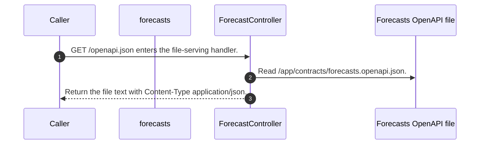
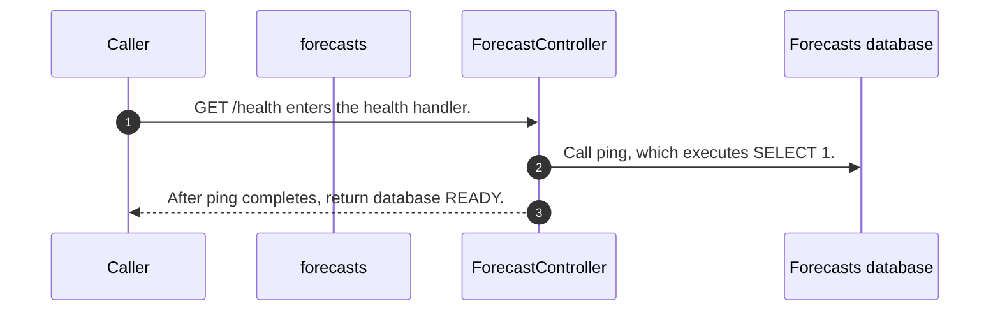
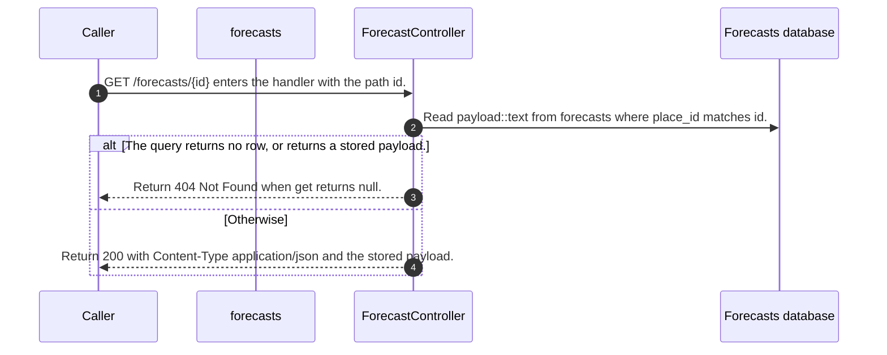

# Forecasts

Static source interpretation. Declared interactions do not establish runtime routing.

## Overview

At the saved source revision c289b28be4819eddf29d59a7c12f178559ec5229, the Forecasts service declares three HTTP handlers and a Kafka listener for weather.place-requested. The forecast endpoint reads a stored payload by place id; health executes a database ping; OpenAPI reads the checked-in forecasts contract. The listener validates place.requested v1 events, records and acknowledges invalid messages before returning, and sends valid events through a transaction callback that inserts the inbox id, upserts the place and calls refresh before reaching the later acknowledgment; runtime callback and transaction behavior remain unverified. Refresh returns early while cached data is unexpired; otherwise fixture or live-provider processing can update the forecast record and attempt a forecast.updated outbox insert. The source includes two scheduled entrypoint declarations, refreshExpired and publishPending; runtime activation is unverified. Kotlin parsing is source-syntax only; the saved capture did not build the service, and runtime activation is unverified.

Source freshness: UNVERIFIED. Meaning review: UNASSESSED.

## Responsibilities

Forecasts serves stored forecast payloads by place id, reports database readiness, and serves the checked-in OpenAPI document. Its Kafka listener consumes weather.place-requested events. Invalid JSON or place.requested v1 validation throws enter the reject branch, which inserts a rejected_messages row and acknowledges the record before returning; the valid branch places inbox insertion, place upsert, and refresh in a transaction callback, then reaches acknowledgment afterward. Callback timing, commit, rollback, and runtime delivery remain unverified.

The service refreshes only when a cached forecast is expired or absent. Its fixture branch reads a place-specific fixture; its live branch calls MET. It builds a forecast payload, attempts an upsert that accepts equal or newer updatedAt values, then attempts a forecast.updated outbox insert. Two source declarations use scheduled annotations: refreshExpired scans expired or missing forecasts, and publishPending sends outbox records. Source syntax and configuration do not establish that either schedule or listener runs in deployment.

Source freshness: UNVERIFIED. Meaning review: UNASSESSED.

## Domain entities

The Forecasts source assembles JSON rather than declaring a separate forecast DTO in the captured implementation. A forecast object contains updatedAt, fetchedAt, mode, and periods. Each period contains time, temperatureC, symbol, and precipitationMm; the source writes null precipitation when the provider omits a numeric amount. A forecast.updated event carries an id formed from place id and updatedAt, type, version 1, place, and forecast. The event schema and OpenAPI document declare one to six periods and date-time strings; their JSON Schema keywords are not fully interpreted here.

The Forecasts database schema stores places, a forecasts row keyed by place_id with updated_at, JSON payload, expires_at, and last_modified, inbox event IDs, forecast_outbox payloads with a published flag, and rejected message coordinates keyed by topic, partition, and offset. These are persistence and delivery records, distinct from the JSON forecast and event shapes.

Source freshness: UNVERIFIED. Meaning review: UNASSESSED.

## Ingress contracts

The controller declares GET /forecasts/{id}, GET /health, and GET /openapi.json. The forecast route returns the stored JSON payload as application/json or 404 when no row exists. The health handler executes SELECT 1 and returns database READY; it does not check Kafka. The OpenAPI declaration describes a 200 forecast payload, 404, and 500 response, restricts id to oslo, helsinki, or lisbon, and declares health fields database READY and kafka READY. The handler and contract therefore differ on the health body, and the contract’s 500 response is not an explicit local error mapping in these handlers. The OpenAPI route reads /app/contracts/forecasts.openapi.json; file or database exceptions are not locally converted by the shown handlers.

A source-declared Kafka listener receives weather.place-requested. The validator requires a nonblank event id, version 1, type place.requested, one of the three place ids, a nonblank name, and numeric coordinates. The event schema additionally declares latitude and longitude bounds and disallows extra top-level properties; the captured validator does not check those rules. Application properties declare earliest offset reset, disabled auto-commit, and manual-immediate acknowledgments. Invalid parse or validation is recorded in rejected_messages and acknowledged; valid processing reaches acknowledgment after the transaction callback. Runtime listener registration, acknowledgment behavior, and framework status serialization remain unverified.

Source freshness: UNVERIFIED. Meaning review: UNASSESSED.

## Egress contracts

When refresh is needed, fixture mode reads /app/fixtures/{id}.json. Live mode requires FORECAST_MODE=live and a nonblank MET_USER_AGENT, truncates coordinates toward zero to four decimal places, and sends GET to the MET locationforecast compact endpoint with a 20-second timeout, User-Agent, gzip acceptance, and If-Modified-Since when cached metadata exists. A 304 with a cached row updates expiry and returns; only 200 and 203 continue to parse the response. The source derives expiry from Expires or defaults to one hour, uses Retry-After for a 429 with a 60-second minimum, and keeps per-place retry times in memory. It extracts at most six periods, requires numeric temperature and a nonempty period list, parses updatedAt, and attempts an upsert whose predicate accepts equal or newer updatedAt values; an older incoming value leaves the stored row unchanged. The source then attempts the forecast.updated outbox insert. These are source paths; no live provider call was made.

After the forecast upsert, the source attempts an outbox row keyed by place id and updatedAt, with type forecast.updated, version 1, place, and forecast. The scheduled publisher selects at most one unpublished row ordered by id with FOR UPDATE SKIP LOCKED, sends weather.forecast-updated using place id as the Kafka key, waits up to 10 seconds, then marks the row published inside the transaction callback. It logs PUBLISH_RETRY on caught failures. A send that completes before a later database failure can leave the row eligible for another attempt; Kafka and PostgreSQL atomicity and runtime transaction behavior are not established.

Source freshness: UNVERIFIED. Meaning review: UNASSESSED.

Source freshness: UNVERIFIED. Meaning review: UNASSESSED.

Content revisions: {"dashboard":"e635069293d58cb0d4f28c8211e748b8d58e6b37","forecasts":"c289b28be4819eddf29d59a7c12f178559ec5229","places":"c289b28be4819eddf29d59a7c12f178559ec5229"}

Target revisions: {"dashboard":"e635069293d58cb0d4f28c8211e748b8d58e6b37","forecasts":"c289b28be4819eddf29d59a7c12f178559ec5229","places":"c289b28be4819eddf29d59a7c12f178559ec5229"}

## Scheduled publishPending declaration

The source declares publishPending with fixedDelayString PUBLISH_INTERVAL_MS and a 1000 millisecond default. It selects at most one unpublished outbox row, waits up to 10 seconds for the Kafka send, then updates the row to published inside a transaction callback. A crash after send but before a committed flag can leave the row eligible for resend; cross-store atomicity and runtime schedule activation are unverified.

The source declaration uses PUBLISH_INTERVAL_MS with a 1000 millisecond fallback; this Work does not prove scheduler registration or runtime invocation.

The source attempts the publisher transaction callback, or catches an exception and logs it.

The query, send, and published-flag update are inside a deferred transaction callback; runtime commit behavior and atomicity with Kafka are not established.

Select at most one unpublished outbox row, ordered by id, using FOR UPDATE SKIP LOCKED.

No row is returned, or one pending row is read for publication.

If the query returns no row, the transaction callback returns without sending.

The source describes an alternative branch.

Read the selected payload, send weather.forecast-updated with place id as key, and wait up to 10 seconds for the send result.

After the send call returns, update this outbox row to published=true.

The source describes an alternative branch.

On an exception, the catch logs PUBLISH_RETRY and the exception class; this source does not prove an automatic retry or completed broker delivery.

```mermaid
sequenceDiagram
    autonumber
    %% Agent-interpreted static source; declared edges are not compiler calls.
    participant caller as Caller
    participant service-forecasts as forecasts
    participant forecast-db as Forecasts database
    participant broker as Kafka weather.forecast-updated
    %% claim-32b4710025f069cbb305: dependencies forecasts:source_annotations:3d7b217355f2e6a34064e800, forecasts:symbol:3d7b217355f2e6a34064e800
    Note over caller: The source declaration uses PUBLISH_INTERVAL_MS with a 1000 millisecond fallback&#59; this Work does not prove scheduler registration or runtime invocation.
    %% claim-e5ce1ccc606eea2f86b4: dependencies forecasts:flow:44c1216c3e37f45f4ff9ceca
    alt The source attempts the publisher transaction callback, or catches an exception and logs it.
    %% claim-adb532bae89d7224583a: dependencies forecasts:flow:c276c8bbe48869c1c665424d
    opt The query, send, and published-flag update are inside a deferred transaction callback&#59; runtime commit behavior and atomicity with Kafka are not established.
    %% claim-068abd97afa84193912a: dependencies forecasts:flow:c276c8bbe48869c1c665424d, forecasts:source_annotations:3d7b217355f2e6a34064e800, forecasts:symbol:3d7b217355f2e6a34064e800
    service-forecasts->>forecast-db: Select at most one unpublished outbox row, ordered by id, using FOR UPDATE SKIP LOCKED.
    %% claim-ade9e205f0a00ae09021: dependencies forecasts:flow:a91ff11cffbbe839dcfe0e41
    alt No row is returned, or one pending row is read for publication.
    %% claim-bdd42d45885877cee64d: dependencies forecasts:flow:ca69bbde23a96263a8aa460b
    Note over caller: If the query returns no row, the transaction callback returns without sending.
    %% claim-d9a220ac3846c3911c3c: dependencies forecasts:flow:a91ff11cffbbe839dcfe0e41
    else Otherwise
    %% claim-9297199d5b2d287b52e6: dependencies forecasts:flow:c276c8bbe48869c1c665424d, forecasts:source_annotations:3d7b217355f2e6a34064e800, forecasts:symbol:3d7b217355f2e6a34064e800
    service-forecasts->>broker: Read the selected payload, send weather.forecast-updated with place id as key, and wait up to 10 seconds for the send result.
    %% claim-52e2229715644c4a4116: dependencies forecasts:flow:c276c8bbe48869c1c665424d, forecasts:source_annotations:3d7b217355f2e6a34064e800, forecasts:symbol:3d7b217355f2e6a34064e800
    service-forecasts->>forecast-db: After the send call returns, update this outbox row to published=true.
    %% claim-91a5b3ef90cd5b908024: dependencies forecasts:flow:a91ff11cffbbe839dcfe0e41
    end
    %% claim-1ad549cf2ec160969612: dependencies forecasts:flow:c276c8bbe48869c1c665424d
    end
    %% claim-4618929dd5263200c796: dependencies forecasts:flow:44c1216c3e37f45f4ff9ceca
    else Otherwise
    %% claim-2ae92366999079bdb501: dependencies forecasts:flow:44c1216c3e37f45f4ff9ceca
    Note over caller: On an exception, the catch logs PUBLISH_RETRY and the exception class&#59; this source does not prove an automatic retry or completed broker delivery.
    %% claim-1f0cc9df62c91d6300ae: dependencies forecasts:flow:44c1216c3e37f45f4ff9ceca
    end
```

Implementation details

Source freshness: UNVERIFIED. Meaning review: UNASSESSED.

Content revisions: {"dashboard":"e635069293d58cb0d4f28c8211e748b8d58e6b37","forecasts":"c289b28be4819eddf29d59a7c12f178559ec5229","places":"c289b28be4819eddf29d59a7c12f178559ec5229"}

Target revisions: {"dashboard":"e635069293d58cb0d4f28c8211e748b8d58e6b37","forecasts":"c289b28be4819eddf29d59a7c12f178559ec5229","places":"c289b28be4819eddf29d59a7c12f178559ec5229"}

## Consume weather.place-requested

The annotated listener validates each place.requested record; parse or validation exceptions enter a rejection write followed by acknowledgement and return when that write succeeds. Valid records pass through a transaction callback that skips duplicate ids or upserts the place and calls refresh before acknowledging the broker; refresh skips an unexpired cache, separates fixture and live paths, and updates only expiry for a cached 304. The saved Kotlin source does not prove Spring listener registration or runtime transaction behavior.

Deliver a record from weather.place-requested to the annotated listener.

JSON parsing and place-event validation succeeds, or parsing/validation throws.

The source passes validatePlaceEvent(it) in the also lambda; the Work records this lambda as DEFERRED with an unresolved target, so invocation behavior is not established by this source capture.

This callback contains the place-event validator call; its captured body and predicate are available in the exact validator source.

The source passes the inbox/upsert/refresh block to transaction.executeWithoutResult; Work marks this callback deferred, so it does not establish runtime commit, rollback, or callback timing.

Insert the event id into inbox with ON CONFLICT DO NOTHING.

The inbox insert reports inserted == 0 for a duplicate id, or a new id was inserted.

A duplicate id returns from the transaction callback before the place upsert and refresh; the listener reaches its following acknowledgement after the callback call returns.

The source describes an alternative branch.

Upsert place name and coordinates, then call refresh inside the same callback.

The cached expiry is later than now, or refresh continues to obtain input.

An unexpired cached row returns immediately, without a provider request, forecast update, or forecast outbox attempt.

The source describes an alternative branch.

After a cache miss or expiry, fixture mode reads the local place file; otherwise the code requires live mode and calls the weather provider.

Fixture mode reads /app/fixtures/{placeId}.json, then uses the common transform and persistence path.

Parse the fixture or accepted response body, build up to six periods, require at least one period, and default a missing or nonnumeric rain amount to null and missing symbol to unknown. The forecast row is upserted only when incoming updatedAt is at least the stored value; the code then attempts a forecast.updated outbox insert using placeId:updatedAt with conflict suppression.

Parse the fixture or accepted response body, build up to six periods, require at least one period, and default a missing or nonnumeric rain amount to null and missing symbol to unknown. The forecast row is upserted only when incoming updatedAt is at least the stored value; the code then attempts a forecast.updated outbox insert using placeId:updatedAt with conflict suppression.

The source describes an alternative branch.

Live mode requires MET_USER_AGENT and no future in-memory nextAttempt; it rounds latitude/longitude down to four decimals and sends a 20-second GET with gzip acceptance and If-Modified-Since when a cached validator exists.

For the response, expires is the parsed Expires header or one hour from now. A 429 stores nextAttempt from Retry-After with a 60-second minimum; other statuses store expires as nextAttempt.

The response is 304 with an existing cached row, or it proceeds to the accepted-status check.

Update expires_at only, then return; no payload parse or forecast outbox insert follows this path.

The source describes an alternative branch.

The response status is 200 or 203, or the required status check fails.

Decode a gzip body when indicated, then transform the returned document and persist the forecast and outbox event.

Parse the fixture or accepted response body, build up to six periods, require at least one period, and default a missing or nonnumeric rain amount to null and missing symbol to unknown. The forecast row is upserted only when incoming updatedAt is at least the stored value; the code then attempts a forecast.updated outbox insert using placeId:updatedAt with conflict suppression.

The source describes an alternative branch.

A 429 has already updated nextAttempt, then fails the 200-or-203 requirement; other unaccepted statuses also throw. A 304 without a cached row reaches this failing check.

After transaction.executeWithoutResult returns, acknowledge the valid record. A callback failure prevents this following call from being reached.

The source describes an alternative branch.

Write topic, partition, offset, and INVALID_EVENT to rejected_messages with conflict suppression.

If the rejection write succeeds, acknowledge the invalid record.

Return from the invalid-event path after the rejection write and acknowledgement.

The source Kafka listener factory declares MANUAL_IMMEDIATE acknowledgement and a one-second fixed backoff with unlimited attempts. Source declarations do not prove that this factory or listener is active at runtime.

```mermaid
sequenceDiagram
    autonumber
    %% Agent-interpreted static source; declared edges are not compiler calls.
    participant caller as Caller
    participant service-forecasts as forecasts
    participant broker as Kafka weather.place-requested
    participant forecast-db as Forecasts database
    participant weather-provider as Weather provider
    %% claim-52aaa5c9ab5e9571dc21: dependencies forecasts:source_annotations:ad28a606f0881dfe7cfc0b1a, forecasts:symbol:ad28a606f0881dfe7cfc0b1a
    broker->>service-forecasts: Deliver a record from weather.place-requested to the annotated listener.
    %% claim-dac4010eb39c09a36f18: dependencies forecasts:flow:a38d386449227ba051cf74c0, forecasts:source_annotations:ad28a606f0881dfe7cfc0b1a, forecasts:source_annotations:cc58d8643f3d17e4b6911d22, forecasts:symbol:ad28a606f0881dfe7cfc0b1a, forecasts:symbol:cc58d8643f3d17e4b6911d22
    alt JSON parsing and place-event validation succeeds, or parsing/validation throws.
    %% claim-45ddf4bf13ec570228c7: dependencies forecasts:flow:5c0f3b18ff82fe4d811047e9
    opt The source passes validatePlaceEvent(it) in the also lambda&#59; the Work records this lambda as DEFERRED with an unresolved target, so invocation behavior is not established by this source capture.
    %% claim-86131f05ce041fc0365e: dependencies forecasts:flow:5c0f3b18ff82fe4d811047e9, forecasts:source_annotations:cc58d8643f3d17e4b6911d22, forecasts:symbol:cc58d8643f3d17e4b6911d22
    Note over caller: This callback contains the place-event validator call&#59; its captured body and predicate are available in the exact validator source.
    %% claim-eb06c65427cb032bfd90: dependencies forecasts:flow:5c0f3b18ff82fe4d811047e9
    end
    %% claim-ebc5c060c4f74dbbc2c8: dependencies forecasts:flow:b7a8f5b7842c514f7f597c4f, forecasts:flow:ff171b4088a1fea4d1c5a617
    opt The source passes the inbox/upsert/refresh block to transaction.executeWithoutResult&#59; Work marks this callback deferred, so it does not establish runtime commit, rollback, or callback timing.
    %% claim-ea03099b82c1b2885e0b: dependencies forecasts:flow:8437237940bc2e908ccb9b76, forecasts:source_annotations:ad28a606f0881dfe7cfc0b1a, forecasts:symbol:ad28a606f0881dfe7cfc0b1a
    service-forecasts->>forecast-db: Insert the event id into inbox with ON CONFLICT DO NOTHING.
    %% claim-b26c5ed26fb8330a56ff: dependencies forecasts:flow:5bda17b9322e1d09244c248e, forecasts:source_annotations:ad28a606f0881dfe7cfc0b1a, forecasts:symbol:ad28a606f0881dfe7cfc0b1a
    alt The inbox insert reports inserted == 0 for a duplicate id, or a new id was inserted.
    %% claim-8192d97c119474e31f23: dependencies forecasts:flow:cbe0a836e93f909f2825846f, forecasts:source_annotations:ad28a606f0881dfe7cfc0b1a, forecasts:symbol:ad28a606f0881dfe7cfc0b1a
    Note over caller: A duplicate id returns from the transaction callback before the place upsert and refresh&#59; the listener reaches its following acknowledgement after the callback call returns.
    %% claim-8fb97d256412bcfecc8b: dependencies forecasts:flow:5bda17b9322e1d09244c248e, forecasts:source_annotations:ad28a606f0881dfe7cfc0b1a, forecasts:symbol:ad28a606f0881dfe7cfc0b1a
    else Otherwise
    %% claim-24946b15d5d1b2a179dd: dependencies forecasts:flow:43b5da447d0cdacd517e50a4, forecasts:flow:e0b522ecefdf6da700eb42d1, forecasts:source_annotations:ad28a606f0881dfe7cfc0b1a, forecasts:symbol:ad28a606f0881dfe7cfc0b1a
    service-forecasts->>forecast-db: Upsert place name and coordinates, then call refresh inside the same callback.
    %% claim-4a534eb058c98ca23228: dependencies forecasts:source_annotations:04bc0feeea5752d3f1979c56, forecasts:symbol:04bc0feeea5752d3f1979c56
    alt The cached expiry is later than now, or refresh continues to obtain input.
    %% claim-55e4dffd2a0624644246: dependencies forecasts:source_annotations:04bc0feeea5752d3f1979c56, forecasts:symbol:04bc0feeea5752d3f1979c56
    Note over caller: An unexpired cached row returns immediately, without a provider request, forecast update, or forecast outbox attempt.
    %% claim-b26b59f08a02d03f85d9: dependencies forecasts:source_annotations:04bc0feeea5752d3f1979c56, forecasts:symbol:04bc0feeea5752d3f1979c56
    else Otherwise
    %% claim-01372daf0686766e36e7: dependencies forecasts:source_annotations:04bc0feeea5752d3f1979c56, forecasts:symbol:04bc0feeea5752d3f1979c56
    alt After a cache miss or expiry, fixture mode reads the local place file&#59; otherwise the code requires live mode and calls the weather provider.
    %% claim-b2d5405de35400ed0a0f: dependencies forecasts:source_annotations:04bc0feeea5752d3f1979c56, forecasts:symbol:04bc0feeea5752d3f1979c56
    Note over caller: Fixture mode reads /app/fixtures/{placeId}.json, then uses the common transform and persistence path.
    %% claim-c881743ec11d4d62fb4d: dependencies forecasts:source_annotations:04bc0feeea5752d3f1979c56, forecasts:source_annotations:1571fff289ff6226f149c918, forecasts:source_annotations:1ea53b95922ad5791d930533, forecasts:source_annotations:3b271aa33f7bd944bb5ab6a5, forecasts:source_annotations:3d7b217355f2e6a34064e800, forecasts:source_annotations:ad28a606f0881dfe7cfc0b1a, forecasts:source_annotations:cc58d8643f3d17e4b6911d22, forecasts:symbol:04bc0feeea5752d3f1979c56, forecasts:syntax_detail:0faab21eaf0b9a233e97b7e6, forecasts:syntax_detail:0fe858295941b31bc615fefa, forecasts:syntax_detail:2b758ee1c16726c56e968742, forecasts:syntax_detail:b86b8774a179db381547b795, forecasts:syntax_detail:bdedac7f9b2afb2a8e682034, forecasts:syntax_detail:cc65db9fa6bd3a33f4ba788a, forecasts:syntax_detail:d3cdb716aaac8f6ed002b7c1, forecasts:syntax_detail:d52cf4645c46f8e435787b58
    Note over caller: Parse the fixture or accepted response body, build up to six periods, require at least one period, and default a missing or nonnumeric rain amount to null and missing symbol to unknown. The forecast row is upserted only when incoming updatedAt is at least the stored value&#59; the code then attempts a forecast.updated outbox insert using placeId:updatedAt with conflict suppression.
    %% claim-68e7b1e99cf49300ae64: dependencies forecasts:source_annotations:04bc0feeea5752d3f1979c56, forecasts:source_annotations:1571fff289ff6226f149c918, forecasts:source_annotations:1ea53b95922ad5791d930533, forecasts:source_annotations:3b271aa33f7bd944bb5ab6a5, forecasts:source_annotations:3d7b217355f2e6a34064e800, forecasts:source_annotations:ad28a606f0881dfe7cfc0b1a, forecasts:source_annotations:cc58d8643f3d17e4b6911d22, forecasts:symbol:04bc0feeea5752d3f1979c56, forecasts:syntax_detail:0faab21eaf0b9a233e97b7e6, forecasts:syntax_detail:0fe858295941b31bc615fefa, forecasts:syntax_detail:2b758ee1c16726c56e968742, forecasts:syntax_detail:b86b8774a179db381547b795, forecasts:syntax_detail:bdedac7f9b2afb2a8e682034, forecasts:syntax_detail:cc65db9fa6bd3a33f4ba788a, forecasts:syntax_detail:d3cdb716aaac8f6ed002b7c1, forecasts:syntax_detail:d52cf4645c46f8e435787b58
    service-forecasts->>forecast-db: Parse the fixture or accepted response body, build up to six periods, require at least one period, and default a missing or nonnumeric rain amount to null and missing symbol to unknown. The forecast row is upserted only when incoming updatedAt is at least the stored value&#59; the code then attempts a forecast.updated outbox insert using placeId:updatedAt with conflict suppression.
    %% claim-35de72fbe3b8bc816a53: dependencies forecasts:source_annotations:04bc0feeea5752d3f1979c56, forecasts:symbol:04bc0feeea5752d3f1979c56
    else Otherwise
    %% claim-384d3a0cb36b4d53281b: dependencies forecasts:source_annotations:04bc0feeea5752d3f1979c56, forecasts:symbol:04bc0feeea5752d3f1979c56
    service-forecasts->>weather-provider: Live mode requires MET_USER_AGENT and no future in-memory nextAttempt&#59; it rounds latitude/longitude down to four decimals and sends a 20-second GET with gzip acceptance and If-Modified-Since when a cached validator exists.
    %% claim-bc8ff3d11f97f1403de9: dependencies forecasts:source_annotations:04bc0feeea5752d3f1979c56, forecasts:symbol:04bc0feeea5752d3f1979c56
    Note over caller: For the response, expires is the parsed Expires header or one hour from now. A 429 stores nextAttempt from Retry-After with a 60-second minimum&#59; other statuses store expires as nextAttempt.
    %% claim-233e351b718151a48197: dependencies forecasts:source_annotations:04bc0feeea5752d3f1979c56, forecasts:symbol:04bc0feeea5752d3f1979c56
    alt The response is 304 with an existing cached row, or it proceeds to the accepted-status check.
    %% claim-7984f7d671bc14d188e8: dependencies forecasts:source_annotations:04bc0feeea5752d3f1979c56, forecasts:symbol:04bc0feeea5752d3f1979c56
    service-forecasts->>forecast-db: Update expires_at only, then return&#59; no payload parse or forecast outbox insert follows this path.
    %% claim-0d7a7a6bdec257fd2dd7: dependencies forecasts:source_annotations:04bc0feeea5752d3f1979c56, forecasts:symbol:04bc0feeea5752d3f1979c56
    else Otherwise
    %% claim-cec5d38766acdef5278c: dependencies forecasts:source_annotations:04bc0feeea5752d3f1979c56, forecasts:symbol:04bc0feeea5752d3f1979c56
    alt The response status is 200 or 203, or the required status check fails.
    %% claim-e368a12c6d35c0ce088b: dependencies forecasts:source_annotations:04bc0feeea5752d3f1979c56, forecasts:source_annotations:1571fff289ff6226f149c918, forecasts:source_annotations:1ea53b95922ad5791d930533, forecasts:source_annotations:3b271aa33f7bd944bb5ab6a5, forecasts:source_annotations:3d7b217355f2e6a34064e800, forecasts:source_annotations:ad28a606f0881dfe7cfc0b1a, forecasts:source_annotations:cc58d8643f3d17e4b6911d22, forecasts:symbol:04bc0feeea5752d3f1979c56, forecasts:syntax_detail:2c1288d911c12d9dba445bb4, forecasts:syntax_detail:cc65db9fa6bd3a33f4ba788a
    Note over caller: Decode a gzip body when indicated, then transform the returned document and persist the forecast and outbox event.
    %% claim-84fc9c634adc3a36e952: dependencies forecasts:source_annotations:04bc0feeea5752d3f1979c56, forecasts:source_annotations:1571fff289ff6226f149c918, forecasts:source_annotations:1ea53b95922ad5791d930533, forecasts:source_annotations:3b271aa33f7bd944bb5ab6a5, forecasts:source_annotations:3d7b217355f2e6a34064e800, forecasts:source_annotations:ad28a606f0881dfe7cfc0b1a, forecasts:source_annotations:cc58d8643f3d17e4b6911d22, forecasts:symbol:04bc0feeea5752d3f1979c56, forecasts:syntax_detail:0faab21eaf0b9a233e97b7e6, forecasts:syntax_detail:0fe858295941b31bc615fefa, forecasts:syntax_detail:2b758ee1c16726c56e968742, forecasts:syntax_detail:b86b8774a179db381547b795, forecasts:syntax_detail:bdedac7f9b2afb2a8e682034, forecasts:syntax_detail:cc65db9fa6bd3a33f4ba788a, forecasts:syntax_detail:d3cdb716aaac8f6ed002b7c1, forecasts:syntax_detail:d52cf4645c46f8e435787b58
    service-forecasts->>forecast-db: Parse the fixture or accepted response body, build up to six periods, require at least one period, and default a missing or nonnumeric rain amount to null and missing symbol to unknown. The forecast row is upserted only when incoming updatedAt is at least the stored value&#59; the code then attempts a forecast.updated outbox insert using placeId:updatedAt with conflict suppression.
    %% claim-42f0bc511b433721a829: dependencies forecasts:source_annotations:04bc0feeea5752d3f1979c56, forecasts:symbol:04bc0feeea5752d3f1979c56
    else Otherwise
    %% claim-ab19f5ff6dbf6893c178: dependencies forecasts:source_annotations:04bc0feeea5752d3f1979c56, forecasts:symbol:04bc0feeea5752d3f1979c56
    Note over caller: A 429 has already updated nextAttempt, then fails the 200-or-203 requirement&#59; other unaccepted statuses also throw. A 304 without a cached row reaches this failing check.
    %% claim-1344dfa1c2318c7fe099: dependencies forecasts:source_annotations:04bc0feeea5752d3f1979c56, forecasts:symbol:04bc0feeea5752d3f1979c56
    end
    %% claim-1597d692bcf25a929757: dependencies forecasts:source_annotations:04bc0feeea5752d3f1979c56, forecasts:symbol:04bc0feeea5752d3f1979c56
    end
    %% claim-a80720649a77ec189943: dependencies forecasts:source_annotations:04bc0feeea5752d3f1979c56, forecasts:symbol:04bc0feeea5752d3f1979c56
    end
    %% claim-cacb886e10041efcf4a1: dependencies forecasts:source_annotations:04bc0feeea5752d3f1979c56, forecasts:symbol:04bc0feeea5752d3f1979c56
    end
    %% claim-0d6dde963d4ce950ac8b: dependencies forecasts:flow:5bda17b9322e1d09244c248e, forecasts:source_annotations:ad28a606f0881dfe7cfc0b1a, forecasts:symbol:ad28a606f0881dfe7cfc0b1a
    end
    %% claim-69da6e785b7ffff7c261: dependencies forecasts:flow:b7a8f5b7842c514f7f597c4f, forecasts:flow:ff171b4088a1fea4d1c5a617
    end
    %% claim-c07146f5d9cf37ccc17b: dependencies forecasts:flow:acbf22bab989bab22a0cd6b8, forecasts:source_annotations:ad28a606f0881dfe7cfc0b1a, forecasts:symbol:ad28a606f0881dfe7cfc0b1a
    service-forecasts->>broker: After transaction.executeWithoutResult returns, acknowledge the valid record. A callback failure prevents this following call from being reached.
    %% claim-b0980888e4cb107178ce: dependencies forecasts:flow:a38d386449227ba051cf74c0, forecasts:source_annotations:ad28a606f0881dfe7cfc0b1a, forecasts:source_annotations:cc58d8643f3d17e4b6911d22, forecasts:symbol:ad28a606f0881dfe7cfc0b1a, forecasts:symbol:cc58d8643f3d17e4b6911d22
    else Otherwise
    %% claim-271e1a7b1844c16e86f7: dependencies forecasts:flow:5c27f4aee13a3c5fa345b9f2, forecasts:source_annotations:04bc0feeea5752d3f1979c56, forecasts:source_annotations:1571fff289ff6226f149c918, forecasts:source_annotations:1ea53b95922ad5791d930533, forecasts:source_annotations:3b271aa33f7bd944bb5ab6a5, forecasts:source_annotations:3d7b217355f2e6a34064e800, forecasts:source_annotations:ad28a606f0881dfe7cfc0b1a, forecasts:source_annotations:cc58d8643f3d17e4b6911d22, forecasts:symbol:ad28a606f0881dfe7cfc0b1a, forecasts:syntax_detail:814ab3aaee1977605c70638e
    service-forecasts->>forecast-db: Write topic, partition, offset, and INVALID_EVENT to rejected_messages with conflict suppression.
    %% claim-b10c0819a28fc2821e8d: dependencies forecasts:flow:85fe67fa83679d5c280755bc, forecasts:source_annotations:ad28a606f0881dfe7cfc0b1a, forecasts:symbol:ad28a606f0881dfe7cfc0b1a
    service-forecasts->>broker: If the rejection write succeeds, acknowledge the invalid record.
    %% claim-c723c4bd94345dc81bc9: dependencies forecasts:flow:6197b7e7ffd42134c6751cb6, forecasts:source_annotations:ad28a606f0881dfe7cfc0b1a, forecasts:symbol:ad28a606f0881dfe7cfc0b1a
    Note over caller: Return from the invalid-event path after the rejection write and acknowledgement.
    %% claim-82d8d0c422c5d80edb6f: dependencies forecasts:flow:a38d386449227ba051cf74c0, forecasts:source_annotations:ad28a606f0881dfe7cfc0b1a, forecasts:source_annotations:cc58d8643f3d17e4b6911d22, forecasts:symbol:ad28a606f0881dfe7cfc0b1a, forecasts:symbol:cc58d8643f3d17e4b6911d22
    end
    %% claim-4c84bad407effe201dd2: dependencies forecasts:source_annotations:d988fd0a0bd0b1deecfb3c0f, forecasts:symbol:d988fd0a0bd0b1deecfb3c0f
    Note over caller: The source Kafka listener factory declares MANUAL_IMMEDIATE acknowledgement and a one-second fixed backoff with unlimited attempts. Source declarations do not prove that this factory or listener is active at runtime.
```

Implementation details

Source freshness: UNVERIFIED. Meaning review: UNASSESSED.

Content revisions: {"dashboard":"e635069293d58cb0d4f28c8211e748b8d58e6b37","forecasts":"c289b28be4819eddf29d59a7c12f178559ec5229","places":"c289b28be4819eddf29d59a7c12f178559ec5229"}

Target revisions: {"dashboard":"e635069293d58cb0d4f28c8211e748b8d58e6b37","forecasts":"c289b28be4819eddf29d59a7c12f178559ec5229","places":"c289b28be4819eddf29d59a7c12f178559ec5229"}

## GET /openapi.json

The handler reads /app/contracts/forecasts.openapi.json and returns the file text with Content-Type application/json. It has no source-level fallback for a missing or unreadable file. The declared contract lists GET /forecasts/{id}, GET /health, and GET /openapi.json; its HTTP statuses are contract declarations, not a runtime test.

GET /openapi.json enters the file-serving handler.

Read /app/contracts/forecasts.openapi.json.

Return the file text with Content-Type application/json.

### OpenAPI: GET /openapi.json

Source-derived http interface description.

| Element | Value / behavior |
|---|---|
| Declared responses | The contract declares 200 and 500 responses. |

Implementation details

Source freshness: UNVERIFIED. Meaning review: UNASSESSED.

Content revisions: {"dashboard":"e635069293d58cb0d4f28c8211e748b8d58e6b37","forecasts":"c289b28be4819eddf29d59a7c12f178559ec5229","places":"c289b28be4819eddf29d59a7c12f178559ec5229"}

Target revisions: {"dashboard":"e635069293d58cb0d4f28c8211e748b8d58e6b37","forecasts":"c289b28be4819eddf29d59a7c12f178559ec5229","places":"c289b28be4819eddf29d59a7c12f178559ec5229"}

## Scheduled refreshExpired declaration

The source declares refreshExpired with fixedDelayString REFRESH_INTERVAL_MS and a 60000 millisecond default. It queries places whose forecast expiry is absent or earlier than now, ordered by place id, then passes each refresh call to a transaction callback. Scheduler activation and runtime callback behavior remain unverified.

The source declaration uses REFRESH_INTERVAL_MS with a 60000 millisecond fallback; this Work does not prove scheduler registration or runtime invocation.

Query places whose forecast has no expiry or an expiry earlier than now, ordered by place id; source supplies the following row-mapper callback.

The query includes a deferred row-mapper lambda; this Work does not establish callback invocation or count.

The lambda builds a place object from each row’s id, name, latitude, and longitude.

For each selected place, the source attempts the transaction callback and catches per-place exceptions.

The transaction call returns, or an exception is caught and logged as FORECAST_RETRY with its class name.

The source passes refresh(place) to transaction.executeWithoutResult as a deferred callback; runtime commit and rollback behavior are not established.

The callback body calls refresh(place).

The source describes an alternative branch.

The catch logs FORECAST_RETRY and the exception class; the source does not establish whether the scheduler will invoke the method again.

```mermaid
sequenceDiagram
    autonumber
    %% Agent-interpreted static source; declared edges are not compiler calls.
    participant caller as Caller
    participant service-forecasts as forecasts
    participant forecast-db as Forecasts database
    %% claim-2ffd167d30d8308bb14c: dependencies forecasts:source_annotations:1ea53b95922ad5791d930533, forecasts:symbol:1ea53b95922ad5791d930533
    Note over caller: The source declaration uses REFRESH_INTERVAL_MS with a 60000 millisecond fallback&#59; this Work does not prove scheduler registration or runtime invocation.
    %% claim-8cf0569d4301d47cb509: dependencies forecasts:source_annotations:1ea53b95922ad5791d930533, forecasts:symbol:1ea53b95922ad5791d930533
    service-forecasts->>forecast-db: Query places whose forecast has no expiry or an expiry earlier than now, ordered by place id&#59; source supplies the following row-mapper callback.
    %% claim-684a21ff53eac57d9512: dependencies forecasts:flow:e9881531c62a3422e80b2b0f
    opt The query includes a deferred row-mapper lambda&#59; this Work does not establish callback invocation or count.
    %% claim-d3a39cfb8566b391a5df: dependencies forecasts:flow:e9881531c62a3422e80b2b0f
    Note over caller: The lambda builds a place object from each row’s id, name, latitude, and longitude.
    %% claim-5e2dc271a7f3a63c35ee: dependencies forecasts:flow:e9881531c62a3422e80b2b0f
    end
    %% claim-c66b1c2172c8b49b0cf6: dependencies forecasts:flow:84ab2c89d2ea612342339614
    loop For each selected place, the source attempts the transaction callback and catches per-place exceptions.
    %% claim-f238d2545dda7a207d56: dependencies forecasts:flow:ea6dd04c278f12f668b5cde7
    alt The transaction call returns, or an exception is caught and logged as FORECAST_RETRY with its class name.
    %% claim-61579b41cb4853ee2793: dependencies forecasts:flow:740f3405b57f36fc72f3f58e
    opt The source passes refresh(place) to transaction.executeWithoutResult as a deferred callback&#59; runtime commit and rollback behavior are not established.
    %% claim-55924566844ed887f9d5: dependencies forecasts:flow:740f3405b57f36fc72f3f58e
    Note over caller: The callback body calls refresh(place).
    %% claim-ebb5b879e26c248014bc: dependencies forecasts:flow:740f3405b57f36fc72f3f58e
    end
    %% claim-ffcb4e488d993163ab52: dependencies forecasts:flow:ea6dd04c278f12f668b5cde7
    else Otherwise
    %% claim-0d23d0e2926d49375b3e: dependencies forecasts:flow:ea6dd04c278f12f668b5cde7
    Note over caller: The catch logs FORECAST_RETRY and the exception class&#59; the source does not establish whether the scheduler will invoke the method again.
    %% claim-14107e309c53b8a138c0: dependencies forecasts:flow:ea6dd04c278f12f668b5cde7
    end
    %% claim-9f4e03ed17f69a0b5187: dependencies forecasts:flow:84ab2c89d2ea612342339614
    end
```

Implementation details

Source freshness: UNVERIFIED. Meaning review: UNASSESSED.

Content revisions: {"dashboard":"e635069293d58cb0d4f28c8211e748b8d58e6b37","forecasts":"c289b28be4819eddf29d59a7c12f178559ec5229","places":"c289b28be4819eddf29d59a7c12f178559ec5229"}

Target revisions: {"dashboard":"e635069293d58cb0d4f28c8211e748b8d58e6b37","forecasts":"c289b28be4819eddf29d59a7c12f178559ec5229","places":"c289b28be4819eddf29d59a7c12f178559ec5229"}

## GET /health

The handler calls Forecasts.ping and then returns database READY. ping executes SELECT 1 through JDBC. The source shows a database check; it does not show a Kafka readiness check. The OpenAPI contract declares 200 and 500 responses.

GET /health enters the health handler.

Call ping, which executes SELECT 1.

After ping completes, return database READY.

### OpenAPI: GET /health

Source-derived http interface description.

| Element | Value / behavior |
|---|---|
| Declared responses | The contract declares 200 and 500 responses. |

Implementation details

Source freshness: UNVERIFIED. Meaning review: UNASSESSED.

Content revisions: {"dashboard":"e635069293d58cb0d4f28c8211e748b8d58e6b37","forecasts":"c289b28be4819eddf29d59a7c12f178559ec5229","places":"c289b28be4819eddf29d59a7c12f178559ec5229"}

Target revisions: {"dashboard":"e635069293d58cb0d4f28c8211e748b8d58e6b37","forecasts":"c289b28be4819eddf29d59a7c12f178559ec5229","places":"c289b28be4819eddf29d59a7c12f178559ec5229"}

## GET /forecasts/{id}

The handler calls Forecasts.get with the path id. That function selects the stored payload by place_id and returns its first row, or null. A missing payload produces 404; a found payload is returned with Content-Type application/json. This route reads the stored cache and does not call refresh. The OpenAPI contract requires id, restricts it to oslo, helsinki, or lisbon, and declares 200, 404, and 500 responses.

GET /forecasts/{id} enters the handler with the path id.

Read payload::text from forecasts where place_id matches id.

The query returns no row, or returns a stored payload.

Return 404 Not Found when get returns null.

The source describes an alternative branch.

Return 200 with Content-Type application/json and the stored payload.

### OpenAPI: GET /forecasts/{id}

Source-derived http interface description.

| Element | Value / behavior |
|---|---|
| Path and responses | The declared id path parameter is required and limited to oslo, helsinki, and lisbon; responses are 200, 404, and 500. |

Implementation details

