# Dashboard

Static source interpretation. Declared interactions do not establish runtime routing.

## Overview

Dashboard serves saved place cards and accepts save and forecast-refresh requests for Places. It also consumes weather.place-requested and weather.forecast-updated events to maintain local cards. Six HTTP roots are GET /, GET /api/weather, POST /api/places, POST /api/places/{id}/refresh, GET /health, and GET /openapi.json. Source start connects Kafka, subscribes from the beginning to both topics, starts the shared consumer with autoCommit false, registers those routes, then listens; this source sequence does not establish runtime activation. The consumer validates recognized topic/event pairs and applies valid events transactionally. Parse or validation failures are persisted before offset plus one is committed; persistence failure prevents the commit, while an unknown topic throws UNKNOWN_TOPIC. The event schema and OpenAPI file are declarations, not proof of runtime enforcement. The capture uses TypeScript source syntax with declared dialect 7.0.2 and file-only browser, contract, schema, and database inputs; runtime and compiler validation remain UNKNOWN. See GET / for browser behavior and each HTTP operation for its declared contract.

Source freshness: STALE. Meaning review: UNASSESSED.

## Responsibilities

The captured Dashboard source serves a home page and saved weather-card JSON, forwards place-save and refresh requests to Places, and subscribes to weather.place-requested and weather.forecast-updated. The consumer dispatches each message to validation and event handling. In a transaction, applyEvent first inserts the event id into inbox; a duplicate commits and returns before any weather_cards upsert. A new place request updates place details. A forecast event inserts a missing card, or updates a conflicting card only when its stored updated_at is null or the incoming updatedAt is strictly newer; an older or equal event can commit its inbox row without changing the card. The health handler probes PostgreSQL and checks a local consumerReady flag. These statements describe source paths and declared registrations, not runtime activation.

Source freshness: STALE. Meaning review: UNASSESSED.

## Domain entities

The service validator checks an event id, version 1, and a place with id, name, latitude, and longitude. A weather.forecast-updated event must carry a forecast with updatedAt, fetchedAt, mode, and one to six periods; each period is checked for a timestamp, numeric temperature, null or nonnegative numeric precipitation, and a string symbol. The weather_cards upsert stores place fields, updated_at, and the forecast JSON. The inbox table is used for event-id duplicate handling, while rejected_messages records topic, partition, offset, and reason. These shapes come from code checks and SQL statements, not a fully interpreted shared JSON Schema.

Source freshness: STALE. Meaning review: UNASSESSED.

## Ingress contracts

The captured OpenAPI declaration lists GET /, GET /api/weather, GET /health, GET /openapi.json, POST /api/places, and POST /api/places/{id}/refresh. It marks the place-save JSON body as required and declares response sets for the save and refresh routes; the source handler forwards the Places response status and JSON body, or maps a caught failure to 503. The refresh handler encodes the id in a bodyless POST. The weather handler selects saved cards ordered by name; the health handler runs SELECT 1 and rejects a false consumerReady flag. Startup source subscribes to weather.place-requested and weather.forecast-updated with fromBeginning true and passes eachMessage to consumeMessage with autoCommit false. The route and topic declarations are source evidence only.

Source freshness: STALE. Meaning review: UNASSESSED.

## Egress contracts

The save and refresh handlers send POST requests to the configured Places base URL with a ten-second timeout. Save sends the request body as JSON; refresh appends the encoded place id and sends no body. Both forward the upstream status and parsed JSON response, and both return 503 with PLACES_UNAVAILABLE when an exception is caught. For consumed messages, the invalid branch attempts a rejected_messages insert and then calls commitOffsets for offset plus one. The valid branch waits for applyEvent and then calls commitOffsets; a thrown handler or database error exits before that call in the shown body. applyEvent uses a PostgreSQL transaction for inbox and weather_cards writes. The source shows call order, not cross-store atomicity or broker delivery guarantees.

Source freshness: STALE. Meaning review: UNASSESSED.

Source freshness: STALE. Meaning review: UNASSESSED.

Content revisions: {"dashboard":"e635069293d58cb0d4f28c8211e748b8d58e6b37","forecasts":"c289b28be4819eddf29d59a7c12f178559ec5229","places":"c289b28be4819eddf29d59a7c12f178559ec5229"}

Target revisions: {"dashboard":"e635069293d58cb0d4f28c8211e748b8d58e6b37","forecasts":"c289b28be4819eddf29d59a7c12f178559ec5229","places":"c289b28be4819eddf29d59a7c12f178559ec5229"}

## GET /api/weather — saved cards

GET /api/weather selects local weather_cards ordered by name and returns the saved rows. A database query failure propagates as an exception; the handler has no local error mapping, while the OpenAPI separately declares a 500 JSON response. The declared success body is an array of place cards with a nullable forecast; runtime schema enforcement is unverified.

Request the saved weather cards

The weather_cards query succeeds

Select local weather_cards ordered by name

Return the selected card rows

Return status 200 with the JSON array of cards

The source describes an alternative branch.

If the weather_cards query fails, its exception propagates; this handler has no local catch or response mapping. The OpenAPI separately declares a 500 JSON response.

### Declared GET /api/weather contract

Source-derived http interface description.

| Element | Value / behavior |
|---|---|
| Request | GET /api/weather has no declared parameters or request body. |
| 200 response | The application/json body is an array of cards. Each requires id, name, latitude, longitude, and forecast; ids are oslo, helsinki, or lisbon; latitude is -90..90 and longitude -180..180. Forecast is null or an object requiring updatedAt, fetchedAt, mode (fixture or live), and one to six periods. Each period requires time, temperatureC, precipitationMm, and symbol; date-time fields are strings, precipitationMm is null or a number &gt;= 0. |
| 500 response | The error response is application/json with an object containing a string error field. |
| Declaration boundary | OpenAPI 3.1 declarations are parsed by a bounded reader; runtime enforcement and full JSON Schema validation are unverified. |

Implementation details

```mermaid
sequenceDiagram
    autonumber
    %% Agent-interpreted static source; declared edges are not compiler calls.
    participant caller as Caller
    participant service-dashboard as dashboard
    participant browser as Browser client
    participant weather-db as Dashboard PostgreSQL
    %% claim-2601de162615666f1513: dependencies dashboard:contract-operation:f2a55cb383d259206638d57a, dashboard:symbol:f3bcad13842060db4065d19b
    browser->>service-dashboard: Request the saved weather cards
    %% claim-4b79b4b60ce47b6520fe: dependencies dashboard:flow:fe4a04d5c5b60afe170eb466, dashboard:symbol:f3bcad13842060db4065d19b
    alt The weather_cards query succeeds
    %% claim-664a7f576b4ca1c61885: dependencies dashboard:flow:fe4a04d5c5b60afe170eb466, dashboard:symbol:f3bcad13842060db4065d19b
    service-dashboard->>weather-db: Select local weather_cards ordered by name
    %% claim-f7428698f76a49102094: dependencies dashboard:flow:fe4a04d5c5b60afe170eb466, dashboard:symbol:f3bcad13842060db4065d19b
    weather-db-->>service-dashboard: Return the selected card rows
    %% claim-902a049509fa6a96dc24: dependencies dashboard:contract-operation:359dbcae66966113bf88b8f9, dashboard:contract-operation:46eb1353d8493620edc8bfcb, dashboard:contract-operation:97d881f216d27f90570cf086, dashboard:contract-operation:a134218675bfd8d39281c02d, dashboard:contract-operation:c8f77692c3c0b8acd9232c7e, dashboard:contract-operation:f2a55cb383d259206638d57a, dashboard:contract:97420ee0a3ffefe0cddb405b, dashboard:flow:016f47de2a6db77dec04def8, dashboard:symbol:f3bcad13842060db4065d19b
    service-dashboard-->>browser: Return status 200 with the JSON array of cards
    %% claim-90806c6cf5e6863f0534: dependencies dashboard:flow:fe4a04d5c5b60afe170eb466, dashboard:symbol:f3bcad13842060db4065d19b
    else Otherwise
    %% claim-c9811727cc96de569cf2: dependencies dashboard:contract-operation:359dbcae66966113bf88b8f9, dashboard:contract-operation:46eb1353d8493620edc8bfcb, dashboard:contract-operation:97d881f216d27f90570cf086, dashboard:contract-operation:a134218675bfd8d39281c02d, dashboard:contract-operation:c8f77692c3c0b8acd9232c7e, dashboard:contract-operation:f2a55cb383d259206638d57a, dashboard:contract:97420ee0a3ffefe0cddb405b, dashboard:flow:fe4a04d5c5b60afe170eb466, dashboard:symbol:f3bcad13842060db4065d19b
    Note over caller: If the weather_cards query fails, its exception propagates&#59; this handler has no local catch or response mapping. The OpenAPI separately declares a 500 JSON response.
    %% claim-db84cc7e53ec2d37230a: dependencies dashboard:flow:fe4a04d5c5b60afe170eb466, dashboard:symbol:f3bcad13842060db4065d19b
    end
```

Source freshness: STALE. Meaning review: UNASSESSED.

Content revisions: {"dashboard":"e635069293d58cb0d4f28c8211e748b8d58e6b37","forecasts":"c289b28be4819eddf29d59a7c12f178559ec5229","places":"c289b28be4819eddf29d59a7c12f178559ec5229"}

Target revisions: {"dashboard":"e635069293d58cb0d4f28c8211e748b8d58e6b37","forecasts":"c289b28be4819eddf29d59a7c12f178559ec5229","places":"c289b28be4819eddf29d59a7c12f178559ec5229"}

## GET /openapi.json — serve contract

The handler reads and parses the fixed Dashboard OpenAPI JSON file. A successful parse returns the object as application/json. A file-read or parse exception propagates without local error mapping; the OpenAPI separately declares a 500 JSON response.

Request the OpenAPI document

The fixed OpenAPI file is read and parses as JSON

Read and parse contracts/dashboard.openapi.json

Return status 200 with the JSON object

The source describes an alternative branch.

If file reading or JSON parsing fails, the exception propagates; this handler has no local catch or response mapping. The OpenAPI separately declares a 500 JSON response.

### Declared GET /openapi.json contract

Source-derived http interface description.

| Element | Value / behavior |
|---|---|
| Request | GET /openapi.json has no declared parameters or request body. |
| 200 response | The success body is application/json with an object that may have additional properties. |
| 500 response | The error response is application/json with an object containing a string error field. |
| Declaration boundary | OpenAPI 3.1 declarations are parsed by a bounded reader; runtime enforcement and full JSON Schema validation are unverified. |

Implementation details

```mermaid
sequenceDiagram
    autonumber
    %% Agent-interpreted static source; declared edges are not compiler calls.
    participant caller as Caller
    participant service-dashboard as dashboard
    participant client as HTTP client
    participant openapi-file as Dashboard OpenAPI file
    %% claim-5a6f82609fa4c79c25d2: dependencies dashboard:contract-operation:359dbcae66966113bf88b8f9, dashboard:symbol:812cb9b6c2878af12cf90ce4
    client->>service-dashboard: Request the OpenAPI document
    %% claim-9da867a0657b69b9bd63: dependencies dashboard:flow:08046fd43308cb3155be6b51, dashboard:flow:ac8e82987faf46cbdbccb757, dashboard:flow:b4ce9e14327c00f246bfa18d, dashboard:symbol:812cb9b6c2878af12cf90ce4
    alt The fixed OpenAPI file is read and parses as JSON
    %% claim-e67057f20dee4577ca23: dependencies dashboard:flow:ac8e82987faf46cbdbccb757, dashboard:flow:b4ce9e14327c00f246bfa18d, dashboard:symbol:812cb9b6c2878af12cf90ce4
    service-dashboard->>openapi-file: Read and parse contracts/dashboard.openapi.json
    %% claim-bcd740421acd87bdcb2f: dependencies dashboard:contract-operation:359dbcae66966113bf88b8f9, dashboard:contract-operation:46eb1353d8493620edc8bfcb, dashboard:contract-operation:97d881f216d27f90570cf086, dashboard:contract-operation:a134218675bfd8d39281c02d, dashboard:contract-operation:c8f77692c3c0b8acd9232c7e, dashboard:contract-operation:f2a55cb383d259206638d57a, dashboard:contract:97420ee0a3ffefe0cddb405b, dashboard:flow:08046fd43308cb3155be6b51, dashboard:symbol:812cb9b6c2878af12cf90ce4
    service-dashboard-->>client: Return status 200 with the JSON object
    %% claim-554386b8513b56c57937: dependencies dashboard:flow:08046fd43308cb3155be6b51, dashboard:flow:ac8e82987faf46cbdbccb757, dashboard:flow:b4ce9e14327c00f246bfa18d, dashboard:symbol:812cb9b6c2878af12cf90ce4
    else Otherwise
    %% claim-81ed0d2178ad55b15d7a: dependencies dashboard:contract-operation:359dbcae66966113bf88b8f9, dashboard:contract-operation:46eb1353d8493620edc8bfcb, dashboard:contract-operation:97d881f216d27f90570cf086, dashboard:contract-operation:a134218675bfd8d39281c02d, dashboard:contract-operation:c8f77692c3c0b8acd9232c7e, dashboard:contract-operation:f2a55cb383d259206638d57a, dashboard:contract:97420ee0a3ffefe0cddb405b, dashboard:flow:ac8e82987faf46cbdbccb757, dashboard:flow:b4ce9e14327c00f246bfa18d, dashboard:symbol:812cb9b6c2878af12cf90ce4
    Note over caller: If file reading or JSON parsing fails, the exception propagates&#59; this handler has no local catch or response mapping. The OpenAPI separately declares a 500 JSON response.
    %% claim-cff9a4b8a282a811340c: dependencies dashboard:flow:08046fd43308cb3155be6b51, dashboard:flow:ac8e82987faf46cbdbccb757, dashboard:flow:b4ce9e14327c00f246bfa18d, dashboard:symbol:812cb9b6c2878af12cf90ce4
    end
```

Source freshness: STALE. Meaning review: UNASSESSED.

Content revisions: {"dashboard":"e635069293d58cb0d4f28c8211e748b8d58e6b37","forecasts":"c289b28be4819eddf29d59a7c12f178559ec5229","places":"c289b28be4819eddf29d59a7c12f178559ec5229"}

Target revisions: {"dashboard":"e635069293d58cb0d4f28c8211e748b8d58e6b37","forecasts":"c289b28be4819eddf29d59a7c12f178559ec5229","places":"c289b28be4819eddf29d59a7c12f178559ec5229"}

## Dashboard startup registrations (source-level)

The captured start function connects and subscribes the consumer, runs shared consumeMessage with autoCommit false, registers six HTTP routes on Fastify, then listens. These syntax-level calls do not prove runtime activation.

Connect the consumer, then subscribe from the beginning to weather.place-requested and weather.forecast-updated.

Run eachMessage using consumeMessage with autoCommit false.

Register GET /, GET /api/weather, POST /api/places, POST /api/places/:id/refresh, GET /health, and GET /openapi.json.

Listen on PORT or 8080.

Implementation details

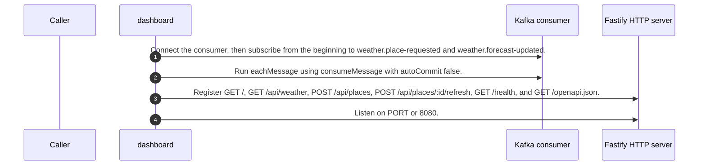

Source freshness: STALE. Meaning review: UNASSESSED.

Content revisions: {"dashboard":"e635069293d58cb0d4f28c8211e748b8d58e6b37","forecasts":"c289b28be4819eddf29d59a7c12f178559ec5229","places":"c289b28be4819eddf29d59a7c12f178559ec5229"}

Target revisions: {"dashboard":"e635069293d58cb0d4f28c8211e748b8d58e6b37","forecasts":"c289b28be4819eddf29d59a7c12f178559ec5229","places":"c289b28be4819eddf29d59a7c12f178559ec5229"}

## POST /api/places/{id}/refresh — queue refresh

The required id path parameter is encoded and sent in a bodyless POST to Places with a 10-second timeout. Dashboard forwards Places status and JSON. If the call or JSON parsing throws, Dashboard returns 503 PLACES_UNAVAILABLE. The declared 202 body means the request is queued, not that forecast data is ready.

POST /api/places/{id}/refresh with the place id in the path

Send a bodyless POST to the encoded Places refresh path with a 10-second timeout

The Places call and response JSON parsing succeed

Return Places status and parsed JSON body

Forward status and JSON body; 202 reports QUEUED

The source describes an alternative branch.

Return status 503 with error PLACES_UNAVAILABLE when the call or response parsing throws

### Declared POST /api/places/{id}/refresh contract

Source-derived http interface description.

| Element | Value / behavior |
|---|---|
| Request | The required path parameter id is oslo, helsinki, or lisbon; no request body is declared. |
| 202 response | The application/json body requires placeId as a string and status as the constant QUEUED. |
| 404, 500, and 503 responses | Each declares an application/json object with a string error field. |
| Declaration boundary | OpenAPI 3.1 declarations are parsed by a bounded reader; runtime enforcement and full JSON Schema validation are unverified. |

Implementation details

```mermaid
sequenceDiagram
    autonumber
    %% Agent-interpreted static source; declared edges are not compiler calls.
    participant caller as Caller
    participant service-dashboard as dashboard
    participant browser as Browser client
    participant places as Places service
    %% claim-d5c633a75d2f702c3ac3: dependencies dashboard:contract-operation:359dbcae66966113bf88b8f9, dashboard:contract-operation:46eb1353d8493620edc8bfcb, dashboard:contract-operation:97d881f216d27f90570cf086, dashboard:contract-operation:a134218675bfd8d39281c02d, dashboard:contract-operation:c8f77692c3c0b8acd9232c7e, dashboard:contract-operation:f2a55cb383d259206638d57a, dashboard:contract:97420ee0a3ffefe0cddb405b, dashboard:symbol:1612e17d589cb9d0fa4ae1f7
    browser->>service-dashboard: POST /api/places/{id}/refresh with the place id in the path
    %% claim-dd509d8a0b7a34957d98: dependencies dashboard:flow:118d806d3691510542299f52, dashboard:flow:898727b9cdc23f7837e53bf8, dashboard:flow:e009a40b8f180befced5ce3f, dashboard:symbol:1612e17d589cb9d0fa4ae1f7
    service-dashboard->>places: Send a bodyless POST to the encoded Places refresh path with a 10-second timeout
    %% claim-d91a25897a31415592e3: dependencies dashboard:flow:0c42e8da3e274553f5bc00ef, dashboard:flow:133e80654ecc67aa9a3110f9, dashboard:flow:23984addf00afef900a22ab0, dashboard:flow:898727b9cdc23f7837e53bf8, dashboard:symbol:1612e17d589cb9d0fa4ae1f7
    alt The Places call and response JSON parsing succeed
    %% claim-aab6e04bb7edcebb8c41: dependencies dashboard:flow:133e80654ecc67aa9a3110f9, dashboard:flow:23984addf00afef900a22ab0, dashboard:symbol:1612e17d589cb9d0fa4ae1f7
    places-->>service-dashboard: Return Places status and parsed JSON body
    %% claim-52e7f85fbab98df7a98a: dependencies dashboard:contract-operation:359dbcae66966113bf88b8f9, dashboard:contract-operation:46eb1353d8493620edc8bfcb, dashboard:contract-operation:97d881f216d27f90570cf086, dashboard:contract-operation:a134218675bfd8d39281c02d, dashboard:contract-operation:c8f77692c3c0b8acd9232c7e, dashboard:contract-operation:f2a55cb383d259206638d57a, dashboard:contract:97420ee0a3ffefe0cddb405b, dashboard:flow:b09c6660b33ff9d4d1049deb, dashboard:symbol:1612e17d589cb9d0fa4ae1f7
    service-dashboard-->>browser: Forward status and JSON body&#59; 202 reports QUEUED
    %% claim-bf89e39a6ec255867349: dependencies dashboard:flow:0c42e8da3e274553f5bc00ef, dashboard:flow:133e80654ecc67aa9a3110f9, dashboard:flow:23984addf00afef900a22ab0, dashboard:flow:898727b9cdc23f7837e53bf8, dashboard:symbol:1612e17d589cb9d0fa4ae1f7
    else Otherwise
    %% claim-a66338467b6569694cf3: dependencies dashboard:flow:0c42e8da3e274553f5bc00ef, dashboard:flow:23984addf00afef900a22ab0, dashboard:flow:898727b9cdc23f7837e53bf8, dashboard:symbol:1612e17d589cb9d0fa4ae1f7
    service-dashboard-->>browser: Return status 503 with error PLACES_UNAVAILABLE when the call or response parsing throws
    %% claim-8e78c245d64654ea4844: dependencies dashboard:flow:0c42e8da3e274553f5bc00ef, dashboard:flow:133e80654ecc67aa9a3110f9, dashboard:flow:23984addf00afef900a22ab0, dashboard:flow:898727b9cdc23f7837e53bf8, dashboard:symbol:1612e17d589cb9d0fa4ae1f7
    end
```

Source freshness: STALE. Meaning review: UNASSESSED.

Content revisions: {"dashboard":"e635069293d58cb0d4f28c8211e748b8d58e6b37","forecasts":"c289b28be4819eddf29d59a7c12f178559ec5229","places":"c289b28be4819eddf29d59a7c12f178559ec5229"}

Target revisions: {"dashboard":"e635069293d58cb0d4f28c8211e748b8d58e6b37","forecasts":"c289b28be4819eddf29d59a7c12f178559ec5229","places":"c289b28be4819eddf29d59a7c12f178559ec5229"}

## GET / — Dashboard page

GET / reads the fixed public HTML file and returns it as text/html. A failed file read propagates as an exception; the handler has no local error mapping, while OpenAPI separately declares a 500 JSON response. The page shows pending forecasts, 0 C, null rain vs 0 mm, and highlights precipitation at 0.2 mm or more. It calls update immediately and polls every three seconds; zero rows says Choose a city, missing forecasts say Forecast pending, and otherwise status clears. A poll failure says Dashboard unavailable; retrying. A save failure says City unavailable; retry shortly; a refresh failure says Refresh unavailable; retry shortly. Save buttons are disabled during a request and re-enabled in finally on success or failure. A changed render restores refresh-button focus; queued refresh is distinct from forecast readiness.

Request the Dashboard page

The public HTML file is read successfully

Read services/dashboard/public/index.html

Return the HTML with status 200 and text/html content type

The source describes an alternative branch.

If reading the public HTML file fails, the exception propagates; this handler has no local catch or response mapping. The OpenAPI separately declares a 500 JSON response.

### Declared GET / contract

Source-derived http interface description.

| Element | Value / behavior |
|---|---|
| Request | GET / has no declared parameters or request body. |
| 200 response | The success response is text/html with a string body. |
| 500 response | The error response is application/json with an object containing a string error field. |
| Declaration boundary | OpenAPI 3.1 declarations are parsed by a bounded reader; runtime enforcement and full JSON Schema validation are unverified. |

Implementation details

```mermaid
sequenceDiagram
    autonumber
    %% Agent-interpreted static source; declared edges are not compiler calls.
    participant caller as Caller
    participant service-dashboard as dashboard
    participant browser as Browser
    participant dashboard-file as Dashboard public HTML file
    %% claim-c62f38090a753094ade3: dependencies dashboard:symbol:8e13fe1feb2708d5e5bd3c43
    browser->>service-dashboard: Request the Dashboard page
    %% claim-9736b8b16b1f4a812bb5: dependencies dashboard:flow:05406ed5368276e7a61376bf, dashboard:flow:9ad8a8c97e47d2d6b4a65129, dashboard:symbol:8e13fe1feb2708d5e5bd3c43
    alt The public HTML file is read successfully
    %% claim-c1e95e79b470f118ca50: dependencies dashboard:flow:05406ed5368276e7a61376bf, dashboard:flow:9ad8a8c97e47d2d6b4a65129, dashboard:symbol:8e13fe1feb2708d5e5bd3c43
    service-dashboard->>dashboard-file: Read services/dashboard/public/index.html
    %% claim-174d839193b2ff23fc13: dependencies dashboard:contract-operation:359dbcae66966113bf88b8f9, dashboard:contract-operation:46eb1353d8493620edc8bfcb, dashboard:contract-operation:97d881f216d27f90570cf086, dashboard:contract-operation:a134218675bfd8d39281c02d, dashboard:contract-operation:c8f77692c3c0b8acd9232c7e, dashboard:contract-operation:f2a55cb383d259206638d57a, dashboard:contract:97420ee0a3ffefe0cddb405b, dashboard:flow:cff844982b5e3d90e6a6d55d, dashboard:symbol:8e13fe1feb2708d5e5bd3c43
    service-dashboard-->>browser: Return the HTML with status 200 and text/html content type
    %% claim-7f79e36f9a8dfdcb3d57: dependencies dashboard:flow:05406ed5368276e7a61376bf, dashboard:flow:9ad8a8c97e47d2d6b4a65129, dashboard:symbol:8e13fe1feb2708d5e5bd3c43
    else Otherwise
    %% claim-59a9473a92ecf49df6c9: dependencies dashboard:contract-operation:359dbcae66966113bf88b8f9, dashboard:contract-operation:46eb1353d8493620edc8bfcb, dashboard:contract-operation:97d881f216d27f90570cf086, dashboard:contract-operation:a134218675bfd8d39281c02d, dashboard:contract-operation:c8f77692c3c0b8acd9232c7e, dashboard:contract-operation:f2a55cb383d259206638d57a, dashboard:contract:97420ee0a3ffefe0cddb405b, dashboard:flow:05406ed5368276e7a61376bf, dashboard:flow:9ad8a8c97e47d2d6b4a65129, dashboard:symbol:8e13fe1feb2708d5e5bd3c43
    Note over caller: If reading the public HTML file fails, the exception propagates&#59; this handler has no local catch or response mapping. The OpenAPI separately declares a 500 JSON response.
    %% claim-17e9ea24860fc48f3a54: dependencies dashboard:flow:05406ed5368276e7a61376bf, dashboard:flow:9ad8a8c97e47d2d6b4a65129, dashboard:symbol:8e13fe1feb2708d5e5bd3c43
    end
```

Source freshness: UNVERIFIED. Meaning review: UNASSESSED.

Content revisions: {"dashboard":"e635069293d58cb0d4f28c8211e748b8d58e6b37","forecasts":"c289b28be4819eddf29d59a7c12f178559ec5229","places":"c289b28be4819eddf29d59a7c12f178559ec5229"}

Target revisions: {"dashboard":"e635069293d58cb0d4f28c8211e748b8d58e6b37","forecasts":"c289b28be4819eddf29d59a7c12f178559ec5229","places":"c289b28be4819eddf29d59a7c12f178559ec5229"}

## Dashboard exercise place and forecast validator

The exercise-only validateEvent(value, topic) first rejects falsy or non-object input with INVALID_EVENT, then checks the event id/version and required allowlisted place fields; that explicit guard also throws INVALID_EVENT. Only topic weather.forecast-updated selects forecast validation. The forecast event type, timestamp parses, mode and periods array (one to six items) are checked by an explicit guard that throws INVALID_FORECAST when a check fails. The period loop reads period.time before its explicit period guard, so periods:[null] passes the length check and then throws a property-access TypeError before INVALID_PERIOD. No local catch handles that TypeError or other property-access/conversion exceptions. When property reads and conversions complete, the explicit period guard throws INVALID_PERIOD for a non-finite parsed time or temperature, precipitation other than null or a finite nonnegative number, or a non-string symbol. Other topics accept only event.type place.requested; a mismatch throws INVALID_PLACE_EVENT. Valid input returns the same event. The body shows no I/O or mutation. Evidence is source-syntax only; call targets, compiler validation, framework trigger, and runtime activation are unverified.

The first guard requires a truthy object.

Falsy input or a value whose type is not object throws INVALID_EVENT and exits before the cast.

The source describes an alternative branch.

A truthy object is cast to Event and proceeds to field validation.

The cast value must have the required identity and place fields.

A non-string id, version other than 1, absent place, non-string or non-allowlisted place id, non-string place name, or non-finite latitude or longitude throws INVALID_EVENT.

The source describes an alternative branch.

If those fields pass, topic-specific validation continues.

Only weather.forecast-updated selects the forecast branch; the else branch checks the place-request event type.

The forecast event metadata and period list must satisfy the forecast guard.

A wrong event type, missing forecast, non-finite parsed updatedAt or fetchedAt, mode outside fixture/live, non-array periods, or period count outside one through six throws INVALID_FORECAST.

The source describes an alternative branch.

After forecast metadata passes, the function checks each period.

The forecast branch iterates through the periods array before the final return.

Every forecast period must pass the period guard.

For periods that reach this explicit guard after their property reads and conversions complete, a non-finite parsed time or temperature, precipitation other than null or a finite nonnegative number, or non-string symbol throws INVALID_PERIOD. A null period reaches period.time before this guard and throws a property-access TypeError; this function has no local catch for that or other property-access/conversion exceptions.

The source describes an alternative branch.

Each period that passes this guard continues through the loop.

The source describes an alternative branch.

For every topic other than weather.forecast-updated, the else-if guard accepts only event.type place.requested.

Any other event type throws INVALID_PLACE_EVENT.

The source describes an alternative branch.

The place-request event type passes this branch.

After the selected validation path completes, return the same event value. Invalid branches throw before reaching this return.

Implementation details

```mermaid
sequenceDiagram
    autonumber
    %% Agent-interpreted static source; declared edges are not compiler calls.
    participant caller as Caller
    participant service-dashboard as dashboard
    participant validateEvent as exercise validateEvent helper
    %% claim-20bf393de9a75e5f5342: dependencies dashboard:flow:59af65c3fbaf8bc5b0368c1c, dashboard:symbol:1465618c5ba0bb960fb12cbc
    alt The first guard requires a truthy object.
    %% claim-2f51ee49ea4e5caf21c2: dependencies dashboard:flow:59af65c3fbaf8bc5b0368c1c, dashboard:flow:f7123948f9ac9571ee5ec287, dashboard:symbol:1465618c5ba0bb960fb12cbc
    Note over caller: Falsy input or a value whose type is not object throws INVALID_EVENT and exits before the cast.
    %% claim-6a3b1fb0810ebbafba6d: dependencies dashboard:flow:59af65c3fbaf8bc5b0368c1c, dashboard:symbol:1465618c5ba0bb960fb12cbc
    else Otherwise
    %% claim-ecffa3809f1b878767a1: dependencies dashboard:flow:59af65c3fbaf8bc5b0368c1c, dashboard:symbol:1465618c5ba0bb960fb12cbc
    Note over caller: A truthy object is cast to Event and proceeds to field validation.
    %% claim-1e8a92851d799468d3d0: dependencies dashboard:flow:59af65c3fbaf8bc5b0368c1c, dashboard:symbol:1465618c5ba0bb960fb12cbc
    end
    %% claim-0595186d56a4aa1b0002: dependencies dashboard:flow:70d916800072dfb172177d8a, dashboard:symbol:1465618c5ba0bb960fb12cbc
    alt The cast value must have the required identity and place fields.
    %% claim-befcdeb41d9381f1f51e: dependencies dashboard:flow:70d916800072dfb172177d8a, dashboard:flow:786254751cf3c563244be64b, dashboard:symbol:1465618c5ba0bb960fb12cbc
    Note over caller: A non-string id, version other than 1, absent place, non-string or non-allowlisted place id, non-string place name, or non-finite latitude or longitude throws INVALID_EVENT.
    %% claim-e706855a9b0813b3afa9: dependencies dashboard:flow:70d916800072dfb172177d8a, dashboard:symbol:1465618c5ba0bb960fb12cbc
    else Otherwise
    %% claim-b7dd3c1fec638efc5dd7: dependencies dashboard:flow:70d916800072dfb172177d8a, dashboard:symbol:1465618c5ba0bb960fb12cbc
    Note over caller: If those fields pass, topic-specific validation continues.
    %% claim-37a0c41c82f029c38635: dependencies dashboard:flow:70d916800072dfb172177d8a, dashboard:symbol:1465618c5ba0bb960fb12cbc
    end
    %% claim-dbfa9e91b54eb2d55019: dependencies dashboard:flow:669efa08e0ffd0238ceeba0e, dashboard:symbol:1465618c5ba0bb960fb12cbc
    alt Only weather.forecast-updated selects the forecast branch&#59; the else branch checks the place-request event type.
    %% claim-a75ea71ff57457344e7d: dependencies dashboard:flow:669efa08e0ffd0238ceeba0e, dashboard:flow:aa3168f1d50baf01de963ad6, dashboard:symbol:1465618c5ba0bb960fb12cbc
    alt The forecast event metadata and period list must satisfy the forecast guard.
    %% claim-ecad56fed5ed1b07896d: dependencies dashboard:flow:669efa08e0ffd0238ceeba0e, dashboard:flow:aa3168f1d50baf01de963ad6, dashboard:flow:abf9e21fadfeffe92fcd4e72, dashboard:symbol:1465618c5ba0bb960fb12cbc
    Note over caller: A wrong event type, missing forecast, non-finite parsed updatedAt or fetchedAt, mode outside fixture/live, non-array periods, or period count outside one through six throws INVALID_FORECAST.
    %% claim-b5ca5b979cfd0c74f50f: dependencies dashboard:flow:669efa08e0ffd0238ceeba0e, dashboard:flow:aa3168f1d50baf01de963ad6, dashboard:symbol:1465618c5ba0bb960fb12cbc
    else Otherwise
    %% claim-0b45c7611930961deb13: dependencies dashboard:flow:669efa08e0ffd0238ceeba0e, dashboard:flow:aa3168f1d50baf01de963ad6, dashboard:symbol:1465618c5ba0bb960fb12cbc
    Note over caller: After forecast metadata passes, the function checks each period.
    %% claim-7f52a01b12b7842c5bb8: dependencies dashboard:flow:669efa08e0ffd0238ceeba0e, dashboard:flow:aa3168f1d50baf01de963ad6, dashboard:symbol:1465618c5ba0bb960fb12cbc
    end
    %% claim-997bc58bd488795dbefb: dependencies dashboard:flow:669efa08e0ffd0238ceeba0e, dashboard:symbol:1465618c5ba0bb960fb12cbc
    Note over caller: The forecast branch iterates through the periods array before the final return.
    %% claim-44bdf626fd8f12978fcd: dependencies dashboard:flow:48801b9ec6a5e672b9764ba8, dashboard:symbol:1465618c5ba0bb960fb12cbc
    alt Every forecast period must pass the period guard.
    %% claim-9011013aa36e05d9d8ea: dependencies dashboard:flow:48801b9ec6a5e672b9764ba8, dashboard:flow:ecae56b17e4bb5956440a783, dashboard:symbol:1465618c5ba0bb960fb12cbc
    Note over caller: For periods that reach this explicit guard after their property reads and conversions complete, a non-finite parsed time or temperature, precipitation other than null or a finite nonnegative number, or non-string symbol throws INVALID_PERIOD. A null period reaches period.time before this guard and throws a property-access TypeError&#59; this function has no local catch for that or other property-access/conversion exceptions.
    %% claim-5efbfc5a9f945a0395b6: dependencies dashboard:flow:48801b9ec6a5e672b9764ba8, dashboard:symbol:1465618c5ba0bb960fb12cbc
    else Otherwise
    %% claim-c22708df1ffcb53388e8: dependencies dashboard:flow:48801b9ec6a5e672b9764ba8, dashboard:symbol:1465618c5ba0bb960fb12cbc
    Note over caller: Each period that passes this guard continues through the loop.
    %% claim-997dc6d2ae3e0226ae52: dependencies dashboard:flow:48801b9ec6a5e672b9764ba8, dashboard:symbol:1465618c5ba0bb960fb12cbc
    end
    %% claim-d9ec0943779a4ab23217: dependencies dashboard:flow:669efa08e0ffd0238ceeba0e, dashboard:symbol:1465618c5ba0bb960fb12cbc
    else Otherwise
    %% claim-c311920494841ddc12ba: dependencies dashboard:flow:669efa08e0ffd0238ceeba0e, dashboard:flow:bcc268250ac3365e936bdbb6, dashboard:symbol:1465618c5ba0bb960fb12cbc
    alt For every topic other than weather.forecast-updated, the else-if guard accepts only event.type place.requested.
    %% claim-478b09d90db0fba616f9: dependencies dashboard:flow:b223aa825b8f19aeeeab1b95, dashboard:flow:bcc268250ac3365e936bdbb6, dashboard:symbol:1465618c5ba0bb960fb12cbc
    Note over caller: Any other event type throws INVALID_PLACE_EVENT.
    %% claim-c11e7964a33bfeec2324: dependencies dashboard:flow:669efa08e0ffd0238ceeba0e, dashboard:flow:bcc268250ac3365e936bdbb6, dashboard:symbol:1465618c5ba0bb960fb12cbc
    else Otherwise
    %% claim-89f97c31fadde3092fd9: dependencies dashboard:flow:bcc268250ac3365e936bdbb6, dashboard:symbol:1465618c5ba0bb960fb12cbc
    Note over caller: The place-request event type passes this branch.
    %% claim-3623f4f25ab2efe91cc7: dependencies dashboard:flow:669efa08e0ffd0238ceeba0e, dashboard:flow:bcc268250ac3365e936bdbb6, dashboard:symbol:1465618c5ba0bb960fb12cbc
    end
    %% claim-88a3af838a4636d90cad: dependencies dashboard:flow:669efa08e0ffd0238ceeba0e, dashboard:symbol:1465618c5ba0bb960fb12cbc
    end
    %% claim-3c531a2e047631e617dd: dependencies dashboard:flow:96e481025d0bc821956af40b, dashboard:symbol:1465618c5ba0bb960fb12cbc
    validateEvent-->>caller: After the selected validation path completes, return the same event value. Invalid branches throw before reaching this return.
```

Source freshness: UNVERIFIED. Meaning review: UNASSESSED.

Content revisions: {"dashboard":"e635069293d58cb0d4f28c8211e748b8d58e6b37","forecasts":"c289b28be4819eddf29d59a7c12f178559ec5229","places":"c289b28be4819eddf29d59a7c12f178559ec5229"}

Target revisions: {"dashboard":"e635069293d58cb0d4f28c8211e748b8d58e6b37","forecasts":"c289b28be4819eddf29d59a7c12f178559ec5229","places":"c289b28be4819eddf29d59a7c12f178559ec5229"}

## Dashboard timestamp predicate

isTimestamp is a TypeScript type predicate from unknown to string. Its single returned conjunction first requires a string, then a UTC-shaped YYYY-MM-DDTHH:mm:ss value with optional fractional seconds and a trailing Z, and finally a finite Date.parse result. Because the checks use &amp;&amp;, a failed earlier check returns false and short-circuits later checks; true requires all three. No I/O or mutation is written in the captured body; the extractor leaves its calls unresolved.

The first conjunct accepts only a string. A non-string makes the conjunction false and short-circuits the later checks.

For a string, test the UTC-shaped YYYY-MM-DDTHH:mm:ss form with optional fractional seconds and a trailing Z. A mismatch makes the conjunction false before parsing.

Only a string that passes the shape check reaches Date.parse(value); the final conjunct requires Number.isFinite of that result. This describes the captured predicates and does not claim a separate calendar-validity guarantee.

Return the conjunction result: false when any check fails, otherwise true; the declared type predicate narrows the value to string on true.

Implementation details

```mermaid
sequenceDiagram
    autonumber
    %% Agent-interpreted static source; declared edges are not compiler calls.
    participant caller as Caller
    participant service-dashboard as dashboard
    participant isTimestamp as isTimestamp helper
    %% claim-f7dd6b77786e5260b3c5: dependencies dashboard:flow:92efe6e56a77af9d10a05c85
    Note over caller: The first conjunct accepts only a string. A non-string makes the conjunction false and short-circuits the later checks.
    %% claim-ab24454115fd69905df2: dependencies dashboard:flow:92efe6e56a77af9d10a05c85, dashboard:flow:c00945001e34de6614a02ff5
    Note over caller: For a string, test the UTC-shaped YYYY-MM-DDTHH:mm:ss form with optional fractional seconds and a trailing Z. A mismatch makes the conjunction false before parsing.
    %% claim-7a4c06cd150fcb8d7e1e: dependencies dashboard:flow:92efe6e56a77af9d10a05c85, dashboard:flow:b5b1b463ad0398712327e2ad, dashboard:flow:ed09a9c3381f5ed3557ff767
    Note over caller: Only a string that passes the shape check reaches Date.parse(value)&#59; the final conjunct requires Number.isFinite of that result. This describes the captured predicates and does not claim a separate calendar-validity guarantee.
    %% claim-3c82c4ceb7dd5421d87a: dependencies dashboard:flow:92efe6e56a77af9d10a05c85, dashboard:symbol:7d0d09a16ac25de86e5beb53
    isTimestamp-->>caller: Return the conjunction result: false when any check fails, otherwise true&#59; the declared type predicate narrows the value to string on true.
```

Source freshness: UNVERIFIED. Meaning review: UNASSESSED.

Content revisions: {"dashboard":"e635069293d58cb0d4f28c8211e748b8d58e6b37","forecasts":"c289b28be4819eddf29d59a7c12f178559ec5229","places":"c289b28be4819eddf29d59a7c12f178559ec5229"}

Target revisions: {"dashboard":"e635069293d58cb0d4f28c8211e748b8d58e6b37","forecasts":"c289b28be4819eddf29d59a7c12f178559ec5229","places":"c289b28be4819eddf29d59a7c12f178559ec5229"}

## Apply dashboard event effects

applyEvent calls pool.connect before try, then sends BEGIN and inserts event.id into inbox with ON CONFLICT DO NOTHING. If the insert returns no row, it sends COMMIT and returns DUPLICATE before any card write. Otherwise, the forecast upsert runs only when event.type is forecast.updated and event.forecast is truthy; on conflict it accepts a NULL stored timestamp or a strictly newer incoming updatedAt. Every other event type or a falsy forecast takes the place-only upsert, which does not itself validate place.requested. The function then sends COMMIT and returns OLDER_OR_EQUAL for rowCount 0 or APPLIED otherwise; a stale/equal forecast still commits the newly inserted inbox row. An error in try awaits ROLLBACK then rethrows; rollback failure replaces the original error. finally releases the client, and a release error may replace the pending result. A connect rejection is outside try. These are source-level calls and branches; DB semantics, runtime delivery, and exactly-once effects are unverified.

Acquire a pool client, send BEGIN, then insert event.id into inbox with ON CONFLICT DO NOTHING RETURNING event_id.

If the inbox insert returns no row, take the duplicate branch.

Send COMMIT and return DUPLICATE without writing a weather card.

The source describes an alternative branch.

A newly inserted inbox id continues to the card branch.

The forecast branch requires both event.type === forecast.updated and a truthy event.forecast.

Upsert forecast fields; on conflict, update only when the stored updated_at is NULL or the incoming updatedAt is strictly greater. The function calls JSON.stringify(event.forecast) to prepare the query parameter passed to client.query.

The source describes an alternative branch.

All other types or a falsy forecast use the place-only upsert; this branch is not validation that the event is place.requested.

After the card query, send COMMIT and return OLDER_OR_EQUAL when rowCount is zero, otherwise APPLIED. A skipped stale/equal forecast still reaches COMMIT after the inbox insert.

If a statement inside try throws, catch awaits ROLLBACK and then throws the caught error.

If ROLLBACK itself rejects, that failure escapes instead of the original caught error.

The source describes an alternative branch.

When try completes without throwing, the return path proceeds to finally.

After a client is acquired, finally calls client.release on normal and caught-error exits; a release exception may replace the pending result. pool.connect runs before try, so its rejection bypasses this catch and finally.

Implementation details

```mermaid
sequenceDiagram
    autonumber
    %% Agent-interpreted static source; declared edges are not compiler calls.
    participant caller as Caller
    participant service-dashboard as dashboard
    participant applyEvent as Dashboard applyEvent helper
    participant database as SQL database
    %% claim-855f2f61d1c41ca9a151: dependencies dashboard:flow:05d6c53782065c056deee939, dashboard:flow:41d01107b6ced5e4d4ffa25a, dashboard:flow:4f5f126e3bf63fdac028a7f5, dashboard:symbol:ac3aadb76be6fea3e790cb85
    applyEvent->>database: Acquire a pool client, send BEGIN, then insert event.id into inbox with ON CONFLICT DO NOTHING RETURNING event_id.
    %% claim-07649a05021ebd3fc79e: dependencies dashboard:flow:9e928e7e01e6f4f57297f644, dashboard:symbol:ac3aadb76be6fea3e790cb85
    alt If the inbox insert returns no row, take the duplicate branch.
    %% claim-c28a672d6236e4b7e04e: dependencies dashboard:flow:223f1fc24249023e2f0c0bea, dashboard:flow:282ee420abe115949937bbce, dashboard:symbol:ac3aadb76be6fea3e790cb85
    service-dashboard-->>caller: Send COMMIT and return DUPLICATE without writing a weather card.
    %% claim-3b5309bdd86e17ad2da3: dependencies dashboard:flow:9e928e7e01e6f4f57297f644, dashboard:symbol:ac3aadb76be6fea3e790cb85
    else Otherwise
    %% claim-8e5c69cba9c0eadaab1e: dependencies dashboard:flow:05d6c53782065c056deee939, dashboard:flow:9e928e7e01e6f4f57297f644, dashboard:symbol:ac3aadb76be6fea3e790cb85
    Note over caller: A newly inserted inbox id continues to the card branch.
    %% claim-7e9d1e6eb68cf56babcb: dependencies dashboard:flow:9e928e7e01e6f4f57297f644, dashboard:symbol:ac3aadb76be6fea3e790cb85
    end
    %% claim-df1cbcaac485b32fea51: dependencies dashboard:flow:854efdf0a86011aa192f1d67, dashboard:symbol:ac3aadb76be6fea3e790cb85
    alt The forecast branch requires both event.type === forecast.updated and a truthy event.forecast.
    %% claim-ca3012c01c3e3c04ea23: dependencies dashboard:flow:2b29c8029290550013351947, dashboard:flow:fe9fc2018876b96b81765f2b, dashboard:symbol:ac3aadb76be6fea3e790cb85
    Note over caller: Upsert forecast fields&#59; on conflict, update only when the stored updated_at is NULL or the incoming updatedAt is strictly greater. The function calls JSON.stringify(event.forecast) to prepare the query parameter passed to client.query.
    %% claim-0581be73b4bcefd140bd: dependencies dashboard:flow:854efdf0a86011aa192f1d67, dashboard:symbol:ac3aadb76be6fea3e790cb85
    else Otherwise
    %% claim-a37047d79116c12434e9: dependencies dashboard:flow:b2f7fd0e0db7cc6be8729756, dashboard:symbol:ac3aadb76be6fea3e790cb85
    Note over caller: All other types or a falsy forecast use the place-only upsert&#59; this branch is not validation that the event is place.requested.
    %% claim-2bc6aea997a0770a558f: dependencies dashboard:flow:854efdf0a86011aa192f1d67, dashboard:symbol:ac3aadb76be6fea3e790cb85
    end
    %% claim-3abe5337366b9d5c4bb4: dependencies dashboard:flow:05d6c53782065c056deee939, dashboard:flow:0e727ee03a01470009eeee9f, dashboard:flow:2c732614425111f1a7e9e96d, dashboard:symbol:ac3aadb76be6fea3e790cb85
    applyEvent-->>caller: After the card query, send COMMIT and return OLDER_OR_EQUAL when rowCount is zero, otherwise APPLIED. A skipped stale/equal forecast still reaches COMMIT after the inbox insert.
    %% claim-0dbdfbb6788003c14da8: dependencies dashboard:flow:70034b350410935125197a03, dashboard:flow:8a070f0f153e2cc2cdcbf66e, dashboard:flow:c5c282421f8bbbf4078a0f14, dashboard:symbol:ac3aadb76be6fea3e790cb85
    alt If a statement inside try throws, catch awaits ROLLBACK and then throws the caught error.
    %% claim-da61aa21515cd5abbcc1: dependencies dashboard:flow:8a070f0f153e2cc2cdcbf66e, dashboard:flow:c5c282421f8bbbf4078a0f14, dashboard:symbol:ac3aadb76be6fea3e790cb85
    Note over caller: If ROLLBACK itself rejects, that failure escapes instead of the original caught error.
    %% claim-d166c9b4233e3456e81c: dependencies dashboard:flow:70034b350410935125197a03, dashboard:flow:8a070f0f153e2cc2cdcbf66e, dashboard:flow:c5c282421f8bbbf4078a0f14, dashboard:symbol:ac3aadb76be6fea3e790cb85
    else Otherwise
    %% claim-52f213052001e754f89a: dependencies dashboard:flow:70034b350410935125197a03, dashboard:symbol:ac3aadb76be6fea3e790cb85
    Note over caller: When try completes without throwing, the return path proceeds to finally.
    %% claim-ab19853e3d424f63ed76: dependencies dashboard:flow:70034b350410935125197a03, dashboard:flow:8a070f0f153e2cc2cdcbf66e, dashboard:flow:c5c282421f8bbbf4078a0f14, dashboard:symbol:ac3aadb76be6fea3e790cb85
    end
    %% claim-497f238a8b0454a1dd59: dependencies dashboard:flow:4f5f126e3bf63fdac028a7f5, dashboard:flow:bb8da6794fd6a206607eda6a, dashboard:flow:e67af5a2ad85af409bd6d68c, dashboard:symbol:ac3aadb76be6fea3e790cb85
    Note over caller: After a client is acquired, finally calls client.release on normal and caught-error exits&#59; a release exception may replace the pending result. pool.connect runs before try, so its rejection bypasses this catch and finally.
```

Source freshness: STALE. Meaning review: UNASSESSED.

Content revisions: {"dashboard":"e635069293d58cb0d4f28c8211e748b8d58e6b37","forecasts":"c289b28be4819eddf29d59a7c12f178559ec5229","places":"c289b28be4819eddf29d59a7c12f178559ec5229"}

Target revisions: {"dashboard":"e635069293d58cb0d4f28c8211e748b8d58e6b37","forecasts":"c289b28be4819eddf29d59a7c12f178559ec5229","places":"c289b28be4819eddf29d59a7c12f178559ec5229"}

## POST /api/places — save a place

The request carries cityId to Places as JSON. Dashboard forwards Places response status and JSON body. If the downstream call or JSON parsing throws, it returns 503 with PLACES_UNAVAILABLE. The contract declares a required cityId body and a 200 saved-place response; other declared statuses are listed below.

POST a JSON body containing cityId

POST the JSON body to Places with a 10-second timeout

The Places call and response JSON parsing succeed

Return Places status and parsed JSON body

Forward the Places status and JSON body

The source describes an alternative branch.

Return status 503 with error PLACES_UNAVAILABLE when the call or response parsing throws

### Declared POST /api/places contract

Source-derived http interface description.

| Element | Value / behavior |
|---|---|
| Request | A required application/json object has only the required cityId field; cityId is oslo, helsinki, or lisbon. |
| 200 response | The application/json object requires id, name, latitude, and longitude. id is oslo, helsinki, or lisbon; latitude is -90..90 and longitude -180..180. |
| 400, 500, and 503 responses | Each declares an application/json object with a string error field. |
| 415 response | Status 415 is declared without a response body schema. |
| Declaration boundary | OpenAPI 3.1 declarations are parsed by a bounded reader; runtime enforcement and full JSON Schema validation are unverified. |

Implementation details

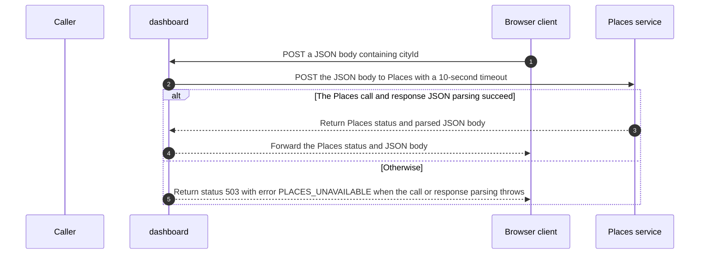

Source freshness: STALE. Meaning review: UNASSESSED.

Content revisions: {"dashboard":"e635069293d58cb0d4f28c8211e748b8d58e6b37","forecasts":"c289b28be4819eddf29d59a7c12f178559ec5229","places":"c289b28be4819eddf29d59a7c12f178559ec5229"}

Target revisions: {"dashboard":"e635069293d58cb0d4f28c8211e748b8d58e6b37","forecasts":"c289b28be4819eddf29d59a7c12f178559ec5229","places":"c289b28be4819eddf29d59a7c12f178559ec5229"}

## GET /health — local readiness checks

The handler probes PostgreSQL with SELECT 1 and reads the local consumerReady flag. It returns the READY body only after a successful database probe and a true flag; a failed probe propagates, and a false flag throws. This handler has no local error mapping, while the OpenAPI separately declares a 500 JSON response. The flag is not a fresh broker-health probe.

Request local readiness status

The database probe succeeds and consumerReady is true

Run SELECT 1

Return a successful database probe

Return status 200 with database READY and kafka READY

The source describes an alternative branch.

If the probe fails, its exception propagates; if consumerReady is false, the source throws. This handler has no local error mapping; the OpenAPI separately declares a 500 JSON response.

### Declared GET /health contract

Source-derived http interface description.

| Element | Value / behavior |
|---|---|
| Request | GET /health has no declared parameters or request body. |
| 200 response | The application/json object declares database READY and kafka READY. |
| 500 response | The error response is application/json with an object containing a string error field. |
| Declaration boundary | OpenAPI 3.1 declarations are parsed by a bounded reader; runtime enforcement and full JSON Schema validation are unverified. |

Implementation details

```mermaid
sequenceDiagram
    autonumber
    %% Agent-interpreted static source; declared edges are not compiler calls.
    participant caller as Caller
    participant service-dashboard as dashboard
    participant client as Health-check caller
    participant weather-db as Dashboard PostgreSQL
    %% claim-2e9e24a88fa30ccd9655: dependencies dashboard:contract-operation:c8f77692c3c0b8acd9232c7e, dashboard:symbol:1db17a7767cbf1b12d50234a
    client->>service-dashboard: Request local readiness status
    %% claim-05033045febc27846743: dependencies dashboard:flow:0515cb5fe6fd4b05a4fc0b08, dashboard:flow:a4174281df61bd1eb551a1d7, dashboard:flow:cfe766397f14fd43379ec157, dashboard:flow:d4af166cd6cf671b39e776a6, dashboard:symbol:1db17a7767cbf1b12d50234a
    alt The database probe succeeds and consumerReady is true
    %% claim-8a0a93a5d7522a57f3c8: dependencies dashboard:flow:a4174281df61bd1eb551a1d7, dashboard:symbol:1db17a7767cbf1b12d50234a
    service-dashboard->>weather-db: Run SELECT 1
    %% claim-3932aac55a107bc21d82: dependencies dashboard:flow:a4174281df61bd1eb551a1d7, dashboard:symbol:1db17a7767cbf1b12d50234a
    weather-db-->>service-dashboard: Return a successful database probe
    %% claim-2826dfa27ad03f61da8b: dependencies dashboard:contract-operation:359dbcae66966113bf88b8f9, dashboard:contract-operation:46eb1353d8493620edc8bfcb, dashboard:contract-operation:97d881f216d27f90570cf086, dashboard:contract-operation:a134218675bfd8d39281c02d, dashboard:contract-operation:c8f77692c3c0b8acd9232c7e, dashboard:contract-operation:f2a55cb383d259206638d57a, dashboard:contract:97420ee0a3ffefe0cddb405b, dashboard:symbol:1db17a7767cbf1b12d50234a
    service-dashboard-->>client: Return status 200 with database READY and kafka READY
    %% claim-fc444687faa2ffa81583: dependencies dashboard:flow:0515cb5fe6fd4b05a4fc0b08, dashboard:flow:a4174281df61bd1eb551a1d7, dashboard:flow:cfe766397f14fd43379ec157, dashboard:flow:d4af166cd6cf671b39e776a6, dashboard:symbol:1db17a7767cbf1b12d50234a
    else Otherwise
    %% claim-a18e62d7899e586de308: dependencies dashboard:contract-operation:359dbcae66966113bf88b8f9, dashboard:contract-operation:46eb1353d8493620edc8bfcb, dashboard:contract-operation:97d881f216d27f90570cf086, dashboard:contract-operation:a134218675bfd8d39281c02d, dashboard:contract-operation:c8f77692c3c0b8acd9232c7e, dashboard:contract-operation:f2a55cb383d259206638d57a, dashboard:contract:97420ee0a3ffefe0cddb405b, dashboard:flow:0515cb5fe6fd4b05a4fc0b08, dashboard:flow:a4174281df61bd1eb551a1d7, dashboard:flow:cfe766397f14fd43379ec157, dashboard:flow:d4af166cd6cf671b39e776a6, dashboard:symbol:1db17a7767cbf1b12d50234a
    Note over caller: If the probe fails, its exception propagates&#59; if consumerReady is false, the source throws. This handler has no local error mapping&#59; the OpenAPI separately declares a 500 JSON response.
    %% claim-65e306cbdc0f851392e5: dependencies dashboard:flow:0515cb5fe6fd4b05a4fc0b08, dashboard:flow:a4174281df61bd1eb551a1d7, dashboard:flow:cfe766397f14fd43379ec157, dashboard:flow:d4af166cd6cf671b39e776a6, dashboard:symbol:1db17a7767cbf1b12d50234a
    end
```

Source freshness: UNVERIFIED. Meaning review: UNASSESSED.

Content revisions: {"dashboard":"e635069293d58cb0d4f28c8211e748b8d58e6b37","forecasts":"c289b28be4819eddf29d59a7c12f178559ec5229","places":"c289b28be4819eddf29d59a7c12f178559ec5229"}

Target revisions: {"dashboard":"e635069293d58cb0d4f28c8211e748b8d58e6b37","forecasts":"c289b28be4819eddf29d59a7c12f178559ec5229","places":"c289b28be4819eddf29d59a7c12f178559ec5229"}

## Dashboard consumeMessage wrapper

consumeMessage takes an EachMessagePayload, then converts message.value with optional toString and a nullish empty-string fallback, parses JSON, and calls validateEvent inside one try. A throw from that expression enters catch: the wrapper awaits an INSERT into rejected_messages with reason INVALID_EVENT and ON CONFLICT DO NOTHING, then awaits commitOffsets with the next offset and returns. If the try completes, its result is assigned to event; the normal path awaits applyEvent(event), then the same next-offset call. The source shows these ordered awaits, not listener activation, call results, database durability, broker delivery, or applyEvent transaction outcomes.

Evaluate the conversion, JSON parse, and validateEvent expression under try. If it completes, assign the returned value to event and continue; if any part throws, the catch path below runs.

Read message.value?.toString() and use an empty string when that result is nullish, then call JSON.parse. A conversion or parse exception enters catch.

Call validateEvent with the parsed value and topic; if it returns, assign that value to event. This wrapper does not describe the validator’s checks.

The source describes an alternative branch.

Await pool.query for an INSERT into rejected_messages with topic, partition, message.offset, and reason INVALID_EVENT; the SQL uses ON CONFLICT DO NOTHING.

The INSERT is awaited before offset handling. If it rejects, the offset call is not reached; the catch body has no nested handler.

Then await consumer.commitOffsets with (BigInt(message.offset) + 1n).toString(). If the conversion or call fails, the following return is not reached.

After the rejection query and next-offset call return, exit without applying event.

On the nonthrowing try path, await applyEvent(event) before attempting the normal-path offset call; its effect is not established by this wrapper.

If applyEvent rejects, the following offset call is not reached; no catch surrounds this path in the captured body.

After applyEvent returns, await consumer.commitOffsets with the same next-offset expression. A conversion or commit error has no local handler here.

Implementation details

```mermaid
sequenceDiagram
    autonumber
    %% Agent-interpreted static source; declared edges are not compiler calls.
    participant caller as Caller
    participant service-dashboard as dashboard
    participant validation-call as validateEvent call target (unresolved)
    participant rejection-query as pool.query call target (unresolved)
    participant offset-call as consumer.commitOffsets call target (unresolved)
    participant apply-event-call as applyEvent call target (unresolved)
    %% claim-ff3791dcc1ad16ce5481: dependencies dashboard:flow:a190efb9bca6603f1d2abc58, dashboard:symbol:a4627e5e868830287e83e0dc
    alt Evaluate the conversion, JSON parse, and validateEvent expression under try. If it completes, assign the returned value to event and continue&#59; if any part throws, the catch path below runs.
    %% claim-839f99eedccbf652533f: dependencies dashboard:flow:0c9e2425ea81d2e2e4f781a1, dashboard:flow:1198b0d44dde70fcd80329fc, dashboard:symbol:a4627e5e868830287e83e0dc
    Note over caller: Read message.value?.toString() and use an empty string when that result is nullish, then call JSON.parse. A conversion or parse exception enters catch.
    %% claim-49d5c9d2d5bd0707367d: dependencies dashboard:flow:886390b176392fdbad06fc3a, dashboard:symbol:a4627e5e868830287e83e0dc
    service-dashboard->>validation-call: Call validateEvent with the parsed value and topic&#59; if it returns, assign that value to event. This wrapper does not describe the validator’s checks.
    %% claim-64c0d01116e12da836b8: dependencies dashboard:flow:a190efb9bca6603f1d2abc58, dashboard:symbol:a4627e5e868830287e83e0dc
    else Otherwise
    %% claim-c67b2fe5df7f4bee2160: dependencies dashboard:flow:59f03a0653cc7a3798b8ceaf, dashboard:symbol:a4627e5e868830287e83e0dc
    service-dashboard->>rejection-query: Await pool.query for an INSERT into rejected_messages with topic, partition, message.offset, and reason INVALID_EVENT&#59; the SQL uses ON CONFLICT DO NOTHING.
    %% claim-9dad88348400d67f3d39: dependencies dashboard:flow:59f03a0653cc7a3798b8ceaf, dashboard:flow:654eeebd7e0618b0c6dd58f9, dashboard:symbol:a4627e5e868830287e83e0dc
    Note over caller: The INSERT is awaited before offset handling. If it rejects, the offset call is not reached&#59; the catch body has no nested handler.
    %% claim-cb4d50832e00d5782e77: dependencies dashboard:flow:5f3ddc5ec529c16f3f1143f8, dashboard:flow:654eeebd7e0618b0c6dd58f9, dashboard:flow:667235490ded3f35c51f99f1, dashboard:symbol:a4627e5e868830287e83e0dc
    service-dashboard->>offset-call: Then await consumer.commitOffsets with (BigInt(message.offset) + 1n).toString(). If the conversion or call fails, the following return is not reached.
    %% claim-90da7476b8308f92a14f: dependencies dashboard:flow:f4a336f51f8e91a3da04831a, dashboard:symbol:a4627e5e868830287e83e0dc
    service-dashboard-->>caller: After the rejection query and next-offset call return, exit without applying event.
    %% claim-331f4f6e31042a4541d5: dependencies dashboard:flow:a190efb9bca6603f1d2abc58, dashboard:symbol:a4627e5e868830287e83e0dc
    end
    %% claim-a31383d61462fd30cbdd: dependencies dashboard:flow:37dec2bf70bc69d603cb8d4b, dashboard:symbol:a4627e5e868830287e83e0dc
    service-dashboard->>apply-event-call: On the nonthrowing try path, await applyEvent(event) before attempting the normal-path offset call&#59; its effect is not established by this wrapper.
    %% claim-310055d7070e9c8ca715: dependencies dashboard:flow:37dec2bf70bc69d603cb8d4b, dashboard:flow:8a4f6855cb7f1a476a0484e4, dashboard:symbol:a4627e5e868830287e83e0dc
    Note over caller: If applyEvent rejects, the following offset call is not reached&#59; no catch surrounds this path in the captured body.
    %% claim-215f729f998c07e6957d: dependencies dashboard:flow:049a97e649d7feb212e6c67f, dashboard:flow:82ca6f23f0ad8605f0571692, dashboard:flow:8a4f6855cb7f1a476a0484e4, dashboard:symbol:a4627e5e868830287e83e0dc
    service-dashboard->>offset-call: After applyEvent returns, await consumer.commitOffsets with the same next-offset expression. A conversion or commit error has no local handler here.
```

Source freshness: UNVERIFIED. Meaning review: UNASSESSED.

Content revisions: {"dashboard":"e635069293d58cb0d4f28c8211e748b8d58e6b37","forecasts":"c289b28be4819eddf29d59a7c12f178559ec5229","places":"c289b28be4819eddf29d59a7c12f178559ec5229"}

Target revisions: {"dashboard":"e635069293d58cb0d4f28c8211e748b8d58e6b37","forecasts":"c289b28be4819eddf29d59a7c12f178559ec5229","places":"c289b28be4819eddf29d59a7c12f178559ec5229"}

## Dashboard event validation

validateEvent rejects falsy or non-object input with INVALID_EVENT, then requires a string id, version 1, and a truthy place with a string id in oslo/helsinki/lisbon, a string name, and finite latitude and longitude; a false explicit predicate throws INVALID_EVENT. No nonempty-string or coordinate-range check appears. For topic weather.forecast-updated, the explicit guard requires type forecast.updated, a truthy forecast, timestamps passing the isTimestamp calls, mode fixture/live, and an array of 1-6 periods; a failed predicate throws INVALID_FORECAST. The captured same-file isTimestamp definition checks string type, a YYYY-MM-DDTHH:mm:ss pattern with optional fractional seconds and trailing Z, and finite Date.parse; analysis does not resolve these call targets or establish full calendar validation. Each period is checked for timestamp, finite temperature, precipitation null or finite and nonnegative, and string symbol; a failed explicit check throws INVALID_PERIOD. The loop reads period.time first, so a null period throws TypeError before that guard; there is no local catch for that or other property-access exceptions. For weather.place-requested, event.type must be place.requested and forecast must be undefined, else INVALID_PLACE_EVENT. Other topics throw UNKNOWN_TOPIC. Success returns the same event; no I/O or mutation appears. Framework activation and runtime behavior are unverified.

The first guard accepts only truthy values whose runtime type is object.

Falsy input or any value whose type is not object throws INVALID_EVENT before the cast.

The source describes an alternative branch.

A truthy object is cast to Event and proceeds; the type assertion itself does not validate the remaining fields.

The next guard checks the event identity and required place fields.

A non-string id, version other than 1, falsy place, non-string or non-allowlisted place id, non-string place name, or latitude/longitude for which Number.isFinite is false throws INVALID_EVENT.

The source describes an alternative branch.

If these explicit predicates pass, validation continues to the topic branches.

The topic test selects the forecast branch first, then the place-requested branch; every other topic takes the unknown-topic error branch.

For weather.forecast-updated, the forecast metadata and list guard checks the event type, forecast truthiness, two timestamp calls, mode, array shape, and list length.

A wrong type, falsy forecast, failed timestamp predicate, mode outside fixture/live, non-array periods, or period count outside 1-6 throws INVALID_FORECAST.

The source describes an alternative branch.

When the metadata/list guard passes, the function iterates over event.forecast.periods.

The loop reads period.time as an argument before the period guard can run. A null period therefore throws a property-access TypeError before INVALID_PERIOD; this function has no local catch for that or other property-access exceptions.

Each iterated period is checked for timestamp, temperature, precipitation, and symbol.

If the timestamp predicate fails, temperature is not finite, precipitation is neither null nor finite and nonnegative, or symbol is not a string, the explicit guard throws INVALID_PERIOD.

The source describes an alternative branch.

A period that passes these checks continues through the loop.

The source describes an alternative branch.

After the forecast topic fails to match, the function tests for weather.place-requested.

For weather.place-requested, the event type must be place.requested and forecast must be undefined.

If event.type differs from place.requested or event.forecast is not undefined, the guard throws INVALID_PLACE_EVENT.

The source describes an alternative branch.

When both predicates pass, this branch reaches the shared return.

The source describes an alternative branch.

Any topic other than weather.forecast-updated or weather.place-requested throws UNKNOWN_TOPIC.

After the selected validation path completes, return the same event object. Explicit validation failures throw before this return.

Implementation details

```mermaid
sequenceDiagram
    autonumber
    %% Agent-interpreted static source; declared edges are not compiler calls.
    participant caller as Caller
    participant service-dashboard as dashboard
    participant validateEvent as Dashboard validateEvent
    %% claim-576d5a67cd731bed6d02: dependencies dashboard:flow:ba648b1e1f16618112ba232c, dashboard:symbol:021fcd0ff7baa53bd3c51930
    alt The first guard accepts only truthy values whose runtime type is object.
    %% claim-0c632cec26fe5c752286: dependencies dashboard:flow:612a99808c3d0cb4660876ba, dashboard:flow:ba648b1e1f16618112ba232c, dashboard:symbol:021fcd0ff7baa53bd3c51930
    Note over caller: Falsy input or any value whose type is not object throws INVALID_EVENT before the cast.
    %% claim-b6e78134a8fd3a956eac: dependencies dashboard:flow:ba648b1e1f16618112ba232c, dashboard:symbol:021fcd0ff7baa53bd3c51930
    else Otherwise
    %% claim-14e8105119b83db5b27f: dependencies dashboard:flow:ba648b1e1f16618112ba232c, dashboard:symbol:021fcd0ff7baa53bd3c51930
    Note over caller: A truthy object is cast to Event and proceeds&#59; the type assertion itself does not validate the remaining fields.
    %% claim-66df2bac9b4253cd12f9: dependencies dashboard:flow:ba648b1e1f16618112ba232c, dashboard:symbol:021fcd0ff7baa53bd3c51930
    end
    %% claim-ab3fb5ec291af39fb4e1: dependencies dashboard:flow:b05a5fad821839a42cc6b248, dashboard:symbol:021fcd0ff7baa53bd3c51930
    alt The next guard checks the event identity and required place fields.
    %% claim-72e05c9080482087d724: dependencies dashboard:flow:1f5c9b6fabfdb83f3a2787b9, dashboard:flow:b05a5fad821839a42cc6b248, dashboard:symbol:021fcd0ff7baa53bd3c51930
    Note over caller: A non-string id, version other than 1, falsy place, non-string or non-allowlisted place id, non-string place name, or latitude/longitude for which Number.isFinite is false throws INVALID_EVENT.
    %% claim-8f928f070291fbd0a25c: dependencies dashboard:flow:b05a5fad821839a42cc6b248, dashboard:symbol:021fcd0ff7baa53bd3c51930
    else Otherwise
    %% claim-b4ec9724c9200465c982: dependencies dashboard:flow:b05a5fad821839a42cc6b248, dashboard:symbol:021fcd0ff7baa53bd3c51930
    Note over caller: If these explicit predicates pass, validation continues to the topic branches.
    %% claim-5dda05ad410d06112541: dependencies dashboard:flow:b05a5fad821839a42cc6b248, dashboard:symbol:021fcd0ff7baa53bd3c51930
    end
    %% claim-c90d94cf3c2eb9531637: dependencies dashboard:flow:3fdc360a9fa865a2c723f0d9, dashboard:flow:4cafc6a4fb1ad99644a7de57, dashboard:flow:cb18ba8c0e515e1a650f8666, dashboard:symbol:021fcd0ff7baa53bd3c51930
    alt The topic test selects the forecast branch first, then the place-requested branch&#59; every other topic takes the unknown-topic error branch.
    %% claim-9ec1bc33bab7b862a011: dependencies dashboard:flow:24db9c53afcbb4e3c95ba6a3, dashboard:flow:cb18ba8c0e515e1a650f8666, dashboard:symbol:021fcd0ff7baa53bd3c51930, dashboard:symbol:7d0d09a16ac25de86e5beb53
    alt For weather.forecast-updated, the forecast metadata and list guard checks the event type, forecast truthiness, two timestamp calls, mode, array shape, and list length.
    %% claim-415fd7defc2b906ca6c9: dependencies dashboard:flow:24db9c53afcbb4e3c95ba6a3, dashboard:flow:52639c83831bdd8eeef32f40, dashboard:symbol:021fcd0ff7baa53bd3c51930, dashboard:symbol:7d0d09a16ac25de86e5beb53
    Note over caller: A wrong type, falsy forecast, failed timestamp predicate, mode outside fixture/live, non-array periods, or period count outside 1-6 throws INVALID_FORECAST.
    %% claim-18b64ff870c888552fd4: dependencies dashboard:flow:24db9c53afcbb4e3c95ba6a3, dashboard:flow:cb18ba8c0e515e1a650f8666, dashboard:symbol:021fcd0ff7baa53bd3c51930, dashboard:symbol:7d0d09a16ac25de86e5beb53
    else Otherwise
    %% claim-406c5f1fd4c678844b2c: dependencies dashboard:flow:24db9c53afcbb4e3c95ba6a3, dashboard:flow:cb18ba8c0e515e1a650f8666, dashboard:symbol:021fcd0ff7baa53bd3c51930
    Note over caller: When the metadata/list guard passes, the function iterates over event.forecast.periods.
    %% claim-2c6be6457bd39fc96815: dependencies dashboard:flow:24db9c53afcbb4e3c95ba6a3, dashboard:flow:cb18ba8c0e515e1a650f8666, dashboard:symbol:021fcd0ff7baa53bd3c51930, dashboard:symbol:7d0d09a16ac25de86e5beb53
    end
    %% claim-48bebf4fb496924496b1: dependencies dashboard:flow:2b5fd504b0e44e1aac6d6baf, dashboard:flow:cb18ba8c0e515e1a650f8666, dashboard:symbol:021fcd0ff7baa53bd3c51930, dashboard:symbol:7d0d09a16ac25de86e5beb53
    Note over caller: The loop reads period.time as an argument before the period guard can run. A null period therefore throws a property-access TypeError before INVALID_PERIOD&#59; this function has no local catch for that or other property-access exceptions.
    %% claim-9bb0cba556e22dbbd91a: dependencies dashboard:flow:2b5fd504b0e44e1aac6d6baf, dashboard:symbol:021fcd0ff7baa53bd3c51930, dashboard:symbol:7d0d09a16ac25de86e5beb53
    alt Each iterated period is checked for timestamp, temperature, precipitation, and symbol.
    %% claim-86e6a03d2601a04c96b1: dependencies dashboard:flow:2b5fd504b0e44e1aac6d6baf, dashboard:flow:5402c6a44ee72e4cc62b12b8, dashboard:symbol:021fcd0ff7baa53bd3c51930, dashboard:symbol:7d0d09a16ac25de86e5beb53
    Note over caller: If the timestamp predicate fails, temperature is not finite, precipitation is neither null nor finite and nonnegative, or symbol is not a string, the explicit guard throws INVALID_PERIOD.
    %% claim-060f5a2b9746d84c6207: dependencies dashboard:flow:2b5fd504b0e44e1aac6d6baf, dashboard:symbol:021fcd0ff7baa53bd3c51930, dashboard:symbol:7d0d09a16ac25de86e5beb53
    else Otherwise
    %% claim-5b392aaf6cce766044bf: dependencies dashboard:flow:2b5fd504b0e44e1aac6d6baf, dashboard:symbol:021fcd0ff7baa53bd3c51930
    Note over caller: A period that passes these checks continues through the loop.
    %% claim-2437e44bb13bf454cadb: dependencies dashboard:flow:2b5fd504b0e44e1aac6d6baf, dashboard:symbol:021fcd0ff7baa53bd3c51930, dashboard:symbol:7d0d09a16ac25de86e5beb53
    end
    %% claim-306694924d615aa655e8: dependencies dashboard:flow:3fdc360a9fa865a2c723f0d9, dashboard:flow:4cafc6a4fb1ad99644a7de57, dashboard:flow:cb18ba8c0e515e1a650f8666, dashboard:symbol:021fcd0ff7baa53bd3c51930
    else Otherwise
    %% claim-1dbabd3b2e6cb356bb42: dependencies dashboard:flow:3fdc360a9fa865a2c723f0d9, dashboard:flow:cb18ba8c0e515e1a650f8666, dashboard:symbol:021fcd0ff7baa53bd3c51930
    alt After the forecast topic fails to match, the function tests for weather.place-requested.
    %% claim-14316294d45f0e61c608: dependencies dashboard:flow:19e884dd0fd36b653b1ad843, dashboard:flow:3fdc360a9fa865a2c723f0d9, dashboard:symbol:021fcd0ff7baa53bd3c51930
    alt For weather.place-requested, the event type must be place.requested and forecast must be undefined.
    %% claim-e3b79d1d6c590b080318: dependencies dashboard:flow:19e884dd0fd36b653b1ad843, dashboard:flow:3d63e1a01907b4d631f3e73c, dashboard:symbol:021fcd0ff7baa53bd3c51930
    Note over caller: If event.type differs from place.requested or event.forecast is not undefined, the guard throws INVALID_PLACE_EVENT.
    %% claim-7d5a151864d18013f2e0: dependencies dashboard:flow:19e884dd0fd36b653b1ad843, dashboard:flow:3fdc360a9fa865a2c723f0d9, dashboard:symbol:021fcd0ff7baa53bd3c51930
    else Otherwise
    %% claim-1fa910f1ac26c4ddd88b: dependencies dashboard:flow:19e884dd0fd36b653b1ad843, dashboard:flow:a35f99e7fc0d3624f4b0a379, dashboard:symbol:021fcd0ff7baa53bd3c51930
    Note over caller: When both predicates pass, this branch reaches the shared return.
    %% claim-1a9ad40ef10b0d451a63: dependencies dashboard:flow:19e884dd0fd36b653b1ad843, dashboard:flow:3fdc360a9fa865a2c723f0d9, dashboard:symbol:021fcd0ff7baa53bd3c51930
    end
    %% claim-09286f213765f5dd778d: dependencies dashboard:flow:3fdc360a9fa865a2c723f0d9, dashboard:flow:cb18ba8c0e515e1a650f8666, dashboard:symbol:021fcd0ff7baa53bd3c51930
    else Otherwise
    %% claim-dde34386b573179c6907: dependencies dashboard:flow:3fdc360a9fa865a2c723f0d9, dashboard:flow:4cafc6a4fb1ad99644a7de57, dashboard:symbol:021fcd0ff7baa53bd3c51930
    Note over caller: Any topic other than weather.forecast-updated or weather.place-requested throws UNKNOWN_TOPIC.
    %% claim-dea24ae447c9a275f2f3: dependencies dashboard:flow:3fdc360a9fa865a2c723f0d9, dashboard:flow:cb18ba8c0e515e1a650f8666, dashboard:symbol:021fcd0ff7baa53bd3c51930
    end
    %% claim-494ce3a5157cce8d95be: dependencies dashboard:flow:3fdc360a9fa865a2c723f0d9, dashboard:flow:4cafc6a4fb1ad99644a7de57, dashboard:flow:cb18ba8c0e515e1a650f8666, dashboard:symbol:021fcd0ff7baa53bd3c51930
    end
    %% claim-8246a932f3244bec5a91: dependencies dashboard:flow:a35f99e7fc0d3624f4b0a379, dashboard:symbol:021fcd0ff7baa53bd3c51930
    validateEvent-->>caller: After the selected validation path completes, return the same event object. Explicit validation failures throw before this return.
```

## Human note: kafka-replay.json

Classification: mixed. Period: 2026-10-13T01:19:20.188431+00:00.

Original captured text (human/imported, unverified):

<pre>{
  &quot;schema&quot;: &quot;clew-weather-runtime-observation/1.0&quot;,
  &quot;id&quot;: &quot;kafka-replay&quot;,
  &quot;origin&quot;: &quot;LOCAL_TEST_OBSERVATION&quot;,
  &quot;compilerEvidence&quot;: false,
  &quot;originalRecordSha256&quot;: &quot;caddd2d52464acb6a2fa5107473b77e1a47d94bd5101e27011382549efd87552&quot;,
  &quot;status&quot;: &quot;PASS&quot;,
  &quot;sourceCommit&quot;: &quot;8d69f2b1d4a6d9770f87c720cd665dab30081815&quot;,
  &quot;sourceHashes&quot;: {
    &quot;services/dashboard/src/main.ts&quot;: &quot;24e65777311802d2204bc41eedf3b814e869f777c2e65cb74d5c8be8c4d47e6a&quot;,
    &quot;services/dashboard/src/events.ts&quot;: &quot;a17702c69c12855a10f629ed89938eba6b4492e1b84efa9faf0e02f251ce2a2b&quot;,
    &quot;services/forecasts/src/main/kotlin/weather/Forecasts.kt&quot;: &quot;6ed6406eab325f8de2860e4fc8a0a0afca9499394732dcf9c7115bd8df711fe6&quot;,
    &quot;compose.yaml&quot;: &quot;76d5d8226d233a558b901a06887bcce216e4738778edff8462367d827169c167&quot;,
    &quot;database/init.sql&quot;: &quot;c888c357d74a2e37512309e826d90fc689be0c348fb3e1cbfe635ce5a46f879f&quot;
  },
  &quot;runnerSha256&quot;: &quot;8bfaa5d4fa467df91f7b46609bf5bd1cd561f30abcf6d635da5bfabf20930f10&quot;,
  &quot;startedAt&quot;: &quot;2026-10-13T01:19:20.188431+00:00&quot;,
  &quot;finishedAt&quot;: &quot;2026-10-13T01:19:39.261171+00:00&quot;,
  &quot;sourceUnchangedAtFinish&quot;: true,
  &quot;cases&quot;: [
    {
      &quot;case&quot;: &quot;forecast-before-place&quot;,
      &quot;pass&quot;: true,
      &quot;observed&quot;: {
        &quot;id&quot;: &quot;lisbon&quot;,
        &quot;name&quot;: &quot;Lisbon&quot;,
        &quot;latitude&quot;: 38.72,
        &quot;longitude&quot;: -9.14,
        &quot;forecast&quot;: {
          &quot;mode&quot;: &quot;fixture&quot;,
          &quot;periods&quot;: [
            {
              &quot;time&quot;: &quot;2026-10-12T21:34:59Z&quot;,
              &quot;symbol&quot;: &quot;synthetic_acceptance&quot;,
              &quot;temperatureC&quot;: 18,
              &quot;precipitationMm&quot;: 0
            }
          ],
          &quot;fetchedAt&quot;: &quot;2026-10-12T20:36:59Z&quot;,
          &quot;updatedAt&quot;: &quot;2026-10-12T20:35:59Z&quot;
        }
      },
      &quot;topicEnd&quot;: 1,
      &quot;groupSnapshot&quot;: &quot;\nGROUP                TOPIC                    PARTITION  CURRENT-OFFSET  LOG-END-OFFSET  LAG             CONSUMER-ID                                            HOST            CLIENT-ID\nweather-dashboard-v1 weather.forecast-updated 0          1               1               0               weather-dashboard-6d4f072e-edfd-4d08-9f35-6cf7f1ad7234 /172.19.0.6     weather-dashboard\nweather-dashboard-v1 weather.place-requested  0          -               0               -               weather-dashboard-6d4f072e-edfd-4d08-9f35-6cf7f1ad7234 /172.19.0.6     weather-dashboard\n&quot;
    },
    {
      &quot;case&quot;: &quot;duplicate&quot;,
      &quot;pass&quot;: true,
      &quot;inboxTimestampBefore&quot;: &quot;2026-10-13 01:19:20.860972+00&quot;,
      &quot;inboxTimestampAfter&quot;: &quot;2026-10-13 01:19:20.860972+00&quot;,
      &quot;topicEnd&quot;: 2,
      &quot;groupSnapshot&quot;: &quot;\nGROUP                TOPIC                    PARTITION  CURRENT-OFFSET  LOG-END-OFFSET  LAG             CONSUMER-ID                                            HOST            CLIENT-ID\nweather-dashboard-v1 weather.forecast-updated 0          2               2               0               weather-dashboard-6d4f072e-edfd-4d08-9f35-6cf7f1ad7234 /172.19.0.6     weather-dashboard\nweather-dashboard-v1 weather.place-requested  0          -               0               -               weather-dashboard-6d4f072e-edfd-4d08-9f35-6cf7f1ad7234 /172.19.0.6     weather-dashboard\n&quot;
    },
    {
      &quot;case&quot;: &quot;older&quot;,
      &quot;pass&quot;: true,
      &quot;inboxRows&quot;: &quot;1&quot;,
      &quot;observed&quot;: {
        &quot;id&quot;: &quot;lisbon&quot;,
        &quot;name&quot;: &quot;Lisbon&quot;,
        &quot;latitude&quot;: 38.72,
        &quot;longitude&quot;: -9.14,
        &quot;forecast&quot;: {
          &quot;mode&quot;: &quot;fixture&quot;,
          &quot;periods&quot;: [
            {
              &quot;time&quot;: &quot;2026-10-12T21:34:59Z&quot;,
              &quot;symbol&quot;: &quot;synthetic_acceptance&quot;,
              &quot;temperatureC&quot;: 18,
              &quot;precipitationMm&quot;: 0
            }
          ],
          &quot;fetchedAt&quot;: &quot;2026-10-12T20:36:59Z&quot;,
          &quot;updatedAt&quot;: &quot;2026-10-12T20:35:59Z&quot;
        }
      },
      &quot;topicEnd&quot;: 3,
      &quot;groupSnapshot&quot;: &quot;\nGROUP                TOPIC                    PARTITION  CURRENT-OFFSET  LOG-END-OFFSET  LAG             CONSUMER-ID                                            HOST            CLIENT-ID\nweather-dashboard-v1 weather.forecast-updated 0          3               3               0               weather-dashboard-6d4f072e-edfd-4d08-9f35-6cf7f1ad7234 /172.19.0.6     weather-dashboard\nweather-dashboard-v1 weather.place-requested  0          -               0               -               weather-dashboard-6d4f072e-edfd-4d08-9f35-6cf7f1ad7234 /172.19.0.6     weather-dashboard\n&quot;
    },
    {
      &quot;case&quot;: &quot;equal&quot;,
      &quot;pass&quot;: true,
      &quot;inboxRows&quot;: &quot;1&quot;,
      &quot;observed&quot;: {
        &quot;id&quot;: &quot;lisbon&quot;,
        &quot;name&quot;: &quot;Lisbon&quot;,
        &quot;latitude&quot;: 38.72,
        &quot;longitude&quot;: -9.14,
        &quot;forecast&quot;: {
          &quot;mode&quot;: &quot;fixture&quot;,
          &quot;periods&quot;: [
            {
              &quot;time&quot;: &quot;2026-10-12T21:34:59Z&quot;,
              &quot;symbol&quot;: &quot;synthetic_acceptance&quot;,
              &quot;temperatureC&quot;: 18,
              &quot;precipitationMm&quot;: 0
            }
          ],
          &quot;fetchedAt&quot;: &quot;2026-10-12T20:36:59Z&quot;,
          &quot;updatedAt&quot;: &quot;2026-10-12T20:35:59Z&quot;
        }
      },
      &quot;topicEnd&quot;: 4,
      &quot;groupSnapshot&quot;: &quot;\nGROUP                TOPIC                    PARTITION  CURRENT-OFFSET  LOG-END-OFFSET  LAG             CONSUMER-ID                                            HOST            CLIENT-ID\nweather-dashboard-v1 weather.forecast-updated 0          4               4               0               weather-dashboard-6d4f072e-edfd-4d08-9f35-6cf7f1ad7234 /172.19.0.6     weather-dashboard\nweather-dashboard-v1 weather.place-requested  0          -               0               -               weather-dashboard-6d4f072e-edfd-4d08-9f35-6cf7f1ad7234 /172.19.0.6     weather-dashboard\n&quot;
    },
    {
      &quot;case&quot;: &quot;newer-zero-temperature-unknown-rain&quot;,
      &quot;pass&quot;: true,
      &quot;observed&quot;: {
        &quot;id&quot;: &quot;lisbon&quot;,
        &quot;name&quot;: &quot;Lisbon&quot;,
        &quot;latitude&quot;: 38.72,
        &quot;longitude&quot;: -9.14,
        &quot;forecast&quot;: {
          &quot;mode&quot;: &quot;fixture&quot;,
          &quot;periods&quot;: [
            {
              &quot;time&quot;: &quot;2026-10-12T21:34:59Z&quot;,
              &quot;symbol&quot;: &quot;synthetic_acceptance&quot;,
              &quot;temperatureC&quot;: 0,
              &quot;precipitationMm&quot;: null
            }
          ],
          &quot;fetchedAt&quot;: &quot;2026-10-12T20:36:59Z&quot;,
          &quot;updatedAt&quot;: &quot;2026-10-12T20:37:59Z&quot;
        }
      },
      &quot;topicEnd&quot;: 5,
      &quot;groupSnapshot&quot;: &quot;\nGROUP                TOPIC                    PARTITION  CURRENT-OFFSET  LOG-END-OFFSET  LAG             CONSUMER-ID                                            HOST            CLIENT-ID\nweather-dashboard-v1 weather.forecast-updated 0          5               5               0               weather-dashboard-6d4f072e-edfd-4d08-9f35-6cf7f1ad7234 /172.19.0.6     weather-dashboard\nweather-dashboard-v1 weather.place-requested  0          -               0               -               weather-dashboard-6d4f072e-edfd-4d08-9f35-6cf7f1ad7234 /172.19.0.6     weather-dashboard\n&quot;
    },
    {
      &quot;case&quot;: &quot;place-arrives-later-and-generated-older-forecast&quot;,
      &quot;pass&quot;: true,
      &quot;observed&quot;: {
        &quot;id&quot;: &quot;lisbon&quot;,
        &quot;name&quot;: &quot;Lisbon&quot;,
        &quot;latitude&quot;: 38.72,
        &quot;longitude&quot;: -9.14,
        &quot;forecast&quot;: {
          &quot;mode&quot;: &quot;fixture&quot;,
          &quot;periods&quot;: [
            {
              &quot;time&quot;: &quot;2026-10-12T21:34:59Z&quot;,
              &quot;symbol&quot;: &quot;synthetic_acceptance&quot;,
              &quot;temperatureC&quot;: 0,
              &quot;precipitationMm&quot;: null
            }
          ],
          &quot;fetchedAt&quot;: &quot;2026-10-12T20:36:59Z&quot;,
          &quot;updatedAt&quot;: &quot;2026-10-12T20:37:59Z&quot;
        }
      },
      &quot;generatedForecastConsumed&quot;: &quot;1&quot;,
      &quot;topicEnd&quot;: 1,
      &quot;groupSnapshot&quot;: &quot;\nGROUP                TOPIC                    PARTITION  CURRENT-OFFSET  LOG-END-OFFSET  LAG             CONSUMER-ID                                            HOST            CLIENT-ID\nweather-dashboard-v1 weather.forecast-updated 0          6               6               0               weather-dashboard-6d4f072e-edfd-4d08-9f35-6cf7f1ad7234 /172.19.0.6     weather-dashboard\nweather-dashboard-v1 weather.place-requested  0          1               1               0               weather-dashboard-6d4f072e-edfd-4d08-9f35-6cf7f1ad7234 /172.19.0.6     weather-dashboard\n&quot;
    }
  ],
  &quot;inputs&quot;: [
    {
      &quot;topic&quot;: &quot;weather.forecast-updated&quot;,
      &quot;event&quot;: {
        &quot;id&quot;: &quot;acceptance-lisbon-7f836229-f312-4e59-881a-d709e7fbd1ee-initial&quot;,
        &quot;type&quot;: &quot;forecast.updated&quot;,
        &quot;version&quot;: 1,
        &quot;place&quot;: {
          &quot;id&quot;: &quot;lisbon&quot;,
          &quot;name&quot;: &quot;Lisbon&quot;,
          &quot;latitude&quot;: 38.72,
          &quot;longitude&quot;: -9.14
        },
        &quot;forecast&quot;: {
          &quot;updatedAt&quot;: &quot;2026-10-12T20:35:59Z&quot;,
          &quot;fetchedAt&quot;: &quot;2026-10-12T20:36:59Z&quot;,
          &quot;mode&quot;: &quot;fixture&quot;,
          &quot;periods&quot;: [
            {
              &quot;time&quot;: &quot;2026-10-12T21:34:59Z&quot;,
              &quot;temperatureC&quot;: 18,
              &quot;precipitationMm&quot;: 0,
              &quot;symbol&quot;: &quot;synthetic_acceptance&quot;
            }
          ]
        }
      }
    },
    {
      &quot;topic&quot;: &quot;weather.forecast-updated&quot;,
      &quot;event&quot;: {
        &quot;id&quot;: &quot;acceptance-lisbon-7f836229-f312-4e59-881a-d709e7fbd1ee-initial&quot;,
        &quot;type&quot;: &quot;forecast.updated&quot;,
        &quot;version&quot;: 1,
        &quot;place&quot;: {
          &quot;id&quot;: &quot;lisbon&quot;,
          &quot;name&quot;: &quot;Lisbon&quot;,
          &quot;latitude&quot;: 38.72,
          &quot;longitude&quot;: -9.14
        },
        &quot;forecast&quot;: {
          &quot;updatedAt&quot;: &quot;2026-10-12T20:35:59Z&quot;,
          &quot;fetchedAt&quot;: &quot;2026-10-12T20:36:59Z&quot;,
          &quot;mode&quot;: &quot;fixture&quot;,
          &quot;periods&quot;: [
            {
              &quot;time&quot;: &quot;2026-10-12T21:34:59Z&quot;,
              &quot;temperatureC&quot;: 18,
              &quot;precipitationMm&quot;: 0,
              &quot;symbol&quot;: &quot;synthetic_acceptance&quot;
            }
          ]
        }
      }
    },
    {
      &quot;topic&quot;: &quot;weather.forecast-updated&quot;,
      &quot;event&quot;: {
        &quot;id&quot;: &quot;acceptance-lisbon-7f836229-f312-4e59-881a-d709e7fbd1ee-older&quot;,
        &quot;type&quot;: &quot;forecast.updated&quot;,
        &quot;version&quot;: 1,
        &quot;place&quot;: {
          &quot;id&quot;: &quot;lisbon&quot;,
          &quot;name&quot;: &quot;Lisbon&quot;,
          &quot;latitude&quot;: 38.72,
          &quot;longitude&quot;: -9.14
        },
        &quot;forecast&quot;: {
          &quot;updatedAt&quot;: &quot;2026-10-12T20:34:59Z&quot;,
          &quot;fetchedAt&quot;: &quot;2026-10-12T20:36:59Z&quot;,
          &quot;mode&quot;: &quot;fixture&quot;,
          &quot;periods&quot;: [
            {
              &quot;time&quot;: &quot;2026-10-12T21:34:59Z&quot;,
              &quot;temperatureC&quot;: 99,
              &quot;precipitationMm&quot;: 0,
              &quot;symbol&quot;: &quot;synthetic_acceptance&quot;
            }
          ]
        }
      }
    },
    {
      &quot;topic&quot;: &quot;weather.forecast-updated&quot;,
      &quot;event&quot;: {
        &quot;id&quot;: &quot;acceptance-lisbon-7f836229-f312-4e59-881a-d709e7fbd1ee-equal&quot;,
        &quot;type&quot;: &quot;forecast.updated&quot;,
        &quot;version&quot;: 1,
        &quot;place&quot;: {
          &quot;id&quot;: &quot;lisbon&quot;,
          &quot;name&quot;: &quot;Lisbon&quot;,
          &quot;latitude&quot;: 38.72,
          &quot;longitude&quot;: -9.14
        },
        &quot;forecast&quot;: {
          &quot;updatedAt&quot;: &quot;2026-10-12T20:35:59Z&quot;,
          &quot;fetchedAt&quot;: &quot;2026-10-12T20:36:59Z&quot;,
          &quot;mode&quot;: &quot;fixture&quot;,
          &quot;periods&quot;: [
            {
              &quot;time&quot;: &quot;2026-10-12T21:34:59Z&quot;,
              &quot;temperatureC&quot;: 98,
              &quot;precipitationMm&quot;: 0,
              &quot;symbol&quot;: &quot;synthetic_acceptance&quot;
            }
          ]
        }
      }
    },
    {
      &quot;topic&quot;: &quot;weather.forecast-updated&quot;,
      &quot;event&quot;: {
        &quot;id&quot;: &quot;acceptance-lisbon-7f836229-f312-4e59-881a-d709e7fbd1ee-newer&quot;,
        &quot;type&quot;: &quot;forecast.updated&quot;,
        &quot;version&quot;: 1,
        &quot;place&quot;: {
          &quot;id&quot;: &quot;lisbon&quot;,
          &quot;name&quot;: &quot;Lisbon&quot;,
          &quot;latitude&quot;: 38.72,
          &quot;longitude&quot;: -9.14
        },
        &quot;forecast&quot;: {
          &quot;updatedAt&quot;: &quot;2026-10-12T20:37:59Z&quot;,
          &quot;fetchedAt&quot;: &quot;2026-10-12T20:36:59Z&quot;,
          &quot;mode&quot;: &quot;fixture&quot;,
          &quot;periods&quot;: [
            {
              &quot;time&quot;: &quot;2026-10-12T21:34:59Z&quot;,
              &quot;temperatureC&quot;: 0,
              &quot;precipitationMm&quot;: null,
              &quot;symbol&quot;: &quot;synthetic_acceptance&quot;
            }
          ]
        }
      }
    },
    {
      &quot;topic&quot;: &quot;weather.place-requested&quot;,
      &quot;event&quot;: {
        &quot;id&quot;: &quot;acceptance-lisbon-7f836229-f312-4e59-881a-d709e7fbd1ee-place-last&quot;,
        &quot;type&quot;: &quot;place.requested&quot;,
        &quot;version&quot;: 1,
        &quot;place&quot;: {
          &quot;id&quot;: &quot;lisbon&quot;,
          &quot;name&quot;: &quot;Lisbon&quot;,
          &quot;latitude&quot;: 38.72,
          &quot;longitude&quot;: -9.14
        }
      }
    }
  ],
  &quot;topicPartitions&quot;: 1
}
</pre>

Original metadata and associations
<pre>{
  &quot;classification&quot;: &quot;mixed&quot;,
  &quot;id&quot;: &quot;runtime-kafka-replay&quot;,
  &quot;metadata&quot;: {
    &quot;compilerEvidence&quot;: false,
    &quot;sourceSha256&quot;: &quot;d27da19937723e3bb0f18876946fe40afed441d3c57aca7431f6b3e83e5fa8e5&quot;
  },
  &quot;path&quot;: &quot;notes/runtime-kafka-replay.md&quot;,
  &quot;period&quot;: &quot;2026-10-13T01:19:20.188431+00:00&quot;,
  &quot;schema&quot;: &quot;codeclew-documentation-note-association/1.0&quot;,
  &quot;service&quot;: &quot;dashboard&quot;,
  &quot;tags&quot;: [
    &quot;imported-context&quot;
  ],
  &quot;targets&quot;: [
    &quot;service:dashboard/section-overview&quot;
  ],
  &quot;title&quot;: &quot;kafka-replay.json&quot;
}</pre>

Separate agent assessment: CONSISTENT. Period assessed: 2026-10-13T01:19:20.188431+00:00.

At 8d69f2b1d4a6d9770f87c720cd665dab30081815, imported runtime replay passed six: forecast-before-place, duplicate ID, older/equal timestamps, newer 0 °C/null rain, place-after-forecast.

At Dashboard revision e635069293d58cb0d4f28c8211e748b8d58e6b37, applyEvent inserts event IDs into inbox transactionally; duplicates commit before card writes. INSERT may create a card; conflicts update for null stored timestamp or newer incoming updatedAt. With a dated card, a distinct new event ID is recorded in inbox; older/equal forecast updatedAt leaves it unchanged; newer applies. Valid path: consumeMessage awaits applyEvent before offset+1 commit; invalid events persist rejected_messages before offset commit. Validation permits 0 °C and null/nonnegative rain; timestamps must match UTC shape and yield finite Date.parse output. Place upsert leaves forecast unchanged.

These six historical runtime passes are not a current rerun; they establish no universal ordering, restart/crash behavior, or exactly-once guarantee. No compiler result is claimed.

From checkout root: Python 3, Docker Compose, free ports 8080–8082, fresh project/volumes, fixture mode, ready Dashboard API with empty array, no Lisbon card. Example project weather-replay-20261013-ab12; sibling output ../replay-ab12. Change the suffix if either exists. Start:
FORECAST_MODE=fixture docker compose --project-name weather-replay-20261013-ab12 -f compose.yaml up --build -d
Replay:
python3 -I -S -B exercises/replay.py --project weather-replay-20261013-ab12 --dashboard-url http://127.0.0.1:8080 --output ../replay-ab12
Output must be new, outside and not above the checkout. Replay does not create or clean the stack. Cleanup:
docker compose --project-name weather-replay-20261013-ab12 -f compose.yaml down --volumes --remove-orphans
Cleanup targets only that project. For alternate ports use the same Compose override for up, replay with --compose-override, and down; set the matching Dashboard URL. Recipe source-checked, not executed here.

See accompanying operation states for evidence freshness and meaning review.

## Human note: validator-node24.json

Classification: mixed. Period: v24.21.0.

Original captured text (human/imported, unverified):

<pre>{
  &quot;schema&quot;: &quot;clew-weather-runtime-observation/1.0&quot;,
  &quot;id&quot;: &quot;validator-node24&quot;,
  &quot;origin&quot;: &quot;LOCAL_TEST_OBSERVATION&quot;,
  &quot;compilerEvidence&quot;: false,
  &quot;originalRecordSha256&quot;: &quot;dd0db06bc40207580d6c1097e68fff4d0fe696172e7d861fe528e98468bc218a&quot;,
  &quot;status&quot;: &quot;PASSED&quot;,
  &quot;nodeVersion&quot;: &quot;v24.21.0&quot;,
  &quot;assetSha256&quot;: &quot;bed7eea5325e1108f32ce5228ddd6a5f0f08a499ee42aa7442aea583702f6057&quot;,
  &quot;officialChecksumMatched&quot;: true,
  &quot;exerciseResult&quot;: {
    &quot;status&quot;: &quot;PASSED&quot;,
    &quot;assertions&quot;: 6,
    &quot;runtime&quot;: &quot;v24.21.0&quot;
  },
  &quot;repositoryRevision&quot;: &quot;8d69f2b1d4a6d9770f87c720cd665dab30081815&quot;
}
</pre>

Original metadata and associations
<pre>{
  &quot;classification&quot;: &quot;mixed&quot;,
  &quot;id&quot;: &quot;runtime-validator-node24&quot;,
  &quot;metadata&quot;: {
    &quot;compilerEvidence&quot;: false,
    &quot;sourceSha256&quot;: &quot;0b92cf23a6811f7044e0c7a86d99c694638f63bab2f59b3376565bf1616ab2de&quot;
  },
  &quot;path&quot;: &quot;notes/runtime-validator-node24.md&quot;,
  &quot;period&quot;: &quot;v24.21.0&quot;,
  &quot;schema&quot;: &quot;codeclew-documentation-note-association/1.0&quot;,
  &quot;service&quot;: &quot;dashboard&quot;,
  &quot;tags&quot;: [
    &quot;imported-context&quot;
  ],
  &quot;targets&quot;: [
    &quot;service:dashboard/section-overview&quot;
  ],
  &quot;title&quot;: &quot;validator-node24.json&quot;
}</pre>

Separate agent assessment: CONSISTENT. Period assessed: v24.21.0.

An unchecked place-event exercise accepts a place.requested event carrying arbitrary forecast data. On the production weather.place-requested path, validateEvent rejects that shape as INVALID_PLACE_EVENT because forecast must be absent. This difference is the contract gap the case is designed to expose.

From the repository root, run node exercises/validator-regression.mjs. The imported Node v24.21.0 observation records six passing assertions: the exercise accepts that shape; production rejects it; a valid place event returns unchanged; an unknown topic yields UNKNOWN_TOPIC; a forecast with 0°C and null precipitation returns unchanged; and numeric updatedAt=0 yields INVALID_FORECAST. Production forecast validation checks updatedAt, fetchedAt and every period.time with isTimestamp: a UTC-shaped string with optional fractional seconds and a trailing Z must also parse to a finite date. Temperatures may be any finite value, including zero; precipitation may be null or finite and nonnegative.

A bounded Codeclew Work places the exercise, production validator, timestamp helper and imported note in one recorded context with exact source text, making this comparison inspectable. The note records Node v24.21.0, an official-checksum-matched Node asset and repository revision 8d69f2b1d4a6d9770f87c720cd665dab30081815; the captured source excerpts are from revision e635069293d58cb0d4f28c8211e748b8d58e6b37. This is imported historical evidence, not a fresh Node or compiler run. The six assertions omit null-period input; the excerpts do not establish every branch, universal calendar validity, automatic runtime discovery or a general runtime guarantee.

See accompanying operation states for evidence freshness and meaning review.

