# Places

Static source interpretation. Declared interactions do not establish runtime routing.

## Overview

Six Places roots in the selected source revision c289b28be4819eddf29d59a7c12f178559ec5229: five HTTP actions and RequestPublisher.ExecuteAsync. Partial C# source coverage; runtime activation and cross-service outcomes are unverified.

GET /places calls List, which reads rows ordered by name; failed database open disposes the connection and rethrows. GET /health runs SELECT 1, then returns 200 database READY. It checks the database, not Kafka.

POST /places maps cityId oslo, helsinki, and lisbon to places; others return 400 UNSUPPORTED_CITY. Supported IDs call Save and return 200. Save inserts with ON CONFLICT DO NOTHING RETURNING id in a transaction; only a new row creates a request_outbox event, so duplicates return 200 without a new request. The event is a new GUID with web-serialized place.requested v1 payload in that transaction.

POST /places/{id}/refresh finds by loading the list; missing IDs return 404 PLACE_NOT_FOUND. A found place is enqueued with a new event ID and returns 202 QUEUED without waiting for forecast recomputation. GET /openapi.json reads /app/contracts/places.openapi.json with no fallback. The contract declares GET /places 200/500, POST /places 200/400/415/500, refresh 202/404/500, and health and OpenAPI retrieval 200/500; its save body requires cityId. JSON Schema semantics are not fully interpreted, and file-read failure is not a successful 200 response.

The publisher selects one eligible unpublished row in created_at order with FOR UPDATE SKIP LOCKED; empty selection returns. It awaits ProduceAsync to weather.place-requested using place ID as key, then marks the database row published and commits. A crash between send completion and database commit can replay the event; producer idempotence does not make the two stores atomic. The producer uses idempotence, KAFKA_BOOTSTRAP or kafka:9092, and a 10-second message timeout. The loop logs other failures as PUBLISH_RETRY, waits one second, and retries; cancellation exits or can propagate from the delay.

Source freshness: STALE. Meaning review: UNASSESSED.

## Responsibilities

Places maps the supported IDs oslo, helsinki, and lisbon to canonical Place records for Oslo, Helsinki, and Lisbon, exposes HTTP actions for listing, saving, and requesting a refresh, and checks database readiness. The repository stores places and durable request_outbox rows; RequestPublisher sends pending place.requested events to Kafka. This service source view does not document forecast recomputation or dashboard-card updates.

Source freshness: STALE. Meaning review: UNASSESSED.

## Domain entities

Place is the service&#39;s domain record with Id, Name, Latitude, and Longitude. SavePlace is an HTTP request DTO containing CityId. The repository persists those place fields in the places table and stores JSON request payloads in request_outbox; the outbox row is a delivery record rather than a domain entity. The static City mapping maps IDs oslo, helsinki, and lisbon to the names and coordinates for Oslo, Helsinki, and Lisbon.

Source freshness: STALE. Meaning review: UNASSESSED.

## Ingress contracts

The controller exposes GET /places, POST /places, POST /places/{id}/refresh, GET /health, and GET /openapi.json. Listing returns the repository result; saving maps SavePlace.CityId and returns 400 UNSUPPORTED_CITY for an unknown ID or saves and returns the Place; refresh returns 404 PLACE_NOT_FOUND for a missing ID or enqueues the place and returns 202 QUEUED. Health runs the repository&#39;s database ping and returns database READY. OpenAPI retrieval reads /app/contracts/places.openapi.json. The declared contract lists 200/500 for GET routes, 200/400/415/500 for save, and 202/404/500 for refresh; it requires cityId in the save body and declares the three supported IDs.

Source freshness: STALE. Meaning review: UNASSESSED.

## Egress contracts

A new supported place insert and its request_outbox event are written in one PostgreSQL transaction. ON CONFLICT DO NOTHING means a duplicate place does not create another event. Refresh of a found place creates a new outbox event in its own transaction. The payload contains a new GUID, type place.requested, version 1, and the Place, serialized with web JSON defaults. RequestPublisher selects one eligible unpublished row in created_at order with FOR UPDATE SKIP LOCKED, sends it to weather.place-requested with Place.Id as the Kafka key, then marks the row published and commits. A failure after Kafka accepts the event but before the database commit can lead to a replay; producer idempotence does not make the Kafka send and database update one transaction.

Source freshness: STALE. Meaning review: UNASSESSED.

Source freshness: STALE. Meaning review: UNASSESSED.

Content revisions: {"forecasts":"c289b28be4819eddf29d59a7c12f178559ec5229","places":"c289b28be4819eddf29d59a7c12f178559ec5229"}

Target revisions: {"forecasts":"c289b28be4819eddf29d59a7c12f178559ec5229","places":"c289b28be4819eddf29d59a7c12f178559ec5229"}

## GET /health

PlacesController.Health awaits PlacesRepository.Ping and then returns Ok with database READY. Ping opens a PostgreSQL connection and executes SELECT 1, so this source checks database reachability and does not check Kafka. If connection opening fails, Open disposes the connection and rethrows. The OpenAPI 200 schema also defines a kafka READY property, while this handler returns only database; the source does not show a Kafka readiness check.

GET /health enters the health handler, which forwards the request cancellation token to Ping.

Ping opens a database connection and executes SELECT 1.

After Ping completes, the handler returns Ok with database READY.

The OpenAPI 200 schema includes a kafka READY property; the handler returns only database and does not query Kafka. The spec property is not evidence that Kafka readiness is checked.

If opening the database connection fails, Open disposes it and rethrows; the handler has no catch for that failure.

### OpenAPI: GET /health

Source-derived http interface description.

| Element | Value / behavior |
|---|---|
| Declared responses | The contract declares 200 and 500 responses. The 200 schema defines database and kafka properties, each with const READY. |

```mermaid
sequenceDiagram
    autonumber
    %% Agent-interpreted static source; declared edges are not compiler calls.
    participant caller as Caller
    participant service-places as places
    participant places-db as Places PostgreSQL
    %% claim-9911cacfae536fa0314b: dependencies places:entrypoint:60965d356edea224ffadd0f9, places:symbol:edfd73109baec00e38bd9ff0
    caller->>service-places: GET /health enters the health handler, which forwards the request cancellation token to Ping.
    %% claim-c457ab8b9e0682d45e3e: dependencies places:symbol:5b61c76fee491604ae120ab3, places:symbol:707eb762b8c1f4718a5b89e7
    service-places->>places-db: Ping opens a database connection and executes SELECT 1.
    %% claim-5263a97f180bce575813: dependencies places:entrypoint:60965d356edea224ffadd0f9, places:flow:d563c7ecbbb7f4ab93d05d31, places:symbol:edfd73109baec00e38bd9ff0
    service-places-->>caller: After Ping completes, the handler returns Ok with database READY.
    %% claim-947d8cc1b0be8a5a74e9: dependencies places:contract-operation:08d1b9df6781b2953a038bc2, places:contract-operation:0f29e92a853c76a6ea564769, places:contract-operation:6b165729e2d309a9b2687873, places:contract-operation:6e713b9442ae5dfc4b99b133, places:contract-operation:fa5644a96e01681d7c2b0445, places:contract:91b280ed0ed0eda3e8e3231d, places:entrypoint:60965d356edea224ffadd0f9, places:symbol:edfd73109baec00e38bd9ff0
    Note over caller: The OpenAPI 200 schema includes a kafka READY property&#59; the handler returns only database and does not query Kafka. The spec property is not evidence that Kafka readiness is checked.
    %% claim-1273d337fa1287272fc5: dependencies places:entrypoint:60965d356edea224ffadd0f9, places:symbol:707eb762b8c1f4718a5b89e7, places:symbol:edfd73109baec00e38bd9ff0
    Note over caller: If opening the database connection fails, Open disposes it and rethrows&#59; the handler has no catch for that failure.
```

<details>
<summary>Implementation details</summary>



</details>

Source freshness: STALE. Meaning review: UNASSESSED.

Content revisions: {"forecasts":"c289b28be4819eddf29d59a7c12f178559ec5229","places":"c289b28be4819eddf29d59a7c12f178559ec5229"}

Target revisions: {"forecasts":"c289b28be4819eddf29d59a7c12f178559ec5229","places":"c289b28be4819eddf29d59a7c12f178559ec5229"}

## POST /places

Save maps cityId oslo, helsinki, or lisbon to a Place; an unknown ID returns 400 with UNSUPPORTED_CITY. For a supported city, Save opens the database, starts a transaction, and inserts with ON CONFLICT DO NOTHING RETURNING id. Only a new row causes InsertRequest to create a GUID and web-serialized place.requested v1 payload in request_outbox. Save commits after that conditional write, and the handler returns 200 with the city. A duplicate insert creates no new outbox event but still reaches the same 200 response. Open disposes and rethrows if connection opening fails. The OpenAPI contract requires cityId and declares 200, 400, 415, and 500 responses.

POST /places supplies a SavePlace body; the handler resolves its cityId before saving.

If the city lookup returns null for an unsupported cityId, the handler returns an error response.

Return 400 Bad Request with error UNSUPPORTED_CITY.

The source describes an alternative branch.

Open the database connection, begin a transaction, and attempt the place insert with conflict suppression.

If the insert returns an id, the row was newly inserted and the repository creates an outbox event; a conflict returns no id.

Generate a new event GUID, serialize the place.requested v1 payload, and insert it into request_outbox in the same transaction.

The source describes an alternative branch.

When the insert returns no id, InsertRequest is skipped, so the duplicate save adds no request_outbox row.

Commit the transaction after the insert and any new-row outbox write.

On the supported-city path, return 200 with the city, including when the insert conflicted with an existing row.

### OpenAPI: POST /places

Source-derived http interface description.

| Element | Value / behavior |
|---|---|
| Request and responses | The contract requires a JSON body with only cityId, whose enum is oslo, helsinki, or lisbon; it declares 200, 400, 415, and 500 responses. |

```mermaid
sequenceDiagram
    autonumber
    %% Agent-interpreted static source; declared edges are not compiler calls.
    participant caller as Caller
    participant service-places as places
    participant places-db as Places PostgreSQL
    %% claim-95ded289d095338b5fd8: dependencies places:entrypoint:17bfec4e1ad29c7ec0342f46, places:symbol:309961f88b197290c1b04e50, places:symbol:9b1977404f23eec4b384ba0d
    caller->>service-places: POST /places supplies a SavePlace body&#59; the handler resolves its cityId before saving.
    %% claim-1384810d5571386d554f: dependencies places:entrypoint:17bfec4e1ad29c7ec0342f46, places:flow:fb7eaacd787375afbd44cfad, places:symbol:309961f88b197290c1b04e50, places:symbol:9b1977404f23eec4b384ba0d
    alt If the city lookup returns null for an unsupported cityId, the handler returns an error response.
    %% claim-126078d94912d5b8e32e: dependencies places:entrypoint:17bfec4e1ad29c7ec0342f46, places:flow:4ae3f1a41f6b7e53d1d6254d, places:symbol:309961f88b197290c1b04e50
    service-places-->>caller: Return 400 Bad Request with error UNSUPPORTED_CITY.
    %% claim-3b91693bb2eacd60f74f: dependencies places:entrypoint:17bfec4e1ad29c7ec0342f46, places:flow:fb7eaacd787375afbd44cfad, places:symbol:309961f88b197290c1b04e50, places:symbol:9b1977404f23eec4b384ba0d
    else Otherwise
    %% claim-be7729d4081cce6d2512: dependencies places:symbol:707eb762b8c1f4718a5b89e7, places:symbol:d3b23b700626394c74b7ef9e
    service-places->>places-db: Open the database connection, begin a transaction, and attempt the place insert with conflict suppression.
    %% claim-a262a0a9155992848168: dependencies places:flow:3e148dc4ec1c8e6777dab503, places:symbol:d3b23b700626394c74b7ef9e
    alt If the insert returns an id, the row was newly inserted and the repository creates an outbox event&#59; a conflict returns no id.
    %% claim-d4ec4175cbd5ea8578d9: dependencies places:symbol:51d94b76d870001475fd2c51, places:symbol:d3b23b700626394c74b7ef9e
    service-places->>places-db: Generate a new event GUID, serialize the place.requested v1 payload, and insert it into request_outbox in the same transaction.
    %% claim-8d8eb7157efc1d5d0064: dependencies places:flow:3e148dc4ec1c8e6777dab503, places:symbol:d3b23b700626394c74b7ef9e
    else Otherwise
    %% claim-c19d1a6965a7cae5cb1a: dependencies places:flow:3e148dc4ec1c8e6777dab503, places:symbol:d3b23b700626394c74b7ef9e
    Note over caller: When the insert returns no id, InsertRequest is skipped, so the duplicate save adds no request_outbox row.
    %% claim-66c737f724735730e2c6: dependencies places:flow:3e148dc4ec1c8e6777dab503, places:symbol:d3b23b700626394c74b7ef9e
    end
    %% claim-94f96c3f6acfdaf1dd68: dependencies places:symbol:d3b23b700626394c74b7ef9e
    service-places->>places-db: Commit the transaction after the insert and any new-row outbox write.
    %% claim-156e18add2a30e93a7e3: dependencies places:entrypoint:17bfec4e1ad29c7ec0342f46, places:flow:6c58eb605998ee97db0f1bdd, places:symbol:309961f88b197290c1b04e50, places:symbol:d3b23b700626394c74b7ef9e
    service-places-->>caller: On the supported-city path, return 200 with the city, including when the insert conflicted with an existing row.
    %% claim-2a2e14444b75a2715cd6: dependencies places:entrypoint:17bfec4e1ad29c7ec0342f46, places:flow:fb7eaacd787375afbd44cfad, places:symbol:309961f88b197290c1b04e50, places:symbol:9b1977404f23eec4b384ba0d
    end
```

<details>
<summary>Implementation details</summary>



</details>

Source freshness: STALE. Meaning review: UNASSESSED.

Content revisions: {"forecasts":"c289b28be4819eddf29d59a7c12f178559ec5229","places":"c289b28be4819eddf29d59a7c12f178559ec5229"}

Target revisions: {"forecasts":"c289b28be4819eddf29d59a7c12f178559ec5229","places":"c289b28be4819eddf29d59a7c12f178559ec5229"}

## GET /places

PlacesController.List awaits PlacesRepository.List with the request cancellation token. The repository opens PostgreSQL, selects id, name, latitude, and longitude ordered by name, reads all rows, and maps each row to a Place. If connection opening fails, Open disposes the connection and rethrows; the controller does not catch that failure. The OpenAPI contract declares a 200 JSON array and a 500 response.

GET /places enters PlacesController.List, which forwards the request cancellation token to the repository.

The repository selects the place fields ordered by name.

Read each database row and map its id, name, latitude, and longitude to a Place until the reader is exhausted.

On normal completion, the repository returns the materialized list and the handler returns it.

If opening the database connection fails, Open disposes and rethrows; the handler does not catch it.

### OpenAPI: GET /places

Source-derived http interface description.

| Element | Value / behavior |
|---|---|
| Declared response | The contract declares a 200 JSON array whose object items require id, name, latitude, and longitude, plus a 500 response. |

```mermaid
sequenceDiagram
    autonumber
    %% Agent-interpreted static source; declared edges are not compiler calls.
    participant caller as Caller
    participant service-places as places
    participant places-db as Places PostgreSQL
    %% claim-8709ff6b6b1d866b8b13: dependencies places:entrypoint:a34d7257660a5d643c0d9c73, places:symbol:19e12857365e6c3ab8c199bd
    caller->>service-places: GET /places enters PlacesController.List, which forwards the request cancellation token to the repository.
    %% claim-6d6494bb61a8d693816f: dependencies places:symbol:93a350e119c095d258221cb9
    service-places->>places-db: The repository selects the place fields ordered by name.
    %% claim-5518a18df6908479ad8c: dependencies places:flow:19710e183d3cbefd518fe845, places:symbol:93a350e119c095d258221cb9
    loop Read each database row and map its id, name, latitude, and longitude to a Place until the reader is exhausted.
    %% claim-37c5b7cb1d6a19188d5d: dependencies places:flow:19710e183d3cbefd518fe845, places:symbol:93a350e119c095d258221cb9
    end
    %% claim-99a3b0c384aa7d90c93e: dependencies places:entrypoint:a34d7257660a5d643c0d9c73, places:flow:5186c682af4611de338b774d, places:symbol:19e12857365e6c3ab8c199bd, places:symbol:93a350e119c095d258221cb9
    service-places-->>caller: On normal completion, the repository returns the materialized list and the handler returns it.
    %% claim-b9718517ffd22ea01291: dependencies places:entrypoint:a34d7257660a5d643c0d9c73, places:symbol:19e12857365e6c3ab8c199bd, places:symbol:707eb762b8c1f4718a5b89e7
    Note over caller: If opening the database connection fails, Open disposes and rethrows&#59; the handler does not catch it.
```

<details>
<summary>Implementation details</summary>



</details>

Source freshness: STALE. Meaning review: UNASSESSED.

Content revisions: {"forecasts":"c289b28be4819eddf29d59a7c12f178559ec5229","places":"c289b28be4819eddf29d59a7c12f178559ec5229"}

Target revisions: {"forecasts":"c289b28be4819eddf29d59a7c12f178559ec5229","places":"c289b28be4819eddf29d59a7c12f178559ec5229"}

## GET /openapi.json

PlacesController.OpenApi reads /app/contracts/places.openapi.json and returns its contents as application/json. The source shows no fallback or catch for a file-read failure, so a successful 200 response is not guaranteed by this code. The OpenAPI file itself declares 200 application/json and 500 responses for this route. Runtime file deployment and HTTP behavior remain unverified.

GET /openapi.json enters the contract-file handler.

Read /app/contracts/places.openapi.json using the request cancellation token.

If the file read completes, return its contents with application/json content type.

The shown handler has no fallback or catch around file reading; do not infer a successful 200 if the file cannot be read.

### OpenAPI: GET /openapi.json

Source-derived http interface description.

| Element | Value / behavior |
|---|---|
| Declared responses | The contract declares 200 application/json with an object schema and a 500 response. |

```mermaid
sequenceDiagram
    autonumber
    %% Agent-interpreted static source; declared edges are not compiler calls.
    participant caller as Caller
    participant service-places as places
    participant places-openapi-file as OpenAPI contract file
    %% claim-2c10e8edf250b88956af: dependencies places:entrypoint:ebc7f56be0a61c52f682dcc7, places:symbol:980888b04e77862e073cbcc8
    caller->>service-places: GET /openapi.json enters the contract-file handler.
    %% claim-91ea58b23330724e1635: dependencies places:entrypoint:ebc7f56be0a61c52f682dcc7, places:symbol:980888b04e77862e073cbcc8
    service-places->>places-openapi-file: Read /app/contracts/places.openapi.json using the request cancellation token.
    %% claim-7ad05f9136a50e352564: dependencies places:entrypoint:ebc7f56be0a61c52f682dcc7, places:flow:03ca9c0afeb32ca6a28e4bd2, places:symbol:980888b04e77862e073cbcc8
    service-places-->>caller: If the file read completes, return its contents with application/json content type.
    %% claim-43a34b790e0e90735714: dependencies places:entrypoint:ebc7f56be0a61c52f682dcc7, places:symbol:980888b04e77862e073cbcc8
    Note over caller: The shown handler has no fallback or catch around file reading&#59; do not infer a successful 200 if the file cannot be read.
```

<details>
<summary>Implementation details</summary>



</details>

Source freshness: STALE. Meaning review: UNASSESSED.

Content revisions: {"forecasts":"c289b28be4819eddf29d59a7c12f178559ec5229","places":"c289b28be4819eddf29d59a7c12f178559ec5229"}

Target revisions: {"forecasts":"c289b28be4819eddf29d59a7c12f178559ec5229","places":"c289b28be4819eddf29d59a7c12f178559ec5229"}

## POST /places/{id}/refresh

PlacesController.Refresh passes the path id to Find, which loads the full list and chooses the first matching Place. A missing match returns 404 PLACE_NOT_FOUND. A match is enqueued in a database transaction with a newly generated request_outbox event ID and web-serialized place.requested v1 payload, then the handler returns 202 QUEUED. It does not wait for forecast recomputation. The OpenAPI contract declares an id enum of oslo, helsinki, and lisbon and 202, 404, and 500 responses; the handler source shown does not perform that enum validation. If database connection opening fails, Open disposes the connection and rethrows.

POST /places/{id}/refresh passes the supplied path id to the repository lookup.

Find loads the list and selects the first Place whose id matches the path value.

If no Place matches, return the missing-place response; otherwise enqueue a request.

Return 404 Not Found with error PLACE_NOT_FOUND.

The source describes an alternative branch.

InsertRequest creates a new event GUID and place.requested v1 JSON payload in request_outbox within the enqueue transaction, then Enqueue commits.

Return 202 Accepted with placeId and status QUEUED after enqueue completes; no forecast recomputation is awaited here.

### OpenAPI: POST /places/{id}/refresh

Source-derived http interface description.

| Element | Value / behavior |
|---|---|
| Path and responses | The contract requires path parameter id with enum oslo, helsinki, or lisbon and declares 202, 404, and 500 responses. |

```mermaid
sequenceDiagram
    autonumber
    %% Agent-interpreted static source; declared edges are not compiler calls.
    participant caller as Caller
    participant service-places as places
    participant places-db as Places PostgreSQL
    %% claim-862cf13e66efb12411ec: dependencies places:entrypoint:f471dd170980c48ef424033f, places:symbol:65de4bdfa04d114b73dffbc2
    caller->>service-places: POST /places/{id}/refresh passes the supplied path id to the repository lookup.
    %% claim-eb87fd8d97539d058378: dependencies places:symbol:24afabf4ce6fb0dad4a762cb, places:symbol:93a350e119c095d258221cb9
    service-places->>places-db: Find loads the list and selects the first Place whose id matches the path value.
    %% claim-a3a3a9e6489495e8b740: dependencies places:entrypoint:f471dd170980c48ef424033f, places:flow:94d093f3220cad23f468d056, places:symbol:65de4bdfa04d114b73dffbc2
    alt If no Place matches, return the missing-place response&#59; otherwise enqueue a request.
    %% claim-4b23141210b65de33384: dependencies places:entrypoint:f471dd170980c48ef424033f, places:flow:1bdf9a8c438732fd9a47e250, places:symbol:65de4bdfa04d114b73dffbc2
    service-places-->>caller: Return 404 Not Found with error PLACE_NOT_FOUND.
    %% claim-2c84e5fa72bb011322e0: dependencies places:entrypoint:f471dd170980c48ef424033f, places:flow:94d093f3220cad23f468d056, places:symbol:65de4bdfa04d114b73dffbc2
    else Otherwise
    %% claim-3731e04d998b1d89f509: dependencies places:symbol:434ffab68fae2f991ebba252, places:symbol:51d94b76d870001475fd2c51
    service-places->>places-db: InsertRequest creates a new event GUID and place.requested v1 JSON payload in request_outbox within the enqueue transaction, then Enqueue commits.
    %% claim-3574406aeae6c4d31c28: dependencies places:entrypoint:f471dd170980c48ef424033f, places:flow:9e8cdc503c6cd9f7b5e3386c, places:symbol:65de4bdfa04d114b73dffbc2
    service-places-->>caller: Return 202 Accepted with placeId and status QUEUED after enqueue completes&#59; no forecast recomputation is awaited here.
    %% claim-9f0a7126a1e232d4caec: dependencies places:entrypoint:f471dd170980c48ef424033f, places:flow:94d093f3220cad23f468d056, places:symbol:65de4bdfa04d114b73dffbc2
    end
```

<details>
<summary>Implementation details</summary>



</details>


## Human note: broker-outage.json

Classification: mixed. Period: 2026-10-13T07:33:08.044370+00:00.

Original captured text (human/imported, unverified):

<pre>{
  &quot;schema&quot;: &quot;clew-weather-runtime-observation/1.0&quot;,
  &quot;id&quot;: &quot;broker-outage&quot;,
  &quot;origin&quot;: &quot;GITHUB_ACTIONS_TEST_OBSERVATION&quot;,
  &quot;compilerEvidence&quot;: false,
  &quot;originalRecordSha256&quot;: &quot;114d2103efc72decc3ad929f2e0efb5eb3530fa71049ede4d7e9a18492e30845&quot;,
  &quot;runUrl&quot;: &quot;https://github.com/codeclew/clew-weather-demo/actions/runs/38363357256&quot;,
  &quot;status&quot;: &quot;PASSED&quot;,
  &quot;sourceRevision&quot;: &quot;d135990a1c8770928d3c7be2274ff60e7f5d75d3&quot;,
  &quot;project&quot;: &quot;clew-weather-outage-431a9af3e8d6&quot;,
  &quot;runnerSha256&quot;: &quot;c36ff8bf2ca8ad555e80a28a8663b7856d3b861bd7c245176ea4b5e78ffb8714&quot;,
  &quot;sourceHashes&quot;: {
    &quot;compose.yaml&quot;: &quot;76d5d8226d233a558b901a06887bcce216e4738778edff8462367d827169c167&quot;,
    &quot;services/places/RequestPublisher.cs&quot;: &quot;1f6e0b7b1d1f54e318bcc903f875407e879ed591e29c0509423525e3772c099e&quot;,
    &quot;services/places/PlacesRepository.cs&quot;: &quot;f77ef5110e62488caaa82deeeb599e33f8063303aad786b8763b1be3b6d5e578&quot;,
    &quot;services/forecasts/src/main/kotlin/weather/Forecasts.kt&quot;: &quot;6ed6406eab325f8de2860e4fc8a0a0afca9499394732dcf9c7115bd8df711fe6&quot;,
    &quot;services/dashboard/src/main.ts&quot;: &quot;24e65777311802d2204bc41eedf3b814e869f777c2e65cb74d5c8be8c4d47e6a&quot;
  },
  &quot;checks&quot;: [
    {
      &quot;case&quot;: &quot;fresh-dashboard-empty&quot;,
      &quot;passed&quot;: true,
      &quot;observed&quot;: {}
    },
    {
      &quot;case&quot;: &quot;save-commits-with-broker-down&quot;,
      &quot;passed&quot;: true,
      &quot;observed&quot;: {
        &quot;status&quot;: 200,
        &quot;body&quot;: {
          &quot;id&quot;: &quot;oslo&quot;,
          &quot;name&quot;: &quot;Oslo&quot;,
          &quot;latitude&quot;: 59.93,
          &quot;longitude&quot;: 10.72
        }
      }
    },
    {
      &quot;case&quot;: &quot;outbox-retained-unpublished-after-producer-timeout&quot;,
      &quot;passed&quot;: true,
      &quot;observed&quot;: {
        &quot;outbox&quot;: 1,
        &quot;published&quot;: 0
      }
    },
    {
      &quot;case&quot;: &quot;places-health-does-not-attest-broker&quot;,
      &quot;passed&quot;: true,
      &quot;observed&quot;: {
        &quot;status&quot;: 200,
        &quot;body&quot;: {
          &quot;database&quot;: &quot;READY&quot;
        }
      }
    },
    {
      &quot;case&quot;: &quot;duplicate-save-does-not-create-another-outbox-row&quot;,
      &quot;passed&quot;: true,
      &quot;observed&quot;: {
        &quot;response&quot;: {
          &quot;status&quot;: 200,
          &quot;body&quot;: {
            &quot;id&quot;: &quot;oslo&quot;,
            &quot;name&quot;: &quot;Oslo&quot;,
            &quot;latitude&quot;: 59.93,
            &quot;longitude&quot;: 10.72
          }
        },
        &quot;counts&quot;: {
          &quot;outbox&quot;: 1,
          &quot;published&quot;: 0
        }
      }
    },
    {
      &quot;case&quot;: &quot;broker-recovery-delivers-through-all-three-services&quot;,
      &quot;passed&quot;: true,
      &quot;observed&quot;: {
        &quot;counts&quot;: {
          &quot;outbox&quot;: 1,
          &quot;published&quot;: 1
        },
        &quot;card&quot;: {
          &quot;id&quot;: &quot;oslo&quot;,
          &quot;name&quot;: &quot;Oslo&quot;,
          &quot;latitude&quot;: 59.93,
          &quot;longitude&quot;: 10.72,
          &quot;forecast&quot;: {
            &quot;mode&quot;: &quot;fixture&quot;,
            &quot;periods&quot;: [
              {
                &quot;time&quot;: &quot;2026-10-12T20:00:00Z&quot;,
                &quot;symbol&quot;: &quot;fair_night&quot;,
                &quot;temperatureC&quot;: 2,
                &quot;precipitationMm&quot;: 0
              },
              {
                &quot;time&quot;: &quot;2026-10-12T21:00:00Z&quot;,
                &quot;symbol&quot;: &quot;partlycloudy_night&quot;,
                &quot;temperatureC&quot;: 2.3,
                &quot;precipitationMm&quot;: 0
              },
              {
                &quot;time&quot;: &quot;2026-10-12T22:00:00Z&quot;,
                &quot;symbol&quot;: &quot;cloudy&quot;,
                &quot;temperatureC&quot;: 2.6,
                &quot;precipitationMm&quot;: 0
              },
              {
                &quot;time&quot;: &quot;2026-10-12T23:00:00Z&quot;,
                &quot;symbol&quot;: &quot;cloudy&quot;,
                &quot;temperatureC&quot;: 2.6,
                &quot;precipitationMm&quot;: 0
              },
              {
                &quot;time&quot;: &quot;2026-10-13T00:00:00Z&quot;,
                &quot;symbol&quot;: &quot;cloudy&quot;,
                &quot;temperatureC&quot;: 2.5,
                &quot;precipitationMm&quot;: 0
              },
              {
                &quot;time&quot;: &quot;2026-10-13T01:00:00Z&quot;,
                &quot;symbol&quot;: &quot;cloudy&quot;,
                &quot;temperatureC&quot;: 2.4,
                &quot;precipitationMm&quot;: 0
              }
            ],
            &quot;fetchedAt&quot;: &quot;2026-10-13T07:34:47.468329316Z&quot;,
            &quot;updatedAt&quot;: &quot;2026-10-12T20:34:59Z&quot;
          }
        }
      }
    },
    {
      &quot;case&quot;: &quot;publisher-recorded-retry&quot;,
      &quot;passed&quot;: true,
      &quot;observed&quot;: {
        &quot;retryMarkerPresent&quot;: true
      }
    }
  ],
  &quot;startedAt&quot;: &quot;2026-10-13T07:33:08.044370+00:00&quot;,
  &quot;cleanup&quot;: &quot;COMPLETED_OWN_PROJECT_ONLY&quot;,
  &quot;finishedAt&quot;: &quot;2026-10-13T07:35:22.322626+00:00&quot;
}
</pre>

<details><summary>Original metadata and associations</summary><pre>{
  &quot;classification&quot;: &quot;mixed&quot;,
  &quot;id&quot;: &quot;runtime-broker-outage&quot;,
  &quot;metadata&quot;: {
    &quot;compilerEvidence&quot;: false,
    &quot;sourceSha256&quot;: &quot;e870c5d480cc89c45d5feeaf9154f7397402152b9131599b239c65fe2b810fbb&quot;
  },
  &quot;path&quot;: &quot;notes/runtime-broker-outage-cloud-v1.md&quot;,
  &quot;period&quot;: &quot;2026-10-13T07:33:08.044370+00:00&quot;,
  &quot;schema&quot;: &quot;codeclew-documentation-note-association/1.0&quot;,
  &quot;service&quot;: &quot;places&quot;,
  &quot;tags&quot;: [
    &quot;imported-context&quot;
  ],
  &quot;targets&quot;: [
    &quot;service:places/section-overview&quot;
  ],
  &quot;title&quot;: &quot;broker-outage.json&quot;
}</pre></details>

Separate agent assessment: CONSISTENT. Period assessed: 2026-10-13T07:33:08.044370+00:00.

During a broker outage, POST /places can still save a supported city: the controller awaits PlacesRepository.Save and returns 200. Save inserts the place and, only for a new row, writes a place.requested message to request_outbox in the same database transaction; a duplicate creates no second request. The publisher selects the oldest pending row, sends it to weather.place-requested, then marks it published and commits. A failed send leaves it pending; ExecuteAsync logs PUBLISH_RETRY and waits one second before retrying. The producer uses a 10-second message timeout and enables idempotence. GET /health checks SELECT 1 only, so database READY does not attest to broker health.

The imported GitHub Actions run reports seven passing checks: the dashboard began empty; save returned 200 while the broker was down; one outbox row remained unpublished; health still returned database READY; a duplicate save kept one row; a retry marker appeared; and after broker recovery the row was published and a dashboard card contained a forecast. The run is https://github.com/codeclew/clew-weather-demo/actions/runs/38363357256 at revision d135990a1c8770928d3c7be2274ff60e7f5d75d3. Its five saved hashes matched compose.yaml, RequestPublisher.cs, PlacesRepository.cs, Forecasts.kt and Dashboard main.ts. This is imported historical evidence, not a fresh compiler or runtime run. It does not prove exactly-once delivery: a crash after broker delivery but before the database mark can permit a repeat.

Checkout root: python3 -I -S -B exercises/broker-outage.py --output PASTE_NEW_DIRECTORY_OUTSIDE_CHECKOUT. Use a new output directory outside the checkout, not its ancestor. Requires Python 3, Git, Docker and Compose supporting !override; free loopback ports 19080–19082 or three distinct ports via --dashboard-port, --places-port, --forecasts-port. The script creates a unique project, forces fixture mode, runs Compose up --build -d, stops/restarts Kafka, then Compose down --volumes --remove-orphans for that project only. Do not prestart a stack.

See accompanying operation states for evidence freshness and meaning review.


## Receiving service fragment: places-refresh-handler

[Return to process](../scenarios/dashboard-refresh-request.html#thread-step-places-refresh-handler)

## Process steps

Declared reading order does not prove execution order. Call targets and delivery are not established.

- **Handle the refresh request**: Find the place. Return 404 if absent; otherwise await repository.Enqueue and return 202 with status QUEUED. The wrapper does not establish downstream forecast completion. ([source](./../scenarios/dashboard-refresh-request.html#thread-source-places-refresh-L18), lines 18–25).
  - **Declared branches: IF_ELSE**
    - **city is null**
      - [guard source](./../scenarios/dashboard-refresh-request.html#thread-source-places-refresh-L22)
      - **Return place-not-found response**: Return NotFound with error PLACE_NOT_FOUND before enqueue. ([source](./../scenarios/dashboard-refresh-request.html#thread-source-places-refresh-L22), lines 22–22).
        - [RETURN] Return HTTP 404 for a missing place. ([source](./../scenarios/dashboard-refresh-request.html#thread-source-places-refresh-L22)).
    - **Otherwise**
      - **Await repository enqueue**: Await repository.Enqueue(city, token); enqueue storage and subsequent delivery behavior are not established by this controller wrapper. ([source](./../scenarios/dashboard-refresh-request.html#thread-source-places-refresh-L23), lines 23–23).
      - **Return queued status**: Return Accepted with placeId and status QUEUED. This response does not mean the forecast is ready. ([source](./../scenarios/dashboard-refresh-request.html#thread-source-places-refresh-L24), lines 24–24).
        - [RETURN] Return HTTP 202 with QUEUED status. ([source](./../scenarios/dashboard-refresh-request.html#thread-source-places-refresh-L24)).

### Scope and boundaries

Dashboard.requestRefresh and the declared Places.Refresh HTTP boundary, through the controller response that labels accepted work QUEUED.

- The Dashboard-to-Places target is a declared HTTP boundary; compiler linkage and runtime routing are not established.
- HTTP 202 QUEUED does not prove that a forecast refresh ran, completed, or was delivered to either consumer.
- These wrappers do not establish idempotency or deduplication across repeated refresh requests.

<details><summary>Selected thread sources</summary>

### Places Refresh controller

places · services/places/PlacesController.cs:18–25 · c289b28be4819eddf29d59a7c12f178559ec5229

```
[HttpPost("/places/{id}/refresh")]
    public async Task<IActionResult> Refresh(string id, CancellationToken token)
    {
        var city = await repository.Find(id, token);
        if (city is null) return NotFound(new { error = "PLACE_NOT_FOUND" });
        await repository.Enqueue(city, token);
        return Accepted(new { placeId = id, status = "QUEUED" });
    }
```

</details>

## Receiving service fragment: places-save-handler

[Return to process](../scenarios/dashboard-save-city.html#thread-step-places-save-handler)

## Process steps

Declared reading order does not prove execution order. Call targets and delivery are not established.

- **Handle the save request**: Map CityId. Return 400 for an unsupported city; otherwise await repository.Save and return the mapped city. The repository implementation and commit behavior are outside this controller wrapper. ([source](./../scenarios/dashboard-save-city.html#thread-source-places-save-L10), lines 10–17).
  - **Declared branches: IF_ELSE**
    - **city is null**
      - [guard source](./../scenarios/dashboard-save-city.html#thread-source-places-save-L14)
      - **Return unsupported-city response**: Return BadRequest with error UNSUPPORTED_CITY. ([source](./../scenarios/dashboard-save-city.html#thread-source-places-save-L14), lines 14–14).
        - [RETURN] Return HTTP 400 for an unsupported city. ([source](./../scenarios/dashboard-save-city.html#thread-source-places-save-L14)).
    - **Otherwise**
      - **Await the repository save**: Await repository.Save(city, token); this wrapper does not establish its storage or commit semantics. ([source](./../scenarios/dashboard-save-city.html#thread-source-places-save-L15), lines 15–15).
      - **Return the mapped city**: Return Ok(city) after the repository call returns. ([source](./../scenarios/dashboard-save-city.html#thread-source-places-save-L16), lines 16–16).
        - [RETURN] Return HTTP 200 with the mapped city. ([source](./../scenarios/dashboard-save-city.html#thread-source-places-save-L16)).

### Scope and boundaries

Dashboard.savePlace and the declared Places.Save HTTP boundary, with controller-visible request and response branches.

- The Dashboard-to-Places target is a declared HTTP boundary; compiler linkage and runtime routing are not established.
- The selected wrappers do not establish repository commit, timeout completion, retry, or duplicate-request behavior.

<details><summary>Selected thread sources</summary>

### Places Save controller

places · services/places/PlacesController.cs:10–17 · c289b28be4819eddf29d59a7c12f178559ec5229

```
[HttpPost("/places")]
    public async Task<IActionResult> Save([FromBody] SavePlace request, CancellationToken token)
    {
        var city = PlacesRepository.City(request.CityId);
        if (city is null) return BadRequest(new { error = "UNSUPPORTED_CITY" });
        await repository.Save(city, token);
        return Ok(city);
    }
```

</details>
